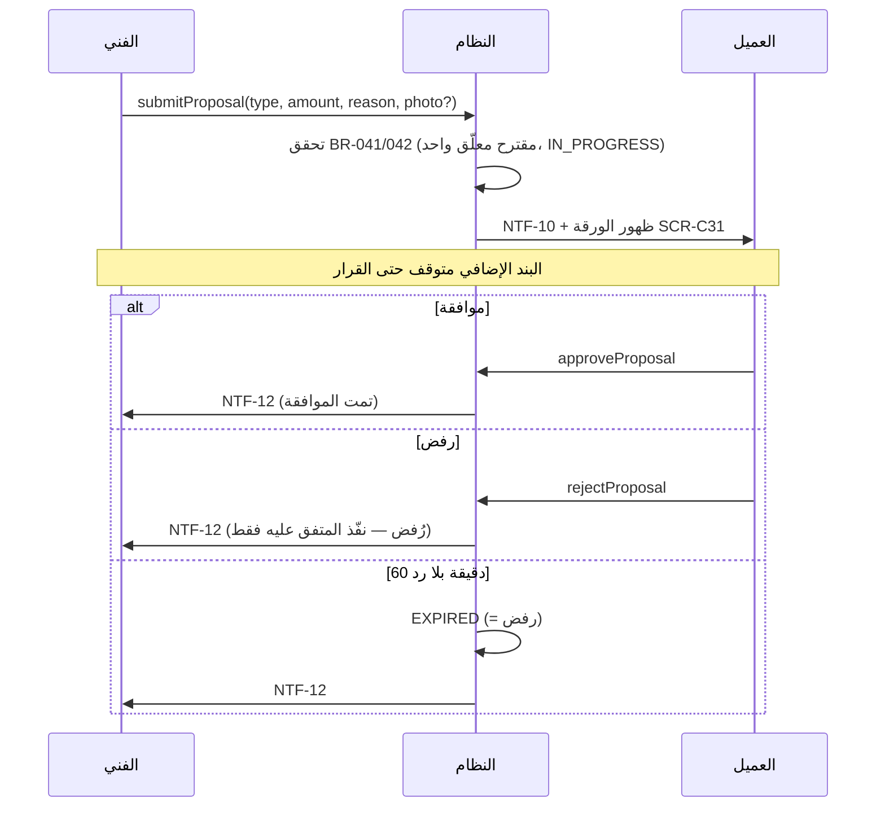

# 12 — التكلفة الإضافية (مقترحات السعر)

كيان واحد `PriceProposal` بثلاثة أنواع (DEC-007): `EXECUTION_QUOTE` (11)، `MATERIALS`، `EXTRA_WORK`.

## الحقول
| الحقل | إلزامي | ملاحظة |
|---|---|---|
| النوع | نعم | `MATERIALS` أو `EXTRA_WORK` |
| المبلغ | نعم | > 0 |
| السبب/الوصف | نعم | 5–300 حرف |
| صورة | لا | صورة واحدة (فاتورة خامات مثلًا) |

## القواعد
- السعر الأصلي لا يتغير (BR-040)؛ الإجمالي يُعاد حسابه من المقترحات الموافق عليها فقط (BR-044).
- الفني يستطيع سحب مقترح `MATERIALS`/`EXTRA_WORK` معلّق ثم تقديم غيره.
- لا إنهاء مع مقترح معلّق (BR-045).
- أثناء `IN_PROGRESS` تعرض `available_actions` موافقة العميل ورفضه للخامات والأعمال الإضافية حتى انتهاء مهلة المقترح. القرار من صاحب الطلب، ويُسجّل ويزيد إصدار الطلب دون تغيير مرحلة التنفيذ. المقترح المنتهي يُحسم بالنظام كـ `EXPIRED`؛ لا يستطيع العميل اعتماده بعد انتهاء المهلة.
- عقد المقترح يرسل `current_total` للإجمالي الحالي و`projected_total` للإجمالي بعد المقترح، محسوبين من المقترحات المعتمدة. C31 يعرض «الإجمالي قبل الإضافة»؛ مبلغ المصنعية المحفوظ عند الإنهاء ليس بديلًا له.
- رفض العميل لا يلغي الطلب: يُنفَّذ المتفق عليه. إذا لم يعد التنفيذ ممكنًا بدون البند المرفوض، يُنهي الفني العمل بما نُفّذ (T-17) أو يسجل "تعذّر التنفيذ" (T-18) إن لم يُنفذ شيء، وللعميل فتح مشكلة.
- سجل كل المقترحات (بما فيها المرفوضة) يظهر في تفاصيل الطلب وفي سجل الإدارة.
- لا مخزون ولا مشتريات؛ الخامات مجرد مبلغ.

## عرض مهلة القرار — 13 أكتوبر 2026

C30 وC31 تعرضان `expires_at` والوقت المتبقي من `server_time` مع `expiry_message`. يتوقف القرار عند الصفر، ويؤكّد الخادم صلاحية المهلة. انتهاء عرض التنفيذ يغلق المعاينة المجانية بلا دفع أو يُبقي رسوم المعاينة المدفوعة وحدها. انتهاء الإضافة يرفضها دون إلغاء الطلب أو إضافة تكلفة.
