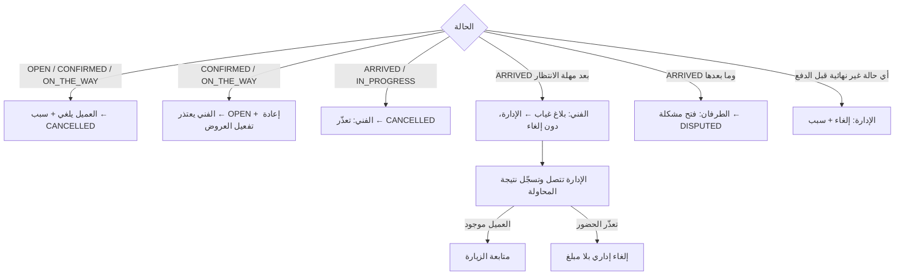

# 13 — الإلغاء

لا رسوم ولا غرامات في النسخة الأولى (DEC-016). كل إلغاء يسجل: المنفذ، رمز السبب، ملاحظة اختيارية، الوقت.

## رموز الأسباب
- **العميل**: `FOUND_ANOTHER`, `NO_LONGER_NEEDED`, `PRICE_TOO_HIGH`, `PROVIDER_LATE`, `WRONG_DETAILS`, `OTHER`
- **الفني** (اعتذار/تعذّر): `EMERGENCY`, `CANNOT_REACH`, `OUT_OF_SCOPE`, `UNSAFE_SITE`, `WRONG_ADDRESS`, `OTHER`
- **الإدارة**: `ADMIN_POLICY`, `FRAUD_SUSPECTED`, `DUPLICATE`, `ACCOUNT_BLOCKED`, `OTHER`

## المصفوفة
| المرحلة | العميل | الفني | الإدارة | إعادة نشر؟ | ملاحظات |
|---|---|---|---|---|---|
| قبل النشر | الخروج من المعالج (لا يوجد طلب) | — | — | — | لا مسودة على الخادم |
| OPEN بلا عروض | ✓ مجانًا + سبب | — | ✓ | — | — |
| OPEN بانتظار التعيين *(موظفين)* | ✓ مجانًا + سبب | — | ✓ | — | التعديل متاح دائمًا (لا عروض تمنعه) |
| OPEN مع عروض | ✓ مجانًا + سبب | سحب عرضه فقط | ✓ | — | العروض ← CLOSED + NTF-19 لأصحابها |
| CONFIRMED | ✓ مجانًا + سبب | اعتذار ← OPEN | ✓ إلغاء أو إعادة فتح | تلقائي عند الاعتذار | BR-036؛ في وضع الموظفين الاعتذار يعيد الطلب لانتظار التعيين أو تعيد الإدارة تعيينه مباشرة (T-29) |
| ON_THE_WAY | ✓ مجانًا + سبب | اعتذار ← OPEN | ✓ | تلقائي عند الاعتذار | يُسجل إن كان السبب `PROVIDER_LATE` |
| ARRIVED | ✗ ← فتح مشكلة | تعذّر؛ غياب العميل بلاغ للإدارة بعد 20 دقيقة | ✓ متابعة الغياب بعد الاتصال | لا | البلاغ وحده لا يلغي الطلب |
| AWAITING_QUOTE_APPROVAL | ✗ (الرفض ≠ إلغاء) ← مشكلة | ✗ | ✓ | لا | الرفض ← دفع رسوم المعاينة؛ وبمعاينة مجانية ← إغلاق بلا أي مبلغ (T-28) |
| IN_PROGRESS | ✗ ← مشكلة | تعذّر (إن لم يُنفذ شيء) | ✓ | لا | — |
| بعد مقترح معلّق | كالحالة الأصلية؛ الإلغاء/النزاع يغلق المقترح | — | — | — | — |
| AWAITING_PAYMENT / CONFIRMATION | ✗ ← مشكلة | ✗ ← مشكلة | عبر نزاع أو إغلاق بدون دفع | لا | — |
| CLOSED | ✗ ← نزاع خلال 72 ساعة | ✗ | استرداد عبر نزاع | لا | — |

## المتابعة التشغيلية
الإدارة ترى لكل عميل وفني: عدد الإلغاءات والاعتذارات آخر 30 يومًا (16). لا إجراء آلي؛ القرار (تنبيه، إيقاف) للإدارة.

## بلاغ غياب العميل — قرار المالك 13 أكتوبر 2026
الفني لا يتصل بالعميل ولا يلغي الطلب بسبب الغياب. بعد مهلة CFG-033 يرسل بلاغًا واحدًا معلقًا، وتسجَّل EVT-093 ويصل تنبيه للمديرين النشطين. يظل الطلب ARRIVED وتُمنع انتقالات الفني إلى أن تحسم الإدارة البلاغ. من صفحة الطلب، الإدارة تتصل بالعميل وتسجّل نتيجة المحاولة (5–500 حرف)، ثم تتابع الزيارة أو تلغي إداريًا بسبب CUSTOMER_NO_SHOW بلا مبلغ. تُسجَّل المتابعة EVT-094 باسم المسؤول؛ تُحفظ ملاحظة الاتصال للإدارة ولا تظهر للطرفين في الملخص.
