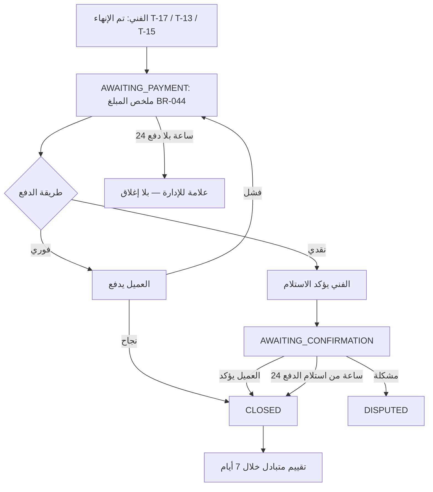

# 14 — الإنهاء والتقييم

## الإنهاء
- الفني يضغط "تم الإنهاء" بعد التحقق من BR-045. يُعرض عليه وعلى العميل ملخص: المصنعية، الخامات، الإجمالي، طريقة الدفع.
- العميل يرى زر "ادفع الآن" (فوري) أو "في انتظار تأكيد الفني لاستلام المبلغ" (نقدي)، مع إمكانية تبديل الطريقة (BR-050).

## التأكيد
- الدفع الإلكتروني الناجح يُعد تأكيدًا (BR-052).
- النقدي: العميل يؤكد، أو إغلاق تلقائي بعد 24 ساعة من `paid_at` لأحدث دفعة ناجحة (BR-080؛ وفق CFG-051)، أو فتح مشكلة.
- الإدارة لا تغلق طلبًا يدويًا إلا عبر: تسجيل دفع نقدي (T-19)، إغلاق بدون دفع (T-25)، أو قرار نزاع (T-23).

## التقييم
| | العميل ← الفني | الفني ← العميل |
|---|---|---|
| متى | بعد CLOSED، خلال 7 أيام | بعد CLOSED، خلال 7 أيام |
| المحتوى | 3 أبعاد (1–5) + نص اختياري | نجوم 1–5 + وسوم اختيارية من الخادم + تعليق اختياري حتى 500 حرف |
| الظهور | علني في ملف الفني باسم مختصر، شارة "خدمة مؤكدة"، نوع المشكلة | متوسط يظهر للفنيين في تفاصيل الطلب |
| التعديل | لا | لا |
| الإشراف | الإدارة تخفي المسيء | الإدارة تخفي |

- المتوسط المعروض للفني = متوسط الأبعاد الثلاثة للتقييمات الظاهرة، ويظهر كل بعد منفصلًا (مطابق SCR-C07).
- تذكير واحد بالتقييم بعد 24 ساعة من الإغلاق (NTF-18).
- الطلبات الملغاة والمنتهية لا تُقيّم (BR-092).

### صور الإصلاح والضمان — اعتماد الشات 13 أكتوبر 2026

صور قبل وبعد إلزامية للفني عند إنهاء الإصلاح؛ وصور بعد الإصلاح اختيارية للعميل مع إدخال النجوم والتعليق. حد خمس صور لكل مجموعة. الفحص في الخادم يفصل صور العمل عن صور وصف المشكلة ومقترحات السعر، ولا يتحقق من الزمن الحقيقي لالتقاط الصور.

ضمان الإصلاح 14 يومًا من إنهاء الإصلاح الأصلي؛ الزيارة والمصنعية مجانًا، والخامات وقطع الغيار خارج التغطية. المطالبة مستقلة عن النزاع، والإدارة تعيّن فنيًا مختلفًا مؤهلًا لطلب زيارة مرتبط بالأصل. الزيارة تستخدم التتبع والرسائل والصور والتقييم المعتادة. المعاينة دون بدء إصلاح لا تمنح ضمان إصلاح، وزيارة الضمان لا تبدأ مدة ضمان جديدة.

في الزيارة، مقترح السعر المتاح هو الخامات فقط، بموافقة العميل قبل تنفيذها. الإنهاء يتطلب صورًا قبل وبعد من الفني المسند وعدم وجود مقترح معلّق. دون خامات معتمدة يُغلق الطلب عبر T-31 بحالة دفع `WAIVED` دون إنشاء دفعة؛ ومع خامات معتمدة ينتقل للدفع لتكلفتها وحدها عبر T-17، والمصنعية والعمولة صفر. إغلاق الزيارة يُكمل المطالبة؛ الإلغاء أو الانتهاء يلغيها؛ اعتذار الفني يعيدها للتنسيق الإداري على الزيارة نفسها. حالة الطلب الأصلي ومدفوعاته ونافذة النزاع لا تتغير.

- تقييم الفني للعميل يُحفظ في `customer_ratings.tags/comment` وتعرضه الإدارة، ولا تعرض تفاصيله للعميل نفسه. لا يتكرر التقييم؛ المجهول أو المكرر من أكواد الوسوم يُرفض دون حفظ جزئي.
- الإغلاق التلقائي يعيد التحقق من المهلة داخل قفل الطلب؛ لا يستند إلى `completed_at` ولا إلى دفعة فاشلة أو دفعة بلا `paid_at`.
