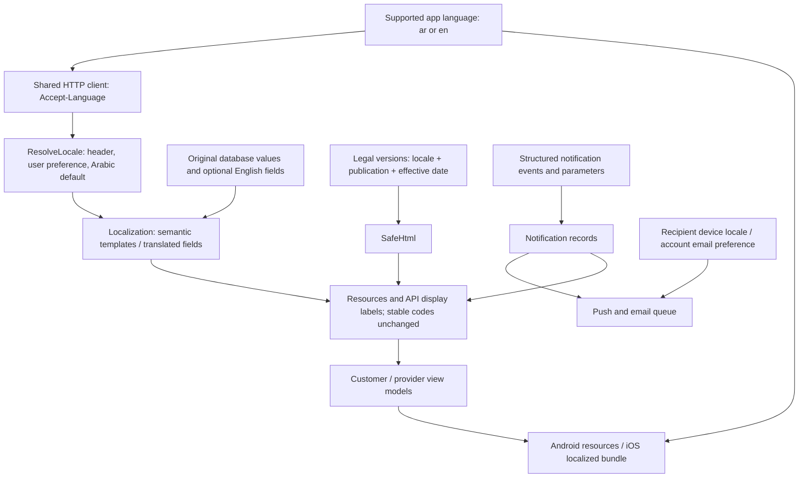

# Localization component inventory

Discovery covers native Android XML Views/Kotlin, native SwiftUI/UIKit plus the Foundation-only Swift Core package, Laravel API/modules, schema/migrations/seeders, Filament content management, queued notification/mail delivery, public HTML pages, shared catalogs and generated assets. No React Native, Flutter or WebView-based primary app was found. Legal rendering uses native formatted text, not a scripting WebView.

The committed parity inventory contains 59 customer/provider screens plus one component gallery, and 42 shared components. The API route inventory below contains 85 entries. A text-level scan does not prove every state was exercised on a device; evidence and gaps are in `test-results.md` and `risks-acceptance.md`.

## Locale and content flow

## Shared and platform infrastructure

| Component | Paths / role |
| --- | --- |
| Source catalogs | `design/strings.ar.json`, `design/strings.en.json`, `design/plurals.json` |
| Exceptions and glossary | `design/localization-exceptions.json`; `docs/localization/glossary.md` |
| Generation and gates | `tools/gen-design`, `tools/lint-design`, `tools/check-parity`; existing Android/design workflows and new `.github/workflows/localization.yml` |
| Android resources | `androidapp/core/design/src/main/res/values{,-ar,-en}/strings.xml` and `plurals.xml`; generated layouts, typography and directional icons |
| Android locale owner | `BremoApplication`, `AppLanguage`, `MainActivity`, manifest `localeConfig` and AppCompat locale persistence |
| Android HTTP and state | `BremoHttp`, `CustomerApi` / `ProviderApi`, their typed service/model files, `CustomerViewModel`, `ProviderViewModel`, `ScreenHistory` |
| Android formatted values | `BzrFormat`; C34 `LegalHtml`; shared input fields and direction-aware components |
| iOS resources | `Localizable.xcstrings`, `InfoPlist.xcstrings`, `project.yml`, localized package bundles |
| iOS locale and transport | `AppLanguage`, `APIClient`, `BzrApp`, `LiveAuthAPI`, `LiveCustomerAPI`, `LiveProviderAPI` |
| iOS state | `CustomerJourney.swift`, `ProviderJourney.swift`, `AuthViewModel` and navigation history |
| iOS rendering | `bzrString`, `bzrPlural`, `BzrFormatter`, `BzrFoundation`, `C34TermsView` attributed UITextView |
| Backend locale and errors | `ResolveLocale`, `EnsureIdempotency`, `bootstrap/app.php`, `Localization`, `MissingLocalizationException` |
| Backend catalogs | `config/localization.php`, `resources/lang/{ar,en}/validation.php`, Arabic framework mail chrome and license attribution |
| Managed data | Category, ProblemType, City, Area, SupportReason; Filament Catalog/Geography/SupportReasons forms |
| Legal chain | LegalPage/LegalPageVersion models, enums, PublishLegalPageVersionAction, LegalPages/VersionsRelationManager, PageController, LegalPageController, SafeHtml, public Blade layout |
| Legal source discovery | `LegalPagesSeeder`, legacy `TermsSeeder` / `terms_versions`, `config/mobile.php` FAQ fallback; `docs/13-CANCELLATION-FLOW.md`, `docs/18-COMMUNICATION-RULES.md`, `docs/32-SECURITY-AND-PRIVACY.md` are product specifications, not proof of legal approval |
| Identity preferences | User / DeviceToken models, AuthController, AccountController, DeviceController, additive localization migration |
| Notification chain | Notifier, NotificationContent, LocalizedMessage, AppNotification, OrderNotifications, AccountNotifications, SettlementNotifications, NotificationController, SendPushNotification, FcmPushSender, mail callbacks in AppServiceProvider |
| Native notification consumers | Android PushDevice/BremoMessagingService/NotificationChannels and deep-link router; iOS PushCenter/AppDelegate and deep-link routing |
| Public HTML | Legal, password reset, verification result, app-link fallback and shared-visit controllers/views; native legal content has independent locale selection |
| User-authored exceptions | Names, request descriptions, chat text, free-text reasons, reviews, biographies, portfolio captions and address labels retain their authored language |

## Every screen in the shared inventory

| Screen | Android source | iOS source |
| --- | --- | --- |
| SCR-GALLERY | `androidapp/core/design/src/main/kotlin/noox/bzr/design/views/gallery/GalleryViews.kt` | `iosapp/Packages/DesignSystem/Sources/DesignSystem/ComponentGallery.swift` |
| SCR-C01 | `androidapp/app/src/main/kotlin/noox/bzr/customer/C01HomeView.kt` | `iosapp/BzrApp/Customer/C01HomeView.swift` |
| SCR-C02 | `androidapp/app/src/main/kotlin/noox/bzr/customer/C02AccountView.kt` | `iosapp/BzrApp/Customer/C02AccountView.swift` |
| SCR-C03 | `androidapp/app/src/main/kotlin/noox/bzr/customer/C03ServiceView.kt` | `iosapp/BzrApp/Customer/C03ServiceView.swift` |
| SCR-C04 | `androidapp/app/src/main/kotlin/noox/bzr/customer/C04TimingView.kt` | `iosapp/BzrApp/Customer/C04TimingView.swift` |
| SCR-C05 | `androidapp/app/src/main/kotlin/noox/bzr/customer/C05ReviewView.kt` | `iosapp/BzrApp/Customer/C05ReviewView.swift` |
| SCR-C06 | `androidapp/app/src/main/kotlin/noox/bzr/customer/C06OffersView.kt` | `iosapp/BzrApp/Customer/C06OffersView.swift` |
| SCR-C07 | `androidapp/app/src/main/kotlin/noox/bzr/customer/C07ProviderView.kt` | `iosapp/BzrApp/Customer/C07ProviderView.swift` |
| SCR-C08 | `androidapp/app/src/main/kotlin/noox/bzr/customer/C08OfferDetailsView.kt` | `iosapp/BzrApp/Customer/C08OfferDetailsView.swift` |
| SCR-C09 | `androidapp/app/src/main/kotlin/noox/bzr/customer/C09TrackingView.kt` | `iosapp/BzrApp/Customer/C09TrackingView.swift` |
| SCR-C10 | `androidapp/app/src/main/kotlin/noox/bzr/auth/CustomerAuthViews.kt` | `iosapp/BzrApp/Auth/CustomerAuthScreens.swift` |
| SCR-C11 | `androidapp/app/src/main/kotlin/noox/bzr/auth/CustomerAuthViews.kt` | `iosapp/BzrApp/Auth/CustomerAuthScreens.swift` |
| SCR-C12 | `androidapp/app/src/main/kotlin/noox/bzr/auth/CustomerAuthViews.kt` | `iosapp/BzrApp/Auth/CustomerAuthScreens.swift` |
| SCR-C13 | `androidapp/app/src/main/kotlin/noox/bzr/auth/CustomerAuthViews.kt` | `iosapp/BzrApp/Auth/CustomerAuthScreens.swift` |
| SCR-C14 | `androidapp/app/src/main/kotlin/noox/bzr/customer/C14AddressesView.kt` | `iosapp/BzrApp/Customer/C14AddressesView.swift` |
| SCR-C15 | `androidapp/app/src/main/kotlin/noox/bzr/customer/C15AddressFormView.kt` | `iosapp/BzrApp/Customer/C15AddressFormView.swift` |
| SCR-C16 | `androidapp/app/src/main/kotlin/noox/bzr/customer/C16SlotPickerView.kt` | `iosapp/BzrApp/Customer/C16SlotPickerView.swift` |
| SCR-C17 | `androidapp/app/src/main/kotlin/noox/bzr/customer/C17MediaView.kt` | `iosapp/BzrApp/Customer/C17MediaView.swift` |
| SCR-C18 | `androidapp/app/src/main/kotlin/noox/bzr/customer/C18MessagesView.kt` | `iosapp/BzrApp/Customer/C18MessagesView.swift` |
| SCR-C19 | `androidapp/app/src/main/kotlin/noox/bzr/customer/C19ChatView.kt` | `iosapp/BzrApp/Customer/C19ChatView.swift` |
| SCR-C20 | `androidapp/app/src/main/kotlin/noox/bzr/customer/C20CancellationView.kt` | `iosapp/BzrApp/Customer/C20CancellationView.swift` |
| SCR-C21 | `androidapp/app/src/main/kotlin/noox/bzr/customer/C21PaymentSummaryView.kt` | `iosapp/BzrApp/Customer/C21PaymentSummaryView.swift` |
| SCR-C22 | `androidapp/app/src/main/kotlin/noox/bzr/customer/C22ElectronicPaymentView.kt` | `iosapp/BzrApp/Customer/C22ElectronicPaymentView.swift` |
| SCR-C23 | `androidapp/app/src/main/kotlin/noox/bzr/customer/C23CompletionView.kt` | `iosapp/BzrApp/Customer/C23CompletionView.swift` |
| SCR-C24 | `androidapp/app/src/main/kotlin/noox/bzr/customer/C24RatingView.kt` | `iosapp/BzrApp/Customer/C24RatingView.swift` |
| SCR-C25 | `androidapp/app/src/main/kotlin/noox/bzr/customer/C25OrdersView.kt` | `iosapp/BzrApp/Customer/C25OrdersView.swift` |
| SCR-C26 | `androidapp/app/src/main/kotlin/noox/bzr/customer/C26OrderHistoryView.kt` | `iosapp/BzrApp/Customer/C26OrderHistoryView.swift` |
| SCR-C27 | `androidapp/app/src/main/kotlin/noox/bzr/customer/C27DisputeView.kt` | `iosapp/BzrApp/Customer/C27DisputeView.swift` |
| SCR-C28 | `androidapp/app/src/main/kotlin/noox/bzr/customer/C28ProviderReportView.kt` | `iosapp/BzrApp/Customer/C28ProviderReportView.swift` |
| SCR-C29 | `androidapp/app/src/main/kotlin/noox/bzr/customer/C29HelpView.kt` | `iosapp/BzrApp/Customer/C29HelpView.swift` |
| SCR-C30 | `androidapp/app/src/main/kotlin/noox/bzr/customer/ProposalDecisionView.kt` | `iosapp/BzrApp/Customer/ProposalDecisionViews.swift` |
| SCR-C31 | `androidapp/app/src/main/kotlin/noox/bzr/customer/ProposalDecisionView.kt` | `iosapp/BzrApp/Customer/ProposalDecisionViews.swift` |
| SCR-C32 | `androidapp/app/src/main/kotlin/noox/bzr/customer/C32NotificationsView.kt` | `iosapp/BzrApp/Customer/C32NotificationsView.swift` |
| SCR-C33 | `androidapp/app/src/main/kotlin/noox/bzr/customer/C33AccountSettingsView.kt` | `iosapp/BzrApp/Customer/C33AccountSettingsView.swift` |
| SCR-C34 | `androidapp/app/src/main/kotlin/noox/bzr/customer/C34TermsView.kt` | `iosapp/BzrApp/Customer/C34TermsView.swift` |
| SCR-C35 | `androidapp/app/src/main/kotlin/noox/bzr/customer/C35NoOffersView.kt` | `iosapp/BzrApp/Customer/C35NoOffersView.swift` |
| SCR-C36 | `androidapp/app/src/main/kotlin/noox/bzr/customer/C36AssignmentView.kt` | `iosapp/BzrApp/Customer/C36AssignmentView.swift` |
| SCR-C37 | `androidapp/app/src/main/kotlin/noox/bzr/customer/C37ProblemView.kt` | `iosapp/BzrApp/Customer/C37ProblemView.swift` |
| SCR-C38 | `androidapp/app/src/main/kotlin/noox/bzr/customer/C38BudgetView.kt` | `iosapp/BzrApp/Customer/C38BudgetView.swift` |
| SCR-P01 | `androidapp/app/src/main/kotlin/noox/bzr/provider/P01IntroView.kt` | `iosapp/BzrApp/Provider/ProviderJourneyViews.swift` |
| SCR-P02 | `androidapp/app/src/main/kotlin/noox/bzr/provider/P02ProfileView.kt` | `iosapp/BzrApp/Provider/ProviderJourneyViews.swift` |
| SCR-P03 | `androidapp/app/src/main/kotlin/noox/bzr/provider/P03IdentityView.kt` | `iosapp/BzrApp/Provider/ProviderJourneyViews.swift` |
| SCR-P04 | `androidapp/app/src/main/kotlin/noox/bzr/provider/P04CatalogView.kt` | `iosapp/BzrApp/Provider/ProviderJourneyViews.swift` |
| SCR-P05 | `androidapp/app/src/main/kotlin/noox/bzr/provider/P05AreasView.kt` | `iosapp/BzrApp/Provider/ProviderJourneyViews.swift` |
| SCR-P06 | `androidapp/app/src/main/kotlin/noox/bzr/provider/P06PayoutView.kt` | `iosapp/BzrApp/Provider/ProviderJourneyViews.swift` |
| SCR-P07 | `androidapp/app/src/main/kotlin/noox/bzr/provider/P07StatusView.kt` | `iosapp/BzrApp/Provider/ProviderJourneyViews.swift` |
| SCR-P08 | `androidapp/app/src/main/kotlin/noox/bzr/provider/P08HomeView.kt` | `iosapp/BzrApp/Provider/ProviderJourneyViews.swift` |
| SCR-P09 | `androidapp/app/src/main/kotlin/noox/bzr/provider/P09AvailableRequestView.kt` | `iosapp/BzrApp/Provider/ProviderJourneyViews.swift` |
| SCR-P10 | `androidapp/app/src/main/kotlin/noox/bzr/provider/P10OfferView.kt` | `iosapp/BzrApp/Provider/ProviderJourneyViews.swift` |
| SCR-P11 | `androidapp/app/src/main/kotlin/noox/bzr/provider/P11OffersView.kt` | `iosapp/BzrApp/Provider/ProviderJourneyViews.swift` |
| SCR-P12 | `androidapp/app/src/main/kotlin/noox/bzr/provider/ProviderActiveOrderView.kt` | `iosapp/BzrApp/Provider/ProviderJourneyViews.swift` |
| SCR-P13 | `androidapp/app/src/main/kotlin/noox/bzr/provider/ProviderActiveOrderView.kt` | `iosapp/BzrApp/Provider/ProviderJourneyViews.swift` |
| SCR-P14 | `androidapp/app/src/main/kotlin/noox/bzr/provider/ProviderActiveOrderView.kt` | `iosapp/BzrApp/Provider/ProviderJourneyViews.swift` |
| SCR-P15 | `androidapp/app/src/main/kotlin/noox/bzr/provider/ProviderActiveOrderView.kt` | `iosapp/BzrApp/Provider/ProviderJourneyViews.swift` |
| SCR-P16 | `androidapp/app/src/main/kotlin/noox/bzr/provider/ProviderActiveOrderView.kt` | `iosapp/BzrApp/Provider/ProviderJourneyViews.swift` |
| SCR-P17 | `androidapp/app/src/main/kotlin/noox/bzr/provider/P17CustomerRatingView.kt` | `iosapp/BzrApp/Provider/ProviderJourneyViews.swift` |
| SCR-P18 | `androidapp/app/src/main/kotlin/noox/bzr/provider/P18EarningsView.kt` | `iosapp/BzrApp/Provider/ProviderJourneyViews.swift` |
| SCR-P19 | `androidapp/app/src/main/kotlin/noox/bzr/provider/P19ProfileView.kt` | `iosapp/BzrApp/Provider/ProviderJourneyViews.swift` |
| SCR-P20 | `androidapp/app/src/main/kotlin/noox/bzr/provider/P20ProposalView.kt` | `iosapp/BzrApp/Provider/ProviderJourneyViews.swift` |
| SCR-P21 | `androidapp/app/src/main/kotlin/noox/bzr/provider/P21UnableView.kt` | `iosapp/BzrApp/Provider/ProviderJourneyViews.swift` |

## Every shared component

| Component | Android source | iOS source |
| --- | --- | --- |
| AppTopBar | `androidapp/core/design/src/main/kotlin/noox/bzr/design/views/AppTopBarView.kt` | `iosapp/Packages/DesignSystem/Sources/DesignSystem/BzrComponents.swift` |
| PrimaryButton | `androidapp/core/design/src/main/kotlin/noox/bzr/design/views/PrimaryButtonView.kt` | `iosapp/Packages/DesignSystem/Sources/DesignSystem/BzrComponents.swift` |
| SecondaryButton | `androidapp/core/design/src/main/kotlin/noox/bzr/design/views/SecondaryButtonView.kt` | `iosapp/Packages/DesignSystem/Sources/DesignSystem/BzrComponents.swift` |
| LinkButton | `androidapp/core/design/src/main/kotlin/noox/bzr/design/views/LinkButtonView.kt` | `iosapp/Packages/DesignSystem/Sources/DesignSystem/BzrComponents.swift` |
| DangerTextButton | `androidapp/core/design/src/main/kotlin/noox/bzr/design/views/DangerTextButtonView.kt` | `iosapp/Packages/DesignSystem/Sources/DesignSystem/BzrComponents.swift` |
| IconSquareButton | `androidapp/core/design/src/main/kotlin/noox/bzr/design/views/IconSquareButtonView.kt` | `iosapp/Packages/DesignSystem/Sources/DesignSystem/BzrComponents.swift` |
| BottomNav | `androidapp/core/design/src/main/kotlin/noox/bzr/design/views/BottomNavView.kt` | `iosapp/Packages/DesignSystem/Sources/DesignSystem/BzrComponents.swift` |
| MenuRow | `androidapp/core/design/src/main/kotlin/noox/bzr/design/views/MenuRowView.kt` | `iosapp/Packages/DesignSystem/Sources/DesignSystem/BzrComponents.swift` |
| DrawerMenu | `androidapp/core/design/src/main/kotlin/noox/bzr/design/views/DrawerMenuView.kt` | `iosapp/Packages/DesignSystem/Sources/DesignSystem/BzrComponents.swift` |
| StepIndicator | `androidapp/core/design/src/main/kotlin/noox/bzr/design/views/StepIndicatorView.kt` | `iosapp/Packages/DesignSystem/Sources/DesignSystem/BzrComponents.swift` |
| SelectableTile | `androidapp/core/design/src/main/kotlin/noox/bzr/design/views/SelectableTileView.kt` | `iosapp/Packages/DesignSystem/Sources/DesignSystem/BzrComponents.swift` |
| SelectableChip | `androidapp/core/design/src/main/kotlin/noox/bzr/design/views/SelectableChipView.kt` | `iosapp/Packages/DesignSystem/Sources/DesignSystem/BzrComponents.swift` |
| RadioCard | `androidapp/core/design/src/main/kotlin/noox/bzr/design/views/RadioCardView.kt` | `iosapp/Packages/DesignSystem/Sources/DesignSystem/BzrComponents.swift` |
| CheckRow | `androidapp/core/design/src/main/kotlin/noox/bzr/design/views/CheckRowView.kt` | `iosapp/Packages/DesignSystem/Sources/DesignSystem/BzrComponents.swift` |
| AppTextField | `androidapp/core/design/src/main/kotlin/noox/bzr/design/views/AppTextFieldView.kt` | `iosapp/Packages/DesignSystem/Sources/DesignSystem/BzrComponents.swift` |
| SecureTextField | `androidapp/core/design/src/main/kotlin/noox/bzr/design/views/SecureTextFieldView.kt` | `iosapp/Packages/DesignSystem/Sources/DesignSystem/BzrComponents.swift` |
| AmountField | `androidapp/core/design/src/main/kotlin/noox/bzr/design/views/AmountFieldView.kt` | `iosapp/Packages/DesignSystem/Sources/DesignSystem/BzrComponents.swift` |
| TextAreaField | `androidapp/core/design/src/main/kotlin/noox/bzr/design/views/TextAreaFieldView.kt` | `iosapp/Packages/DesignSystem/Sources/DesignSystem/BzrComponents.swift` |
| SummaryCard | `androidapp/core/design/src/main/kotlin/noox/bzr/design/views/SummaryCardView.kt` | `iosapp/Packages/DesignSystem/Sources/DesignSystem/BzrComponents.swift` |
| Badge | `androidapp/core/design/src/main/kotlin/noox/bzr/design/views/BadgeView.kt` | `iosapp/Packages/DesignSystem/Sources/DesignSystem/BzrComponents.swift` |
| ProviderHeader | `androidapp/core/design/src/main/kotlin/noox/bzr/design/views/ProviderHeaderView.kt` | `iosapp/Packages/DesignSystem/Sources/DesignSystem/BzrComponents.swift` |
| OfferCard | `androidapp/core/design/src/main/kotlin/noox/bzr/design/views/OfferCardView.kt` | `iosapp/Packages/DesignSystem/Sources/DesignSystem/BzrComponents.swift` |
| SortChips | `androidapp/core/design/src/main/kotlin/noox/bzr/design/views/SortChipsView.kt` | `iosapp/Packages/DesignSystem/Sources/DesignSystem/BzrComponents.swift` |
| StatRow | `androidapp/core/design/src/main/kotlin/noox/bzr/design/views/StatRowView.kt` | `iosapp/Packages/DesignSystem/Sources/DesignSystem/BzrComponents.swift` |
| RatingBars | `androidapp/core/design/src/main/kotlin/noox/bzr/design/views/RatingBarsView.kt` | `iosapp/Packages/DesignSystem/Sources/DesignSystem/BzrComponents.swift` |
| ReviewCard | `androidapp/core/design/src/main/kotlin/noox/bzr/design/views/ReviewCardView.kt` | `iosapp/Packages/DesignSystem/Sources/DesignSystem/BzrComponents.swift` |
| StickyActionBar | `androidapp/core/design/src/main/kotlin/noox/bzr/design/views/StickyActionBarView.kt` | `iosapp/Packages/DesignSystem/Sources/DesignSystem/BzrComponents.swift` |
| InfoBanner | `androidapp/core/design/src/main/kotlin/noox/bzr/design/views/InfoBannerView.kt` | `iosapp/Packages/DesignSystem/Sources/DesignSystem/BzrComponents.swift` |
| WarningBox | `androidapp/core/design/src/main/kotlin/noox/bzr/design/views/WarningBoxView.kt` | `iosapp/Packages/DesignSystem/Sources/DesignSystem/BzrComponents.swift` |
| OfflineBanner | `androidapp/core/design/src/main/kotlin/noox/bzr/design/views/OfflineBannerView.kt` | `iosapp/Packages/DesignSystem/Sources/DesignSystem/BzrComponents.swift` |
| EtaCard | `androidapp/core/design/src/main/kotlin/noox/bzr/design/views/EtaCardView.kt` | `iosapp/Packages/DesignSystem/Sources/DesignSystem/BzrComponents.swift` |
| MapCard | `androidapp/core/design/src/main/kotlin/noox/bzr/design/views/MapCardView.kt` | `iosapp/Packages/DesignSystem/Sources/DesignSystem/BzrComponents.swift` |
| StatusStepper | `androidapp/core/design/src/main/kotlin/noox/bzr/design/views/StatusStepperView.kt` | `iosapp/Packages/DesignSystem/Sources/DesignSystem/BzrComponents.swift` |
| OrderCard | `androidapp/core/design/src/main/kotlin/noox/bzr/design/views/OrderCardView.kt` | `iosapp/Packages/DesignSystem/Sources/DesignSystem/BzrComponents.swift` |
| AppBottomSheet | `androidapp/core/design/src/main/kotlin/noox/bzr/design/views/AppBottomSheetView.kt` | `iosapp/Packages/DesignSystem/Sources/DesignSystem/BzrComponents.swift` |
| EmptyState | `androidapp/core/design/src/main/kotlin/noox/bzr/design/views/EmptyStateView.kt` | `iosapp/Packages/DesignSystem/Sources/DesignSystem/BzrComponents.swift` |
| ErrorState | `androidapp/core/design/src/main/kotlin/noox/bzr/design/views/ErrorStateView.kt` | `iosapp/Packages/DesignSystem/Sources/DesignSystem/BzrComponents.swift` |
| LoadingSkeleton | `androidapp/core/design/src/main/kotlin/noox/bzr/design/views/LoadingSkeletonView.kt` | `iosapp/Packages/DesignSystem/Sources/DesignSystem/BzrComponents.swift` |
| Countdown | `androidapp/core/design/src/main/kotlin/noox/bzr/design/views/CountdownView.kt` | `iosapp/Packages/DesignSystem/Sources/DesignSystem/BzrComponents.swift` |
| ChatBubble | `androidapp/core/design/src/main/kotlin/noox/bzr/design/views/ChatBubbleView.kt` | `iosapp/Packages/DesignSystem/Sources/DesignSystem/BzrComponents.swift` |
| ChatInput | `androidapp/core/design/src/main/kotlin/noox/bzr/design/views/ChatInputView.kt` | `iosapp/Packages/DesignSystem/Sources/DesignSystem/BzrComponents.swift` |
| MediaThumb | `androidapp/core/design/src/main/kotlin/noox/bzr/design/views/MediaThumbView.kt` | `iosapp/Packages/DesignSystem/Sources/DesignSystem/BzrComponents.swift` |

## API route inventory

Display fields are localized at resource/controller/enum boundaries; machine fields and user-authored text retain their contracts.

| Method | URI | Handler |
| --- | --- | --- |
| GET / HEAD | `api/v1/addresses` | `App\Http\Api\V1\Controllers\AddressController@index` |
| POST | `api/v1/addresses` | `App\Http\Api\V1\Controllers\AddressController@store` |
| PATCH | `api/v1/addresses/{address}` | `App\Http\Api\V1\Controllers\AddressController@update` |
| DELETE | `api/v1/addresses/{address}` | `App\Http\Api\V1\Controllers\AddressController@destroy` |
| POST | `api/v1/auth/email/resend` | `App\Http\Api\V1\Controllers\AuthController@resendVerification` |
| GET / HEAD | `api/v1/auth/email/verify/{id}/{hash}` | `App\Http\Api\V1\Controllers\AuthController@verifyEmail` |
| POST | `api/v1/auth/login` | `App\Http\Api\V1\Controllers\AuthController@login` |
| POST | `api/v1/auth/logout` | `App\Http\Api\V1\Controllers\AuthController@logout` |
| POST | `api/v1/auth/password/forgot` | `App\Http\Api\V1\Controllers\AuthController@forgotPassword` |
| POST | `api/v1/auth/password/reset` | `App\Http\Api\V1\Controllers\AuthController@resetPassword` |
| POST | `api/v1/auth/register` | `App\Http\Api\V1\Controllers\AuthController@register` |
| GET / HEAD | `api/v1/catalog` | `App\Http\Api\V1\Controllers\ReferenceController@catalog` |
| GET / HEAD | `api/v1/cities` | `App\Http\Api\V1\Controllers\ReferenceController@cities` |
| GET / HEAD | `api/v1/cities/{city}/areas` | `App\Http\Api\V1\Controllers\ReferenceController@areas` |
| GET / HEAD | `api/v1/config` | `App\Http\Api\V1\Controllers\ConfigController` |
| GET / HEAD | `api/v1/conversations` | `App\Http\Api\V1\Controllers\ConversationController@index` |
| POST | `api/v1/conversations` | `App\Http\Api\V1\Controllers\ConversationController@store` |
| GET / HEAD | `api/v1/conversations/{conversation}/messages` | `App\Http\Api\V1\Controllers\ConversationController@messages` |
| POST | `api/v1/conversations/{conversation}/messages` | `App\Http\Api\V1\Controllers\ConversationController@send` |
| GET / HEAD | `api/v1/me` | `App\Http\Api\V1\Controllers\AccountController@show` |
| PATCH | `api/v1/me` | `App\Http\Api\V1\Controllers\AccountController@update` |
| DELETE | `api/v1/me` | `App\Http\Api\V1\Controllers\AccountController@destroy` |
| GET / HEAD | `api/v1/me/avatar` | `App\Http\Api\V1\Controllers\AccountController@avatar` |
| POST | `api/v1/me/devices` | `App\Http\Api\V1\Controllers\DeviceController@store` |
| DELETE | `api/v1/me/devices` | `App\Http\Api\V1\Controllers\DeviceController@destroy` |
| POST | `api/v1/me/password` | `App\Http\Api\V1\Controllers\AccountController@password` |
| POST | `api/v1/media` | `App\Http\Api\V1\Controllers\MediaController@store` |
| GET / HEAD | `api/v1/media/{media}` | `App\Http\Api\V1\Controllers\MediaController@show` |
| DELETE | `api/v1/media/{media}` | `App\Http\Api\V1\Controllers\MediaController@destroy` |
| GET / HEAD | `api/v1/notifications` | `App\Http\Api\V1\Controllers\NotificationController@index` |
| POST | `api/v1/notifications/read` | `App\Http\Api\V1\Controllers\NotificationController@read` |
| GET / HEAD | `api/v1/orders` | `App\Http\Api\V1\Controllers\OrderController@index` |
| POST | `api/v1/orders` | `App\Http\Api\V1\Controllers\OrderController@store` |
| PATCH | `api/v1/orders/{order}` | `App\Http\Api\V1\Controllers\OrderController@update` |
| GET / HEAD | `api/v1/orders/{order}` | `App\Http\Api\V1\Controllers\OrderController@show` |
| POST | `api/v1/orders/{order}/cancel` | `App\Http\Api\V1\Controllers\OrderController@cancel` |
| POST | `api/v1/orders/{order}/confirm-completion` | `App\Http\Api\V1\Controllers\OrderController@confirmCompletion` |
| GET / HEAD | `api/v1/orders/{order}/disputes` | `App\Http\Api\V1\Controllers\SupportController@disputes` |
| POST | `api/v1/orders/{order}/disputes` | `App\Http\Api\V1\Controllers\SupportController@openDispute` |
| POST | `api/v1/orders/{order}/instapay-transfers` | `App\Http\Api\V1\Controllers\PaymentController@instapayTransfer` |
| GET / HEAD | `api/v1/orders/{order}/offers` | `App\Http\Api\V1\Controllers\OrderController@offers` |
| POST | `api/v1/orders/{order}/offers/{offer}/accept` | `App\Http\Api\V1\Controllers\OrderController@acceptOffer` |
| PATCH | `api/v1/orders/{order}/payment-method` | `App\Http\Api\V1\Controllers\PaymentController@changeMethod` |
| POST | `api/v1/orders/{order}/payments` | `App\Http\Api\V1\Controllers\PaymentController@store` |
| GET / HEAD | `api/v1/orders/{order}/proposals` | `App\Http\Api\V1\Controllers\OrderController@proposals` |
| POST | `api/v1/orders/{order}/proposals/{proposal}/decide` | `App\Http\Api\V1\Controllers\OrderController@decideProposal` |
| POST | `api/v1/orders/{order}/republish` | `App\Http\Api\V1\Controllers\OrderController@republish` |
| POST | `api/v1/orders/{order}/review` | `App\Http\Api\V1\Controllers\RatingController@review` |
| POST | `api/v1/orders/{order}/share-links` | `App\Http\Api\V1\Controllers\ShareLinkController@store` |
| GET / HEAD | `api/v1/orders/{order}/tracking` | `App\Http\Api\V1\Controllers\TrackingController@show` |
| GET / HEAD | `api/v1/pages/{slug}` | `App\Http\Api\V1\Controllers\PageController@show` |
| GET / HEAD | `api/v1/provider/application` | `App\Http\Api\V1\Controllers\ProviderApplicationController@show` |
| POST | `api/v1/provider/application` | `App\Http\Api\V1\Controllers\ProviderApplicationController@store` |
| PUT | `api/v1/provider/availability` | `App\Http\Api\V1\Controllers\ProviderHomeController@updateAvailability` |
| GET / HEAD | `api/v1/provider/earnings` | `App\Http\Api\V1\Controllers\ProviderEarningsController` |
| GET / HEAD | `api/v1/provider/home` | `App\Http\Api\V1\Controllers\ProviderHomeController@show` |
| GET / HEAD | `api/v1/provider/offers` | `App\Http\Api\V1\Controllers\ProviderOrderController@myOffers` |
| POST | `api/v1/provider/offers/{offer}/withdraw` | `App\Http\Api\V1\Controllers\ProviderOrderController@withdrawOffer` |
| GET / HEAD | `api/v1/provider/orders` | `App\Http\Api\V1\Controllers\ProviderOrderController@myOrders` |
| POST | `api/v1/provider/orders/{order}/arrived` | `App\Http\Api\V1\Controllers\ProviderOrderController@markArrived` |
| POST | `api/v1/provider/orders/{order}/back-out` | `App\Http\Api\V1\Controllers\ProviderOrderController@backOut` |
| POST | `api/v1/provider/orders/{order}/cash-received` | `App\Http\Api\V1\Controllers\ProviderOrderController@cashReceived` |
| POST | `api/v1/provider/orders/{order}/complete` | `App\Http\Api\V1\Controllers\ProviderOrderController@complete` |
| POST | `api/v1/provider/orders/{order}/complete-inspection-only` | `App\Http\Api\V1\Controllers\ProviderOrderController@completeInspectionOnly` |
| POST | `api/v1/provider/orders/{order}/customer-no-show` | `App\Http\Api\V1\Controllers\ProviderOrderController@customerNoShow` |
| POST | `api/v1/provider/orders/{order}/customer-rating` | `App\Http\Api\V1\Controllers\RatingController@customerRating` |
| POST | `api/v1/provider/orders/{order}/location` | `App\Http\Api\V1\Controllers\ProviderOrderController@recordLocation` |
| POST | `api/v1/provider/orders/{order}/proposals` | `App\Http\Api\V1\Controllers\ProviderOrderController@submitProposal` |
| POST | `api/v1/provider/orders/{order}/start-trip` | `App\Http\Api\V1\Controllers\ProviderOrderController@startTrip` |
| POST | `api/v1/provider/orders/{order}/start-work` | `App\Http\Api\V1\Controllers\ProviderOrderController@startWork` |
| POST | `api/v1/provider/orders/{order}/unable` | `App\Http\Api\V1\Controllers\ProviderOrderController@unable` |
| POST | `api/v1/provider/portfolio` | `App\Http\Api\V1\Controllers\ProviderPortfolioController@store` |
| DELETE | `api/v1/provider/portfolio/{portfolio}` | `App\Http\Api\V1\Controllers\ProviderPortfolioController@destroy` |
| GET / HEAD | `api/v1/provider/profile` | `App\Http\Api\V1\Controllers\ProviderProfileController@show` |
| PATCH | `api/v1/provider/profile` | `App\Http\Api\V1\Controllers\ProviderProfileController@update` |
| GET / HEAD | `api/v1/provider/requests` | `App\Http\Api\V1\Controllers\ProviderOrderController@availableRequests` |
| GET / HEAD | `api/v1/provider/requests/{order}` | `App\Http\Api\V1\Controllers\ProviderOrderController@availableRequest` |
| POST | `api/v1/provider/requests/{order}/offers` | `App\Http\Api\V1\Controllers\ProviderOrderController@submitOffer` |
| GET / HEAD | `api/v1/providers/{provider}` | `App\Http\Api\V1\Controllers\ProviderController@show` |
| POST | `api/v1/providers/{provider}/reports` | `App\Http\Api\V1\Controllers\SupportController@reportProvider` |
| DELETE | `api/v1/share-links/{shareLink}` | `App\Http\Api\V1\Controllers\ShareLinkController@destroy` |
| GET / HEAD | `api/v1/slots` | `App\Http\Api\V1\Controllers\ReferenceController@slots` |
| GET / HEAD | `api/v1/support/faqs` | `App\Http\Api\V1\Controllers\HelpController@faqs` |
| POST | `api/v1/support/messages` | `App\Http\Api\V1\Controllers\HelpController@message` |
| GET / HEAD | `api/v1/terms/current` | `App\Http\Api\V1\Controllers\PageController@terms` |
