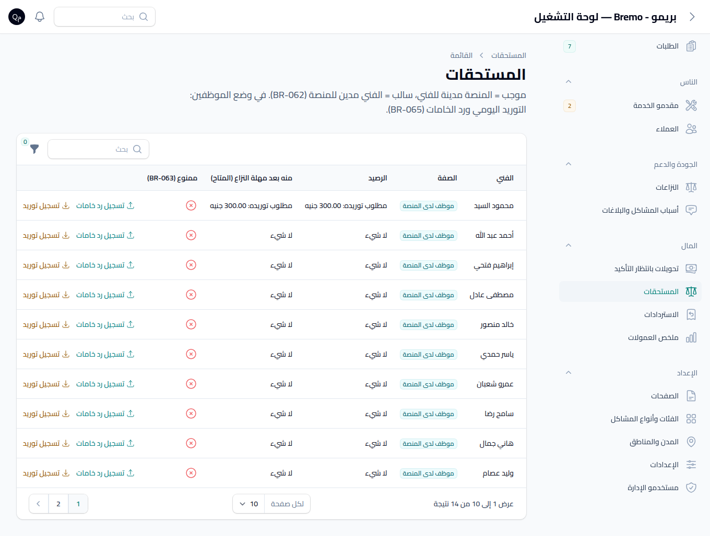
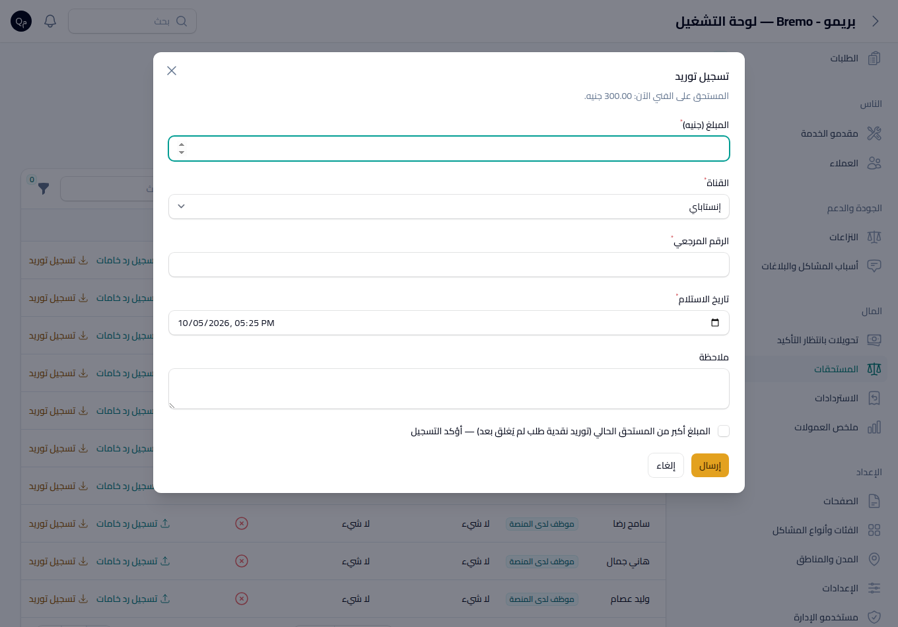
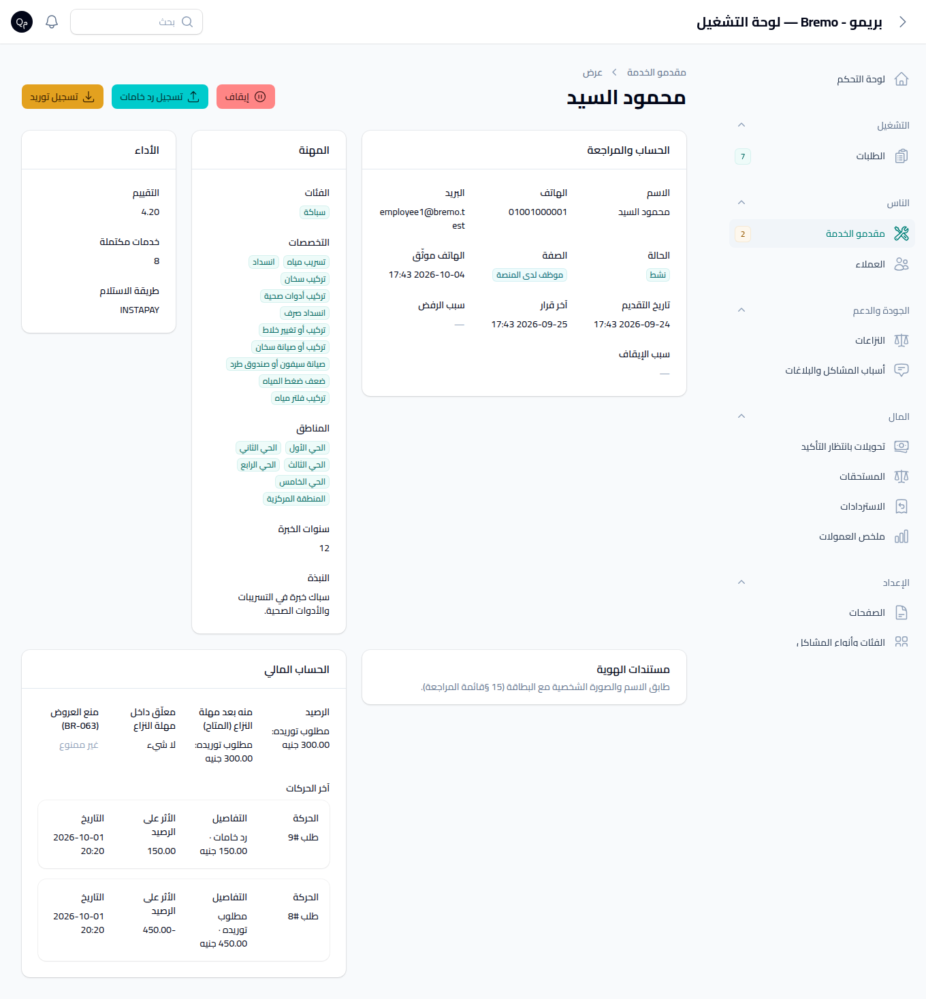
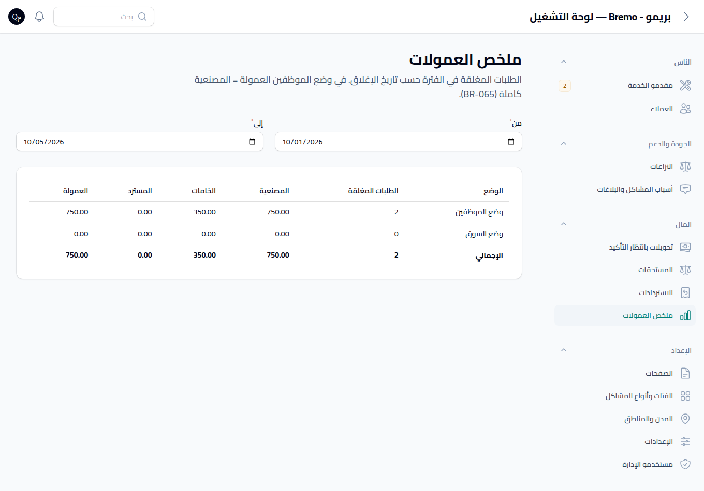
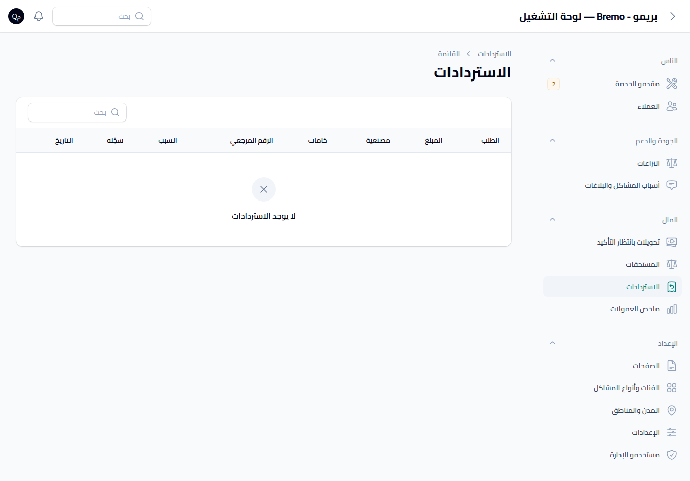

# تقرير الدفعة 7أ — دورة المال في الخادم ولوحة الإدارة

## بوابة الاعتماد

- ✅ **اعتمدها المالك في 2026-10-05.**
- القرار: **DEC-066** في `docs/34-DECISION-LOG.md`.
- لا تغيير في تطبيقي Android وiOS في هذه الدفعة، فمفيش لقطات تطبيق. المطلوب مراجعة صفحات اللوحة الموجودة تحت.
- طريقة المراجعة: ادخل `/admin` بحساب المدير العام، وافتح قسم **المال**.

## ما أصبح ممكنًا

| المسار | من يستطيع | النتيجة |
|---|---|---|
| **تسجيل استرداد** من صفحة النزاع بعد حسمه بـ«إغلاق مع استرداد» أو «إلغاء باسترداد كامل» | المدير العام | بيتسجل جزء المصنعية وجزء الخامات والرقم المرجعي والسبب. بيتحدث `labor_refunded` و`refunded_total` وحالة الدفع (جزئي/كلي)، والعمولة بتتحسب من جديد (BR-060)، وبيتسجل EVT-082. ممنوع على الدفع النقدي، وممنوع يعدّي المتبقي من المصنعية أو الخامات أو المدفوع. «الإلغاء باسترداد كامل» لازم يتسجل بالمتبقي كله |
| **تسجيل تحويل للفني**، وفي وضع الموظفين اسمه «رد خامات» | المدير العام | بيتسجل المبلغ والقناة (إنستاباي/محفظة/بنك) والرقم المرجعي والتاريخ. ممنوع يعدّي **المتاح** (BR-064)، والفني بيوصله NTF-23 |
| **تسجيل سداد من الفني**، وفي وضع الموظفين اسمه «توريد» | المدير العام | لو المبلغ أكبر من المستحق الحالي (زي توريد نقدية طلب لسه ما اتقفلش) لازم تأكيد صريح في النافذة. بعد التسجيل حالة المنع بتتحدث فورًا |
| **منع العروض بسبب المستحقات** (BR-063) | تلقائي كل 10 دقائق، وبعد أي سداد أو استرداد | في وضع السوق بس: الفني بيتمنع لو دينه عدّى CFG-061، والمنع بيترفع لوحده لما يرجع تحت الحد. NTF-24 بيتبعت مرة واحدة عند بداية المنع. في وضع الموظفين مفيش منع، وأي منع قائم بيترفع. ولو CFG-061 فاضي (OD-02) مفيش حد بيتمنع |
| **صفحة «المستحقات»** | المدير العام | لكل فني الرصيد والمتاح، بمسميات حسب صفته: «مطلوب توريده» و«رد خامات» للموظف، و«مدين للمنصة» و«مستحق له» للمستقل. فيها فلاتر (يحتاج تحويل، عليه سداد، ممنوع) وإجراءات التسجيل ورابط الكشف |
| **كشف الفني** في صفحة الفني | المدير العام | الرصيد والمتاح والمعلّق وحالة المنع وآخر 30 حركة. نفس أرقام شاشة P18 في التطبيق بالظبط، لأنهم من نفس الخدمة |
| **قائمة الاستردادات** | المدير العام | للقراءة بس. التسجيل بيتعمل من صفحة النزاع |
| **ملخص العمولات** لفترة من/إلى | المدير العام | الطلبات المقفولة والمصنعية والخامات والمسترد والعمولة، متقسمة حسب الوضع ومعاها الإجمالي |

مدير التشغيل ما يقدرش يفتح أي صفحة من دول، وما يقدرش يسجل أي حركة مالية (403 أو رفض DEC-066).

## صفحات اللوحة

**المستحقات** (البيانات تجريبية: موظف عليه توريد 300 جنيه من طلبين مقفولين):

**تسجيل توريد:** النافذة بتعرض المستحق الحالي، وفيها تأكيد التوريد الزائد:

**كشف الفني** (قسم «الحساب المالي» في صفحة الفني):

**ملخص العمولات:**

**الاستردادات:**

## إصلاحات اتعملت معاها

- **كشف الموظف:** الخامات اللي اتردت للعميل ما بقتش بتتحسب «رد خامات» للموظف (DEC-066 بند 6).
- **ملخص العمولات:** أول نسخة كانت بتعرض صفر في صفوف الأوضاع والإجمالي صح، بسبب `only()` على مجموعة Eloquent. اتكشف من اللقطة واتصلّح، واتضاف اختبار لكل وضع لوحده.

## التحقق

- `php artisan test --compact`: **252/252** ناجحة، منهم 10 جديدة في `tests/Feature/Settlements/MoneyCycleTest.php` بتغطي كل صف في الجدول اللي فوق، والأدوار، والحدود.
- `php artisan api:spec --check`: العقد مطابق، مفيش مسار API اتغير.
- Pint نضيف.
- المهمة `settlements:refresh-dues` متسجلة كل 10 دقائق (`php artisan schedule:list`).
- اللقطات اتاخدت من اللوحة المحلية بحساب مدير عام مؤقت، واتمسح بعدها.

## بيانات تجريبية محلية

اتضاف طلبين مقفولين للموظف `employee1@bremo.test`، ووصفهم «بيان تجريبي لمراجعة صفحة المستحقات». الغرض إن الكشف يبان فيه حركات. موجودين في القاعدة المحلية بس.

## الباقي من الدفعة 7

- **7ب:**
  - شريط «العروض متوقفة بسبب المستحقات» في شاشة P18 في التطبيقين، ومعاه حقل `dues_blocked` في `GET /provider/earnings` بموديل مكتوب حسب DEC-061.
  - فوري الحقيقي.
- **فوري الحقيقي مستني OD-10:** حساب التاجر والمفاتيح.
- **حد المديونية OD-02 (CFG-061):** من غيره منع BR-063 مش هيشتغل في وضع السوق. ده مقصود لحد ما تحدده.
