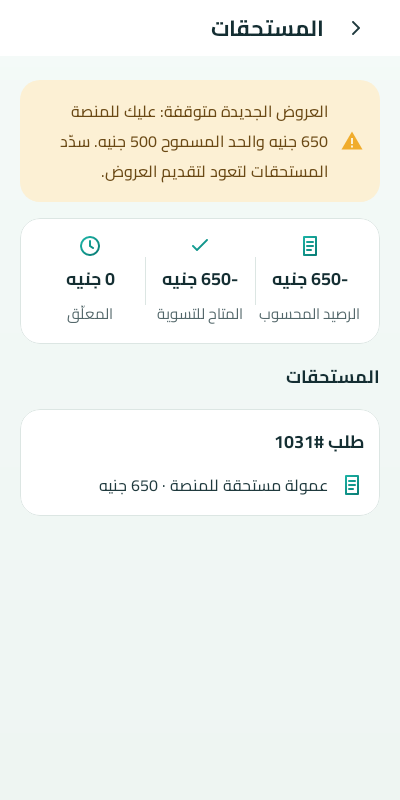

# تقرير الدفعة 7ب — شريط منع العروض في شاشة المستحقات (P18)

## بوابة الاعتماد

- ✅ **اعتمدها المالك في 2026-10-05.** لقطة واحدة جديدة (SCR-P18 · `dues_blocked`):

  

- القرار: **DEC-068** في `docs/34-DECISION-LOG.md`.

## ما اتغير

- **الخادم:** `GET /provider/earnings` بيرجع دلوقتي `dues` فيها `blocked` و`debt` و`limit`.
  - `limit` قيمته `null` في وضع الموظفين، أو لو CFG-061 لسه ما اتحددش (OD-02).
- **التطبيقين:** لو الفني ممنوع من العروض في وضع السوق، بيظهر فوق ملخص المستحقات صندوق تحذير (`WarningBox`) مكتوب فيه:
  > العروض الجديدة متوقفة: عليك للمنصة 650 جنيه والحد المسموح 500 جنيه. سدّد المستحقات لتعود لتقديم العروض.
  - الصندوق ما بيظهرش في وضع الموظفين (BR-065)، ولا لو الفني مش ممنوع.
  - إشعار NTF-24 بيفتح نفس الشاشة دي.
- **حالة مشتركة جديدة** `dues_blocked` في `design/fixtures/SCR-P18`، وبتعدّي في المنصتين.
- **وضوح الحركة:** طلب نقدي في وضع السوق كان مكتوب عليه «صافي الطلب · ‎-650.00»، دلوقتي بقى «عمولة مستحقة للمنصة · 650.00 جنيه».

## DEC-061: أول endpoint في المرحلة 4 من 9أ

- كشف الحساب في أندرويد بقى دالة Retrofit بموديل مكتوب (`ProviderEarningsModels.kt`) بدل `JSONObject`.
- **الردود الحقيقية** متسجلة من السيرفر بـ`tests/Feature/Api/MobileProviderEarningsResponsesTest.php` (مع `RECORD_API_RESPONSES=1`) في `androidapp/app/src/test/resources/api/provider/`.
- **المنصتين بيقروا نفس الملفات المتسجلة** في اختبارات القراءة:
  - أندرويد: `ProviderEarningsDecodeTest`.
  - iOS: `ProviderEarningsDecodeTests`.

## التحقق

| الفحص | النتيجة |
|---|---|
| الخادم | 255/255، منهم 3 جديدة (API + تسجيل الردود). العقد مطابق، وPint نضيف |
| أندرويد: الوحدة + Paparazzi + Lint + البناء | 76 اختبار، صفر فشل، صفر أخطاء Lint |
| iOS Core (Docker swift:6.0) | كل الاختبارات ناجحة، ومعاها اختبارات القراءة الجديدة. swift-format وSwiftLint نضاف |
| `check-parity` و`gen-design --check` | ناجحة (697 مفتاح نص مشترك) |

## الباقي من الدفعة 7

- **فوري الحقيقي:** مستني OD-10 (حساب التاجر والمفاتيح). من غيره القنوات المتاحة هي النقدي وإنستاباي.
- **منع العروض فعليًا:** مستني OD-02 (CFG-061).
