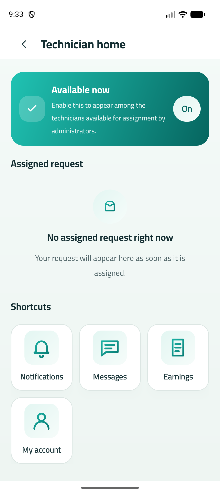

# تقرير DEC-067 — التطبيق يرجع لآخر وضع استخدمه الحساب

## بوابة الاعتماد

- ✅ **اعتمدها المالك في 2026-10-05.**
- مفيش شاشات جديدة ولا لقطات Paparazzi اتغيرت. اللي اتغير هو أنهي شاشة بتفتح عند البداية.

## السلوك الجديد (التطبيقين)

| الحالة | عند فتح التطبيق أو بعد الدخول |
|---|---|
| آخر وضع «عميل»، أو مفيش وضع محفوظ | رئيسية العميل، زي الأول |
| آخر وضع «فني» والفني **نشط** | **رئيسية الفني (P08)** على طول |
| آخر وضع «فني» والطلب قيد المراجعة أو مرفوض أو موقوف | شاشة حالة الطلب (P07) |
| آخر وضع «فني» بس الحساب ما بقاش عنده ملف فني | رئيسية العميل، والوضع المحفوظ بيتمسح |
| فشل التحقق من حالة الفني بسبب الشبكة | رئيسية العميل من غير ما الوضع المحفوظ يتمسح، فالمرة الجاية يرجع للفني |
| فيه إشعار أو رابط مستني | **الرابط هو اللي بيقرر**، وبيتقدم دايمًا (17 §الروابط العميقة) |

- **الوضع بيتحفظ على الجهاز لكل حساب لوحده** (بالبريد). يعني لو حسابين استخدموا نفس الموبايل، كل واحد بيرجع لوضعه.
- **بيتحفظ «فني»** لما وضع الفني يتفتح بأي طريقة: من الحساب، أو من إشعار، أو من رابط، أو من الاستعادة نفسها. **وبيتحفظ «عميل»** لما المستخدم يرجع منه بنفسه.
- **تسجيل الخروج وانتهاء الجلسة ما بيغيروش الوضع المحفوظ.**
  - ملاحظة: في التطبيق دلوقتي زرار تسجيل الخروج موجود في حساب العميل بس. فالفني اللي يسجل خروج بيكون رجع لوضع العميل الأول، وبالتالي الدخول التالي هيفتح على العميل.
  - لو عايز تسجيل الخروج من وضع الفني يحافظ على وضعه، محتاجين زرار خروج جوه وضع الفني. ده تعديل منفصل.
- **القرار نفسه دالة واحدة** `ModeMemory.restoreTarget`، بنفس الحالات السبعة في المنصتين (`design/fixtures/navigation/mode-restore.json`).

## تشغيل فعلي على المحاكي (أندرويد، خادم محلي، `employee1@bremo.test`)

1. أول دخول ← رئيسية العميل ✅، لأن مفيش وضع محفوظ.
2. «وضع الفني» من الحساب ← الوضع المحفوظ بقى `PROVIDER` ✅.
3. قفلت التطبيق بالكامل وفتحته ← **رئيسية الفني على طول** ✅:

   

4. رجوع لوضع العميل ← الوضع المحفوظ بقى `CUSTOMER` ← قفلت وفتحت ← رئيسية العميل ✅.

## إصلاح جانبي

شاشة حالة الطلب (P07) كانت بتعرض سطر مكتوب فيه «null» لما مفيش سبب رفض أو إيقاف. السبب إن org.json بيرجع النص "null" لقيمة JSON فاضية. اتصلّح في `ProviderApi.kt`، وiOS ما كانش فيه المشكلة دي.

## التحقق

| الفحص | النتيجة |
|---|---|
| أندرويد: اختبارات الوحدة + Paparazzi | 74 اختبار، صفر فشل. منهم `ModeMemoryTest` على الحالات السبعة |
| أندرويد: Lint | صفر أخطاء |
| iOS Core (Docker swift:6.0) | 22 اختبار، صفر فشل. منهم `ModeMemoryTests` (الحالات السبعة + الحفظ لكل حساب) |
| swift-format وSwiftLint | نضيف |
| `check-parity` | ناجح |

iOS متختبرش على جهاز، لأن ده محتاج macOS (الدفعة 12). في iOS الاستعادة بتحصل مرة واحدة بس في كل جلسة، عشان الرجوع لوضع العميل ما يفتحش وضع الفني تاني.
