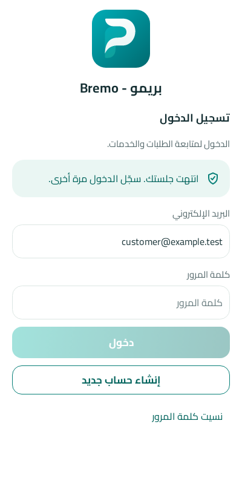

# تقرير إصلاح الجلسة المنتهية — DEC-065

## بوابة الاعتماد

- ✅ **اعتمدها المالك في 2026-10-05.** لقطة واحدة جديدة لشاشة الدخول (SCR-C10 · `session_expired`):

  

## المشكلة

لو السيرفر رفض توكن محفوظ (رد 401)، التطبيق كان يعرض «تعذر الاتصال بالخادم». يحصل ده لو الجلسة اتلغت أو الحساب اتحظر أو قاعدة السيرفر اتبنت من جديد. المستخدم كان بيفتكر إن الشبكة واقعة، وما كانش فيه طريقة يعرف منها إن الحل إعادة الدخول.

## الحل (التطبيقين)

- **الاكتشاف مركزي في طبقة الشبكة:**
  - أندرويد: `SessionExpiry` كـinterceptor في OkHttp، فبيغطي `BremoApiClient` وخدمات Retrofit المكتوبة (9أ).
  - iOS: `APIClient` بيبعت إشعار `SessionExpiry.notification`.
- **التطبيق بيعتبر الجلسة منتهية** لما يرجع 401 على طلب فيه توكن، ماعدا تسجيل الخروج. طلب الدخول نفسه من غير توكن مش بيتحسب.
- **التنفيذ مرة واحدة بس** حتى لو فشلت كذا طلب مع بعض، والعداد بيرجع من الأول مع كل دخول جديد.
- **اللي بيحصل بعد كده:**
  - التوكن بيتمسح محليًا من غير ما يتبعت أي حاجة للسيرفر.
  - وضع الفني بيتقفل.
  - شاشة الدخول بتفتح والبريد مكتوب، ومعاها تنبيه هادي: «انتهت جلستك. سجّل الدخول مرة أخرى.». مفيش رسالة خطأ ولا أخطاء حقول قبل الكتابة.
- **الحالة مثبتة في fixture مشتركة:** `design/fixtures/SCR-C10` (`session_expired`)، وبتعدّي في التطبيقين.

## عيوب اكتشفتها واتصلحت أثناء الشغل

1. **إعادة الدخول بعد تسجيل الخروج كانت بتعلّق على شاشة الدخول** في أندرويد، لأن `requiresAuthentication` ما كانش بيرجع `false` أبدًا. دلوقتي بيرجع مع كل جلسة جديدة (`AuthViewModel.onSessionStarted`). وشاشة الدخول بعد تسجيل الخروج بقت تبدأ نضيفة، من غير أخطاء حقول.
2. **إلغاء تسجيل جهاز الإشعارات عند الخروج كان بيفشل بـ422.** طلب `DELETE /me/devices` كان بيتبعت من غير body من ساعة التحويل لـRetrofit (2026-10-04)، فالجهاز كان بيفضل مسجّل للإشعارات بعد الخروج. اتصلّح وعليه اختبار.

## التحقق

| الفحص | النتيجة |
|---|---|
| أندرويد: اختبارات الوحدة + Paparazzi | 73 اختبار، صفر فشل. منهم 5 لـ`SessionExpiryTest` و1 لـDELETE مع body |
| أندرويد: Lint والبناء | صفر أخطاء |
| iOS Core (Docker swift:6.0) | 20 اختبار، صفر فشل. منهم 5 لـ`SessionExpiryTests` |
| swift-format وSwiftLint | نضيف |
| `check-parity` و`gen-design --check` و`lint-design` | ناجحة |
| **تشغيل فعلي على المحاكي** (خادم محلي) | ① دخول ← سحب التوكن من السيرفر ← فتح تبويب ← رجوع لشاشة الدخول بالتنبيه والبريد ✅ ② دخول تاني ← الرئيسية ✅ ③ تسجيل خروج ← شاشة دخول نضيفة ← دخول تاني ← الرئيسية ✅ |

iOS متختبرش على جهاز، لأن ده محتاج macOS (الدفعة 12).
