# قرارات مراجعة Bremo PRD — سؤال وجواب

**تحديث الصياغة:** 15 أكتوبر 2026. **مصدر التقييم والمقارنة:** مراجعة 12 أكتوبر 2026.

**الحالة الحالية — تحديث 15 أكتوبر:** [تقرير الأجزاء الثابتة والفجوات المتبقية في التطبيق والـPRD](CURRENT-STATUS.md). يوضح حدود التنفيذ الجزئي وربط الصور، ويفصل نقص الكود عن الإعدادات والتوثيق.

هذا الملف يجمع قرارات وتوصيات التقييم، ويغطي بنود الاختلاف الـ26 في [التقرير المصوّر](REPORT.md). الإجابات توضّح السلوك الحالي، والقرار المعتمد سابقًا عندما يوجد، والتوصية المقترحة. **تحويل التوصيات إلى سؤال وجواب لا يعني اعتمادها أو تنفيذها.**

## مرجع المنتج ووضع التشغيل

### س01 — نعتمد الـPRD ولا الـworkflow الموجود في التطبيق؟

**ج:** اختار المستخدم في إجابة الشات 21 الاكتفاء بتقرير الاختلافات حاليًا، مع الاحتفاظ بملف الـPRD الأصلي للمقارنة. تُسجّل في التقرير القرارات المعتمدة وإثبات تنفيذها؛ لا تُنشأ نسخة PRD محدّثة في هذه الدفعة. ترجيح الـworkflow المنفّذ كأساس لتحديث مواصفة مستقبلية يظل توصية، وليس اعتمادًا تلقائيًا لبقية التوصيات.

**الحالة:** نطاق التوثيق محسوم بإجابة الشات 21: التقرير فقط. **المرجع:** التقييم العام و[REPORT.md](REPORT.md).

### س02 — نطلق بنظام موظفين وتعيين إداري ولا سوق عروض؟

**ج:** أكّد المالك بتاريخ 14 أكتوبر 2026 أن التشغيل الفعلي يبدأ بفنيين موظفين لدى الشركة فقط، والتعيين من الإدارة، والمعاينة مجانية. تشغيل السوق والعروض بالكامل مؤجّل. تلبية الطلب مرتبطة بتوفر موظف مؤهل وقدرة الإدارة على التعيين؛ الأولوية لاستكمال واختبار هذه الرحلة وإعداداتها.

**الحالة:** قرار قائم، وفق DEC-039 وDEC-040؛ ليس قرارًا جديدًا. **المرجع:** D01 و[وضعا التشغيل](../../docs/39-OPERATING-MODES.md).

### س03 — إمتى نفعّل سوق العروض؟ وهل يكفي تشغيل مفتاح واحد؟

**ج:** تشغيل السوق والعروض مؤجّل تشغيليًا بقرار المالك المؤكّد في 14 أكتوبر 2026، دون موعد إتاحة محدد. الوظائف المنفّذة تبقى معطّلة، ونواقص السوق الخاصة لا تُعد شروطًا لإطلاق الموظفين. عند اعتماد تشغيله لاحقًا تُراجع العمولة وحد الدين وسياسة المعاينة ويُستكمل اختبار الرحلة قبل الإتاحة. الطلبات القائمة تكمل بوضعها المثبّت، والتغيير يخص الطلبات الجديدة.

**الحالة:** التأجيل التشغيلي معتمد ومؤكّد من المالك؛ موعد الإتاحة غير محدد. **المرجع:** إجابة المالك 14 أكتوبر 2026، وD01 و[متطلبات التبديل إلى السوق](../../docs/39-OPERATING-MODES.md).

## إنشاء الطلب والتعيين والاستثناءات

### س04 — طلب الخدمة يبقى ثلاث خطوات ولا خمس ولا أربع؟

**ج:** تم اعتماد أربع خطوات للموظفين وخمس للسوق في إجابة المالك بتاريخ 13 أكتوبر 2026. في وضع الموظفين الخامات ضمن C04 مع المكان والموعد، ثم المراجعة C05. في السوق تظل C38 مستقلة للميزانية والخامات. تعديل الخامات من شاشة المراجعة يرجع للشاشة المناسبة للوضع.

**الحالة:** معتمد ونُفّذ على التطبيقين؛ اختبارات منطق الخطوات وواجهة Android نجحت. **المرجع:** D02 وD03 وإجابة المالك في الشات.

### س05 — نحتفظ بإيه من خيارات الخامات وطريقة التسعير؟

**ج:** نحتفظ بالخيارات الثلاثة: الخامات عند العميل، الفني يوفّرها، أو الفني يحدّد المطلوب بعد المعاينة. في وضع الموظفين الطلب معاينة مجانية، وطريقة التسعير والميزانية لا تظهران. في السوق يظهر اختيار التنفيذ أو المعاينة والميزانية حسب الرحلة؛ ونوضّح في الـPRD أن النوعين يستقبلان عروضًا، وليس المعاينة وحدها.

**الحالة:** السلوك الحالي هو المقترح الاحتفاظ به وتوثيقه. **المرجع:** D03 و[وضعا التشغيل](../../docs/39-OPERATING-MODES.md).

### س06 — هل دور الإدارة لازم يبقى جزءًا من الـPRD؟

**ج:** نعم. نضيف رحلة الإدارة وصلاحياتها: تعيين وإعادة تعيين الموظفين، مراجعة مقدمي الخدمة، إدارة نطاقات الأسعار، اعتماد تحويلات إنستاباي، حل النزاعات، الاسترداد، التوريد والتسويات. لكل تدخل نكتب المسؤول، والمهلة، والنتيجة في حالة الطلب. المراجعة الحالية لهذه الوظائف من الكود؛ التقرير لا يتضمن لقطات تشغيل جديدة للوحة الإدارة.

**الحالة:** استكمال توثيق وظائف قائمة. **المرجع:** D01 وD08 وD11، وفقرة «دور الإدارة» في التقرير.

### س07 — نعمل إيه لو الطلب لم يُعيَّن لفني؟

**ج:** نحتفظ بمسار انتهاء الطلب بدل تركه مفتوحًا بلا نهاية. في الإعدادات محل المراجعة، مهلة تعيين طلب «الآن» 60 دقيقة، وبعدها يصبح الطلب منتهيًا إذا لم يُعيَّن. نوضح مهلة التعيين وتنبيهات الإدارة وحالة الطلب للعميل، ونوثّق قواعد المواعيد المجدولة منفصلة عن طلب «الآن».

**الحالة:** سلوك حالي يحتاج شرحًا واضحًا. **المرجع:** D01 وإعدادات التقرير.

### س08 — لو مافيش موظف متاح الآن في المنطقة، نسمح للعميل ينشر الطلب؟

**ج:** تم اعتماد تعطيل «الآن» واقتراح موعد بناءً على توفر حقيقي من الخادم. الفحص يخص العنوان والتخصص، ويشترط موظفًا مؤهلًا متاحًا بلا طلب «الآن» نشط. الواجهة تتحقق عند فتح C04 وتتعامل مع التحميل والفشل، والخادم يعيد الفحص عند النشر والتعديل. الموعد المجدول يظل متاحًا؛ لا يعتمد الفحص على مؤشرات اتصال أو أعداد ثابتة.

**الحالة:** معتمد ونُفّذ بتاريخ 13 أكتوبر 2026؛ اختبارات التوفر وإعادة الفحص عند النشر والتعديل نجحت. **المرجع:** D01 وD15 وD18 وإجابة المالك في الشات.

### س09 — لو الفني اعتذر قبل الوصول، نقفل الطلب؟

**ج:** لا. نحتفظ بالمسار الحالي: يرجع الطلب إلى انتظار التعيين أو التوزيع المناسب لوضعه، ويتسجّل اعتذار الفني للإدارة. في وضع الموظفين تعيّن الإدارة بديلًا وفق الأهلية والمهلة. الاعتذار قبل الوصول يختلف عن إلغاء العميل وعن تعذّر التنفيذ بعد الوصول.

**الحالة:** سلوك حالي يُوثَّق. **المرجع:** D10، والانتقال T-06.

### س10 — العميل يقدر يلغي لحد إمتى؟

**ج:** حسب القاعدة الحالية، يقدر يلغي قبل الوصول، بما فيها مرحلة «في الطريق». بعد الوصول المتاح فتح مشكلة أو نزاع بدل الإلغاء المعتاد. نوضح ذلك في الواجهة والـPRD، ونحتفظ بعدم فرض غرامة جديدة من غير قرار صريح.

**الحالة:** قاعدة قائمة. **المرجع:** D10، وBR-070 وDEC-016.

### س11 — لو التنفيذ تعذّر بعد الوصول أو أثناء الشغل، نعلّق الطلب أو نحصل جزءًا من المبلغ؟

**ج:** الحالي يلغي الطلب عند تسجيل التعذّر بلا مبلغ، ولا توجد حالة تعليق مستقلة أو رحلة دفع جزئي في هذا المسار. التوصية نوثّق هذا السلوك كما هو. لو مطلوب تعليق أو مقابل عن عمل جزئي، فده قرار منتج ومالي جديد يحتاج قواعد وصلاحيات واضحة قبل تنفيذه.

**الحالة:** الاحتفاظ بالحالي؛ التعليق والدفع الجزئي غير معتمدين هنا. **المرجع:** D10.

### س12 — الفني يسجّل «العميل غير موجود» بعد الانتظار فقط؟

**ج:** قرار المالك: التواصل المباشر بين العميل والفني بالرسائل فقط. الفني يبلّغ الإدارة بغياب العميل بعد مهلة الانتظار الحالية؛ البلاغ لا يلغي الطلب. الإدارة تتولى الاتصال وتسجّل نتيجة المتابعة، ثم تؤكد استمرار الزيارة أو تلغي الطلب بلا مبلغ. لا تظهر أرقام الطرفين أو إجراءات اتصال بينهما، ويستمر حجب بيانات التواصل في الرسائل بعد التأكيد أيضًا.

**الحالة:** معتمد ونُفّذ بتاريخ 13 أكتوبر 2026، ويحل محل توصية اتصال الفني؛ اختبارات البلاغ والمتابعة وحجب الأرقام نجحت. **المرجع:** إجابة المالك في الشات، وقواعد الغياب والتواصل.

## المعاينة والتسعير وقرار العميل

### س13 — لو المعاينة المجانية خلصت ومفيش شغل مطلوب، الطلب يقفل إزاي؟

**ج:** نحتفظ بالإغلاق بمبلغ صفر، من غير دفع أو تأكيد استلام نقدي. هذا المسار يخص المعاينة المجانية التي لا ينتج عنها تنفيذ؛ ولا نعمّمه على معاينة مدفوعة عند تفعيل رسومها.

**الحالة:** سلوك حالي. **المرجع:** D04 وD09، وT-28 وBR-056.

### س14 — نمنع العميل تلقائيًا لو كرّر رفض المعاينة المجانية؟

**ج:** لا نضيف منعًا أو عقوبة تلقائية. نحتفظ بعدادات الرفض الصريح، وانتهاء مهلة القرار، والمعاينات المغلقة بلا تنفيذ، وتراها الإدارة للمراجعة. أي سياسة عقوبات لاحقة تحتاج قرارًا مستقلًا؛ العدّادات الحالية لا تمنح موافقة عليها.

**الحالة:** قاعدة قائمة في وضع الموظفين. **المرجع:** BR-047 و[ضبط الاستغلال](../../docs/39-OPERATING-MODES.md).

### س15 — مين يحدد السعر؟ وهل الفني يقدر يخرج عن نطاقه؟

**ج:** الإدارة تحدد نطاق المصنعية لكل نوع مشكلة، والفني يراه عند عرض التنفيذ. في الأنواع العادية، الخروج عن النطاق يحتاج سببًا ويظهر للإدارة، لكنه لا يوقف إرسال العرض للعميل. «مشكلة أخرى» لها استثناء من شرط سبب الخروج. والسعر الاسترشادي الظاهر للعميل تحدّده الإدارة بصورة منفصلة عن دليل الموظفين، حسب DEC-077.

**الحالة:** قواعد وقرار معتمدان سابقًا. **المرجع:** BR-046، و[وضعا التشغيل](../../docs/39-OPERATING-MODES.md)، و[DEC-077](../../docs/34-DECISION-LOG.md).

### س16 — رفض عرض التنفيذ مجاني في كل الأحوال؟

**ج:** لا. لو المعاينة مجانية، الرفض أو انتهاء مهلة عرض التنفيذ يغلق الطلب بمبلغ صفر. لو المعاينة مدفوعة، تبقى رسوم المعاينة وحدها مستحقة. النتيجة تعتمد على وجود رسوم معاينة فعلية، وليس اسم وضع التشغيل وحده؛ السوق ممكن يعمل بمعاينة مجانية أيضًا.

**الحالة:** توضيح القاعدة الحالية وتصحيح تعميم الـPRD. **المرجع:** D04.

### س17 — نخصم رسوم المعاينة مرة أخرى من عرض التنفيذ؟

**ج:** اعتمد المستخدم الحساب الحالي في إجابة الشات 19: عند قابلية رسوم المعاينة للخصم، يكون عرض التنفيذ شاملًا لها. رسوم معاينة 75 جنيهًا، وعرض تنفيذ 380 جنيهًا، وخامات 120 جنيهًا، تعطي إجماليًا قدره 500 جنيه؛ لا يُخصم مبلغ 75 مرة أخرى. هذا توضيح لتعريف السعر القائم في الخادم، دون تغيير معادلة الحساب. الرسوم غير القابلة للخصم تُضاف وفق القاعدة الحالية. يُثبت القرار في تقرير الاختلافات، مع إبقاء الـPRD الأصلي كما طلب المستخدم.

**الحالة:** معتمد بإجابة الشات 19؛ السلوك الحالي مطابق. **المرجع:** D05 و[OrderAmounts](../../app/Modules/Pricing/Services/OrderAmounts.php).

### س18 — نظهر عداد مهلة للعميل؟ وإيه اللي يحصل لو الوقت انتهى؟

**ج:** نعم، اعتمد المستخدم التنفيذ في الإصدار الحالي. تعرض C30 وC31 موعد انتهاء القرار والوقت المتبقي على التطبيقين، من `expires_at` و`server_time`، ويستمر العدّ بالوقت المنقضي دون إعادة بدء المهلة عند الرجوع للشاشة. تُمنع الموافقة والرفض عند الانتهاء، والخادم يعيد التحقق. تعرض الشاشة نتيجة الانتهاء من الخادم: إغلاق المعاينة المجانية بلا تنفيذ أو دفع، أو استحقاق رسوم المعاينة المدفوعة وحدها؛ أما انتهاء الإضافة فيرفض البند دون إلغاء الطلب أو إضافة تكلفته. مهلة اختيار عرض السوق منفصلة عن مهلة قرار السعر.

**الحالة:** معتمد بإجابة الشات 14، ومنفّذ ومختبر. **المرجع:** D04 وD06 وD18.

### س19 — نعمل إيه بفجوة قبول أو رفض التكلفة الإضافية؟

**ج:** اعتمد المستخدم التنفيذ في الإصدار الحالي. أُتيحت موافقة العميل ورفضه على الخامات والأعمال الإضافية أثناء `IN_PROGRESS` على التطبيقين. يظل الطلب قيد التنفيذ؛ لا تُضاف للمبلغ إلا المقترحات المعتمدة. إنهاء العمل محجوب مع أي مقترح معلّق؛ الرفض أو انتهاء المهلة لا يلغي الطلب ولا يضيف تكلفة. القرار من صاحب الطلب فقط وقبل انتهاء المهلة. الخادم يرسل الإجمالي الحالي والإجمالي بعد المقترح، حتى لا تُعرض المصنعية غير المثبّتة بعد كسعر سابق صفري.

**الحالة:** معتمد في الشات 13 أكتوبر 2026؛ منفّذ ومختبر. **المرجع:** D06.

## الدفع والإغلاق والنزاعات والتسويات

### س20 — نطلق بوسائل دفع إيه؟

**ج:** اعتمد المستخدم الكاش وإنستاباي في الإصدار الحالي. اكتملت رحلة العميل لرفع صورة التحويل وإدخال مرجعه وإرساله، مع مراجعة الاستلام من لوحة الإدارة. القنوات المتاحة تأتي من الخادم؛ إنستاباي يحتاج عنوان استقبال صحيحًا قبل ظهوره، وفوري يبقى مؤجلًا.

**الحالة:** معتمد في الشات 13 أكتوبر 2026؛ منفّذ. بحسب إجابة المستخدم، تُضاف بيانات إنستاباي واسم المستلم من إعدادات لوحة التحكم، وتظهر القناة بعد ضبط عنوان الاستقبال. **المرجع:** D07 وD08.

### س21 — شاشة إنستاباي المطلوبة تعمل إيه بالتحديد؟

**ج:** يعرض التطبيق عنوان المستلم واسمه ورقم الطلب، ويطلب صورة التحويل والرقم المرجعي إلزاميًا. إرسال التحويل يبقي الطلب بانتظار الدفع إلى أن يؤكد المدير العام استلام المبلغ الفعلي أو يرفضه. شاشة العميل تعرض الانتظار وتحدّث النتيجة وتتيح إعادة المحاولة بعد الرفض، مع سبب الرفض من الخادم. الخادم يرفض الصورة غير المملوكة أو المنتهية أو المستخدمة في طلب آخر.

**الحالة:** منفّذ في الخادم وAndroid ومنطق وواجهة iOS. مصدر عنوان الاستقبال واسم المستلم إعدادات لوحة التحكم؛ لم تُحفظ بيانات استقبال تجريبية في إعدادات التشغيل. **المرجع:** D08.

### س22 — نفعّل فوري الآن بما إن الشاشة موجودة؟

**ج:** التوصية يفضل معطّلًا لحد تنفيذ واختبار الربط الحقيقي. الشاشة والمحاكي لا يثبتان تحصيل أموال فعلية، وتفعيل المفتاح وحده لا يكفي. عند اعتماد إتاحته نختبر الدفع والتسوية والفشل وانتهاء الكود، ونوحّد مدة الكود في الخادم والواجهة والـPRD؛ الموجود في المحاكي 24 ساعة، بينما الـPRD يذكر 48 ساعة.

**الحالة:** الإتاحة مؤجلة لحين اكتمال التكامل؛ المدة تحتاج توحيدًا عند اعتماده. **المرجع:** D07.

### س23 — كل وسائل الدفع لازم تمر بشاشة تأكيد الإنهاء C23؟

**ج:** لا. نحتفظ بفرعين واضحين: في الكاش يؤكد الفني الاستلام، ثم ينتظر الطلب تأكيد العميل. في الدفع الإلكتروني، التسوية الناجحة تغلق الطلب مباشرة. وفي المعاينة المجانية بلا تنفيذ، يُغلق دون دفع. نرسم الفروع الثلاثة في الـPRD بدل فرض C23 على كل الطلبات.

**الحالة:** سلوك حالي يُوثَّق. **المرجع:** D09.

### س24 — مهلة الإغلاق التلقائي للكاش تبدأ من إنهاء الشغل ولا تأكيد الدفع؟

**ج:** اعتمد المستخدم بدء المهلة من وقت تسجيل استلام الدفع `paid_at`، لمدة 24 ساعة وفق إعداد الإغلاق الحالي. مهمة الإغلاق والموعد الظاهر للعميل يعتمدان أحدث دفعة ناجحة، وتُعاد مراجعة المهلة داخل معاملة الإغلاق. وقت إنهاء الشغل لا يقصّر نافذة التأكيد عند تأخر الدفع. لا يُغلق الطلب تلقائيًا دون وقت استلام دفعة ناجحة، ويظل تأكيد العميل المبكر متاحًا.

**الحالة:** معتمد بإجابة الشات 13، ومنفّذ ومختبر. **المرجع:** D26.

### س25 — الخلاف بين العميل والفني يتحل إزاي؟

**ج:** نحتفظ بمسار النزاع الذي تحله الإدارة ونوضّحه في الـPRD. نافذة النزاع بعد الإغلاق في الإعدادات محل المراجعة 72 ساعة، والنزاع يوقف التسوية. نكتب صلاحيات فتح النزاع وحسمه ونتيجته على الطلب والمبالغ، بدل الاكتفاء بزر «مشكلة» من غير شرح المصير.

**الحالة:** توثيق مسار وقواعد قائمة. **المرجع:** T-22 إلى T-24 وإعدادات التقرير.

### س26 — مستحقات الفني تتحول له تلقائيًا وفورًا؟

**ج:** اعتمد المستخدم توثيق التسوية الحالية وحذف وعد التحويل الفوري من نصوص الإصدار. دورة مستحقات الفني أسبوعية، ويسجّل المدير العام التحويل يدويًا في حدود الرصيد المتاح؛ توريد المحصّل النقدي للموظفين يومي. وسيلة الاستلام المسجّلة لا تُنشئ تحويلًا تلقائيًا. لم يظهر وعد التحويل الفوري ضمن النصوص التشغيلية الحالية التي روجعت؛ موضعه في الـPRD الأصلي يُحتفظ به كدليل مقارنة، وهو مستبعد من نطاق الإصدار المعتمد.

**الحالة:** معتمد بإجابة الشات 20؛ توثيق المسار القائم وتصحيح نطاق الوعد. **المرجع:** D11 و[تسجيل التحويل](../../app/Modules/Settlements/Actions/RecordProviderPayoutAction.php).

### س27 — نعيد بناء شاشة الحساب P18؟ والتصدير والفلترة ضروريان؟

**ج:** اعتمد المستخدم تنفيذ التصدير والفلترة الآن. أُضيف اختيار الفترة ونوع الحركة من خيارات الخادم إلى P18 على التطبيقين، مع تحميل بقية الصفحات وإعادة الضبط. الرصيد والمتاح والمعلّق يظلّون إجمالي الحساب؛ الفلتر يخص الحركات فقط. التصدير ملف CSV لكل الحركات المطابقة، وليس الصفحة المعروضة وحدها. تغيير الفلتر يوقف التصدير وتحميل المزيد حتى تطبيقه؛ فشل التحديث يبقي القائمة ويتيح إعادة المحاولة.

**الحالة:** معتمد بإجابة الشات 16، ومنفّذ ومختبر. **المرجع:** D12.

## إثبات الخدمة والثقة وبيانات الواجهة

### س28 — نضيف صور قبل وبعد الإصلاح؟

**ج:** اعتمد المستخدم صور قبل وبعد إلزامية للفني في الإصدار الحالي، وصورًا اختيارية للعميل داخل إدخال التقييم بالنجوم بعد الإصلاح. أُضيف رفع صور الفني من شاشة الوصول والتنفيذ، مع حد خمس صور لكل مرحلة وصورة واحدة على الأقل قبل وصورة بعد للإكمال. صور وصف المشكلة وصورة مقترح السعر لا تستوفيان هذا الشرط. صور العميل اختيارية حتى خمس صور وتُحفظ مع التقييم، وتظهر صور الإصلاح والتقييم للإدارة.

**الحالة:** معتمد في الشات 13 أكتوبر 2026؛ منفّذ ومختبر. التحقق من وجود صور المرحلتين عند الإنهاء؛ لا يثبت زمن التقاط الصورة. **المرجع:** D14 وB-05 في [مراجعة القيم الثابتة](../static-values-review/REPORT.md).

### س29 — نضيف كود تأكيد وصول الفني في الإصدار الحالي؟

**ج:** اعتمد المالك تنفيذه الآن في 15 أكتوبر 2026 بدل التأجيل السابق. كود ستة أرقام خاص برحلة تحرك الموظف، يظهر للعميل فقط ويدخله الفني عند الوصول. صلاحية 10 دقائق وخمس محاولات وقفل خمس دقائق، قابلة للضبط من الإدارة. التخزين مشفّر والتحديث يبطل الكود السابق. عند غياب العميل أو تعذّر إظهار الكود يبلّغ الفني الإدارة بالموقع والسبب؛ الإدارة تتصل وتتحقق وتسجل نتيجة الاتصال وسبب الاستثناء ثم تؤكد الوصول. الكود والاستثناء لا يعنيان قبول التكلفة أو انتهاء الإصلاح.

**الحالة:** معتمد ومنفّذ ومختبر في الخادم والتطبيقين؛ ينسخ قرار التأجيل السابق لهذا البند. اختبار الأجهزة الفعلي وبناء Xcode لم يُنفّذا. **المرجع:** إجابات المالك لهذه الدفعة وG05 في [تقرير الحالة الحالية](CURRENT-STATUS.md).

### س30 — زر مشاركة الزيارة نسيبه كما هو؟

**ج:** اعتمد المستخدم استكمال المشاركة في الإصدار الحالي. الزر ينشئ رابطًا من الخادم ويفتح مشاركة الهاتف على Android وiOS، مع توضيح التجهيز والفشل وإتاحة إعادة المحاولة. الرابط صالح 24 ساعة كحد أقصى، ويتوقف عند الحالة النهائية أو الإلغاء أو سحبه، ولا يعمل أثناء إعادة فتح الطلب دون تعيين. الروابط القديمة دون مهلة صريحة تُحدّ بمدة 24 ساعة من إنشائها. الصفحة تعرض حالة الزيارة واسم الفني الأول والمنطقة ورقم الطلب؛ لا تعرض هاتف أي طرف أو اسم العميل أو العنوان التفصيلي أو الموقع الحي أو السعر.

**الحالة:** معتمد في الشات 13 أكتوبر 2026؛ منفّذ ومختبر. واجهة المشاركة على iOS رُبطت وفُحصت صياغتها؛ لم يُجرَ اختبار جهاز iOS. **المرجع:** D16.

### س31 — تقييم الفني للعميل يبقى نجوم فقط ولا نضيف وسوم وتعليق؟

**ج:** اعتمد المستخدم إضافة الوسوم والتعليق الآن. تقييم الفني للعميل يحفظ النجوم الإلزامية (1–5)، ووسومًا اختيارية بأكواد ثابتة من قوائم الخادم، وتعليقًا اختياريًا حتى 500 حرف. الخيارات الحالية: التعاون، وضوح المشكلة، الالتزام بالموعد، التعامل المحترم، تأخر الرد، وعدم جاهزية المكان. يستمر التقييم مرة واحدة بعد الإغلاق وخلال نافذته الحالية (7 أيام). تظهر التفاصيل في لوحة الإدارة ولا تظهر للعميل في حسابه أو تفاصيل طلبه. التطبيقان يرسلان الوسوم والتعليق ويحتفظان بالمدخلات عند فشل الإرسال لإعادة المحاولة.

**الحالة:** معتمد بإجابة الشات 15، ويحل محل توصية الاكتفاء بالنجوم. منفّذ ومختبر. **المرجع:** D13.

### س32 — نظهر عدد الرسائل غير المقروءة ونقطة «متصل الآن»؟

**ج:** اعتمد المستخدم العدّاد وتصحيح الوصف في الإصدار الحالي. الخادم يحسب الوارد غير المقروء لكل محادثة، والتطبيقان يعرضان العدد وفلتر «غير مقروءة». فتح المحادثة يسجل قراءة الرسائل الواردة في الصفحة المحمّلة فقط، دون الصادر أو الرسائل الأقدم التي لم تُعرض؛ الرجوع للقائمة يحدّث العدد. النقطة لا تظهر إلا عند `available_now=true`، ووصفها «متاح الآن» يعني التوفر للخدمة، وليس اتصالًا داخل التطبيق. مجموع الفلتر يخص المحادثات المحمّلة في القائمة.

**الحالة:** معتمد في الشات 13 أكتوبر 2026؛ منفّذ ومختبر. **المرجع:** D15.

### س33 — نسيب عدد الفنيين وشريط التقدم في شاشة الانتظار؟

**ج:** اعتمد المستخدم عرض البيانات الحقيقية فقط. أُزيل عدد الفنيين والصور وشريط التقدم الثابتون، وشارة «مباشر» والوعد بزمن أول عرض. الخادم يرسل حالة الانتظار والمهلة: تعيين الإدارة للموظفين، واستقبال العروض أو اختيارها للسوق، أو تنسيق زيارة ضمان. التطبيقان يعرضان هذه البيانات مع تحديث الحالة. لا تُختلق مهلة عند عدم وجودها، ولا يُعرض توقع وصول ثابت «30–45 دقيقة» في شاشات الانتظار. عنوان الانتظار لا يدّعي استلام الفنيين للطلب. **استكمال 14 أكتوبر:** أُزيل سطر المدة الثابتة من C04 أيضًا؛ التتبع ووقت القيادة أثناء التحرك من بيانات الموقع الفعلية. تفاصيل S02 في [تقرير الحالة الحالية](CURRENT-STATUS.md).

**الحالة:** معتمد في الشات 13 أكتوبر 2026؛ منفّذ ومختبر. **المرجع:** D01 وD18.

### س34 — إيه اللي نظهره في ملف الفني من سرعة الرد والتحقق والصور؟

**ج:** اعتمد المستخدم التنفيذ في الإصدار الحالي. أُزيل متوسط الرد الثابت «10 دقائق» والتحقق الجنائي والمهني غير المدعوم؛ يظهر إثبات الهوية بحسب `is_verified` فقط. صورة الفني وصور معرضه تُحمّل من روابط مصادق عليها ضمن الطلب الذي يملكه العميل، مع بديل بصري عند غياب الصورة أو فشلها. لا يتحول تخزين الصور الخاص إلى روابط عامة، والتطبيقان يرفضان إرسال رمز الحساب إلى مضيف صور مختلف.

**الحالة:** معتمد في الشات 13 أكتوبر 2026؛ منفّذ ومختبر. **المرجع:** D17.

### س35 — نعمل إيه بعدد الطلبات ومتوسط التقييم في «حسابي»؟

**ج:** اختار المستخدم المكتملة والنشطة معًا. `/me` يعيد إجمالي طلبات صاحب الحساب عبر كل الصفحات: المكتملة `CLOSED`، والنشطة كل ما عدا المغلق والملغي والمنتهي، إضافة إلى عدد العناوين. التطبيقان يعرضان المكتملة والنشطة والعناوين؛ أُزيل متوسط تقييم العميل الثابت. بيانات محادثة العميل لا تعيد له تقييمه أيضًا، مع إبقاء الاطلاع للطرف المخوّل. غياب حقل في استجابة قديمة يترك قيمته فارغة دون اختلاق رقم.

**الحالة:** معتمد في الشات 13 أكتوبر 2026؛ منفّذ ومختبر، مع اختبار إجمالي يتجاوز الصفحة الأولى. **المرجع:** D25 و[DEC-077](../../docs/34-DECISION-LOG.md).

### س36 — صندوق الإشعارات الموجود كفاية لإطلاق التنبيهات؟

**ج:** اعتمد المستخدم تفعيل Push في الإصدار الحالي، ثم أوضح: «جهّز التكامل وسأوفر الإعدادات والأجهزة لاحقًا». تكامل FCM للخادم وAndroid وAPNs عبر Firebase على iOS موجود؛ استُكمل فحص الجاهزية دون كشف المفاتيح، واختبار تنبيه يفتح طلبًا مرتبطًا بالمستلم، وتصحيح تصنيف أخطاء FCM حتى لا تُحذف رموز الأجهزة عند خطأ مشروع عام. الإعداد المحلي ما زال `log`، وبيانات حساب خدمة الخادم وملف iOS غير متوفرة. الاختبارات المعزولة لا تثبت وصول تنبيه إلى جهاز؛ التفعيل والاختبار على الأجهزة ينتظران ما سيوفره المستخدم.

**الحالة:** تجهيز التكامل منفّذ ومختبر؛ إعدادات Firebase/APNs واختبار الوصول على الأجهزة مؤجلان بإجابة المستخدم. **المرجع:** D22 وإجابة الشات 17.

### س37 — نحتفظ بوعود الضمان 14 أو 30 يومًا واسترداد رسوم التأخير والفاتورة الضريبية؟

**ج:** اعتمد المستخدم ضمانًا لمدة 14 يومًا بإرسال فني آخر، وحدّد أن الضمان يشمل الزيارة والمصنعية فقط. الزيارة والمصنعية مجانًا؛ الخامات وقطع الغيار خارج التغطية، وتحتاج موافقة العميل على تكلفتها داخل التطبيق قبل التنفيذ. الإدارة تعيّن فنيًا مختلفًا مؤهلًا وموعدًا، فيُنشأ طلب زيارة ضمان مرتبط بالإصلاح الأصلي ويظهر للطرفين للتتبع والرسائل وإثبات العمل بالصور والتقييم. دون خامات معتمدة يُغلق بلا دفع؛ ومعها يمر بالدفع المعتاد لتكلفة الخامات وحدها. اعتذار الفني يعيد الزيارة نفسها للتعيين الإداري. مدة الضمان محسوبة من إتمام الإصلاح الأصلي، ولا تبدأ من جديد بعد الزيارة؛ المعاينة دون تنفيذ لا تمنح ضمان إصلاح. الطلب الأصلي ومدفوعاته ونافذة النزاع ذات 72 ساعة تبقى محفوظة. نُشرت سياسة التغطية المعتمدة محليًا في 15 أكتوبر 2026. اعتمد المستخدم في إجابة الشات 18 حذف وعود استرداد رسوم التأخير والفاتورة الضريبية من الإصدار الحالي. عنوان ملخص الدفع أصبح «تفاصيل المبلغ»؛ كشف حساب الفني ليس فاتورة ضريبية. لا يتغير الضمان المعتمد أو مسار النزاع والاسترداد القائم بسبب إسقاط الوعدين.

**الحالة:** معتمد ومنفّذ ومختبر على الخادم وAndroid ومنطق وواجهة iOS. الشروط العربية v4 والخصوصية v2 والإلغاء v2 نُشرت محليًا في 15 أكتوبر؛ إعداد PHP-FPM الخاص بموقع التطوير ما زال يحتاج صلاحية إدارية. **المرجع:** D23.

## الواجهة والحدود وتحديث الـPRD

### س38 — «طلباتي» تبقى تبويبين ولا ثلاثة؟

**ج:** التوصية نحتفظ بالثلاثة الموجودة: الحالية، السابقة، والملغاة. تبويب الملغاة يجمع الملغي والمنتهي، والسابقة لا تشملهما. نحدّث C25 ودليل التنقل حتى يعرف العميل مكان طلبه بعد الإلغاء أو انتهاء المهلة.

**الحالة:** الاحتفاظ بواجهة قائمة وتحديث التوثيق. **المرجع:** D19.

### س39 — مدة روابط تفعيل البريد واستعادة كلمة المرور تبقى كام؟

**ج:** اعتمد المستخدم في إجابة الشات 22 الإبقاء على 60 دقيقة لكل من رابط تفعيل البريد ورابط استعادة كلمة المرور. تُقرأ المدة في إنشاء رابط التفعيل ورسائل البريد من إعدادها، وصلاحية الاستعادة الحالية 60 دقيقة. هذا يثبت السلوك القائم؛ لا تُطبّق مدة 24 ساعة للتفعيل أو 15 دقيقة للاستعادة المذكورتان في الـPRD الأصلي.

**الحالة:** معتمد بإجابة الشات 22؛ الإبقاء على المدد الحالية. **المرجع:** D20 و[إعداد الاستعادة](../../config/auth.php) و[إنشاء الرابط ورسائل البريد](../../app/Providers/AppServiceProvider.php).

### س40 — نلتزم بحد فيديو 30 ثانية المذكور في الـPRD؟

**ج:** اعتمد المستخدم خفض حد الفيديو إلى 30 ثانية في إجابة الشات 23. الخادم يفحص مدة الملف الفعلية ويرفض أي تجاوز، ويعيد الحد نفسه في `media_limits.video_seconds`. Android وiOS يفحصان المدة قبل الرفع ويعرضان الحد ورسالة رفض واضحة. يُعاد فحص مدة الفيديو المؤقت عند ربطه بالنشر أو التعديل. باقي الحدود مستمرة: خمس صور، وفيديو واحد، وتسجيل صوتي واحد حتى 120 ثانية؛ حد الحجم للفيديو 50 ميجابايت.

**الحالة:** معتمد بإجابة الشات 23، ومنفّذ ومختبر؛ نتائج التحقق في متابعة هذه الدفعة. **المرجع:** D21.

### س41 — نرجع لهوية التيل وخط Cairo والقائمة الجانبية المذكورين في صفحة 29؟

**ج:** التوصية نحدّث الصفحة لتصف الهوية الحالية: الأزرق `#0054D5` وخط IBM Plex Sans Arabic، وحساب C02 ضمن التنقل السفلي. ونحدّث عدد الخطوات وحالة التكاملات بحسب الإصدار. وجود ملفات خط قديمة داخل المشروع لا يثبت أنها الهوية المستخدمة حاليًا.

**الحالة:** تصحيح توثيق قديم؛ لا تغيير جديد في الهوية بهذا الملف. **المرجع:** D24.

### س42 — نخلي ساعات الخدمة والمهلات وحدود الطلبات تفاصيل داخل الكود فقط؟

**ج:** لا. نوثّقها ونظهر ما يؤثر على قرار العميل من الإعداد الفعلي: في البيئة التي روجعت ساعات الخدمة 08:00–22:00 بتوقيت المدينة، وحد الطلبات المفتوحة ثلاثة، والموعد المجدول بعد 90 دقيقة على الأقل ولحد 7 أيام. نوضّح أيضًا مهل التعيين والقرار والتقييم والنزاع، وبحسب قرار 13 أكتوبر، حجب أرقام الطرفين وإجراءات الاتصال بينهما، وحجب بيانات التواصل في الرسائل خلال الرحلة كلها. لا نستنتج عمولة السوق من أرقام التصميم؛ قيمتها الافتراضية في لقطة الإعدادات غير مضبوطة.

**الحالة:** توثيق قواعد قائمة؛ الأرقام لقطة إعدادات وليست تغييرًا لها. **المرجع:** قسم «القواعد والإعدادات الفعلية» و[settings.json](validation/settings.json).

## ترتيب التنفيذ والاعتماد

### س43 — ننفّذ القرارات دي كلها إزاي وبأي ترتيب؟

**ج:** تُنفّذ إجابات المالك المعتمدة في الشات على الخادم وAndroid وiOS حسب الحاجة، وتُحدّث حالات هذا التقرير ولقطاته ونتائج التحقق بعد كل دفعة. اختار المالك في إجابة الشات 21 الاكتفاء بتقرير الاختلافات، دون إعداد PRD جديد حاليًا. ترتيب العمل السابق كان توصية؛ المنفّذ موثّق في أقسام المتابعة أدناه. تجهيز Push يظل ضمن الإصدار، وتوفّر إعداداته وأجهزة اختبار الوصول مؤجل بإجابة المالك. بقية البنود التي ما زالت موصوفة كتوصيات لا تُعد قرارات معتمدة.

**الحالة:** تقرير الاختلافات هو مخرج التوثيق المعتمد حاليًا، بإجابة الشات 21. **المرجع:** إجابات الشات وأقسام متابعة التنفيذ.

---

**تحديث التنفيذ — 13 أكتوبر 2026:** اعتُمدت ونُفّذت س04 وس08 وس12 وس18 وس19 وس20 وس21 وس24 وس28 وس30 وس31 وس32 وس33 وس34 وس35 وس37 وفق إجابات الشات، مع حفظ السياسة كمسودة لم تُنشر. بقية الإجابات تُقرأ بحسب حالتها، ولا تُعد التوصية اعتمادًا. التقرير المصوّر الأصلي يوثّق مقارنة 12 أكتوبر؛ أقسام المتابعة أدناه توثّق التنفيذ اللاحق.

## تحقق تنفيذ أول ثلاثة قرارات — 13 أكتوبر 2026

نجحت 89 حالة اختبار للخادم (646 تحققًا)، و13 اختبار Android تشمل التنقل الفعلي في واجهة C04، و45 اختبارًا لمنطق iOS Core. بعد استكمال تحميل بيانات البلاغ في تفاصيل العميل أُعيدت اختبارات التواصل والغياب السبعة ونجحت. فحوص التنسيق والتطابق بين موارد التطبيقين نجحت أيضًا. ملفات SwiftUI اجتازت فحص الصياغة والتنسيق؛ لم يُجرَ بناء Xcode أو اختبار على جهاز iOS.

[موظفون: الخطوة الثالثة من أربع](assets/after-decisions-staff-c04.png) · [الخامات ضمن الخطوة نفسها](assets/after-decisions-staff-materials.png) · [السوق: الخطوة الثالثة من خمس](assets/after-decisions-market-c04.png).

هذه لقطات Android جديدة من واجهة التطبيق باستخدام بيانات اختبار مشتركة؛ ليست زيارات فعلية. لم تُستبدل اللقطات المعتمدة للاختبارات بها، ولم يُنشر إصدار بهذه الدفعة.

## متابعة تنفيذ إجابات الصور والدفع والضمان — 13 أكتوبر 2026

اعتمدت هذه الدفعة إجابات المستخدم الرابعة والخامسة والسادسة في الشات. إنستاباي لا يظهر كقناة فعّالة قبل إدخال بيانات المستلم من لوحة التحكم، ولم يُنفّذ تحويل بنكي حقيقي أثناء الاختبار. مسودة السياسة محفوظة كنسخة جديدة دون تغيير نسخة منشورة. استُكملت التغطية المالية ورحلة تنفيذ الضمان بعد إجابة المستخدم الموضّحة في التحديث التالي.

لقطات Android من شاشات التطبيق ببيانات اختبار توضيحية؛ عنوان `demo@instapay` في الصورة مثال للاختبار فقط:

- [الفني: صور قبل وبعد إلزامية](assets/after-decisions-technician-photos.png) · [أزرار رفع صور المرحلتين](assets/after-decisions-technician-photo-controls.png).
- [إنستاباي: بيانات المستلم والمرجع](assets/after-decisions-instapay-form.png) · [صورة التحويل والإرسال](assets/after-decisions-instapay-submit.png) · [انتظار تأكيد الإدارة](assets/after-decisions-instapay-pending.png).
- [صور العميل الاختيارية مع التقييم](assets/after-decisions-review-photos-input.png).
- [إرسال طلب ضمان 14 يومًا](assets/after-decisions-warranty-request.png).

بناء Xcode واختبار جهاز iOS لم يُنفّذا في هذه البيئة. الملفات المصوّرة وPDF وHTML في التقرير الأصلي تظل توثيق مراجعة 12 أكتوبر؛ هذه الإضافة توثّق ما تغيّر بعدها.

التحقق النهائي لهذه الدفعة: 83 اختبار خادم مختلفًا نجحت عبر مجموعات متتابعة، و11 اختبار Android، و49 اختبار Swift Core. يشمل ذلك الصور المطلوبة والملكية والصلاحية، وإيصال إنستاباي وتأكيده ورفضه، ومدة الضمان والفني البديل، ورحلة الطلب والإغلاق والتقييم، مع فحوص تطابق الموارد والتنسيق. تغييرات قاعدة البيانات طُبّقت محليًا، ومسودة الشروط العربية الجديدة محفوظة بالإصدار 2.

[نسخة Android للتجربة — APK Debug](../../androidapp/app/build/outputs/apk/debug/app-debug.apk). لم يُرفع إصدار إلى متجر أو بيئة إنتاج.

## استكمال بيانات إنستاباي وتغطية الضمان — 13 أكتوبر 2026

**إجابة المستخدم:** «إنستاباي واسم المستلم سيتم إضافتهم من لوحة التحكم. الضمان يشمل الزيارة والمصنعية فقط».

إعدادات لوحة التحكم توفّر عنوان إنستاباي واسم المستلم، والتطبيق يقرأهما من الخادم. اختُبر حفظهما وظهورهما في إعدادات التطبيق دون إدخال حساب استقبال حقيقي.

زيارة الضمان أصبحت طلب تنفيذ مستقلًا مرتبطًا بالإصلاح الأصلي. التعيين الإداري يمنع الفني الأصلي، ويتحقق من التخصص والمنطقة وتعارض الموعد. الزيارة تتيح التتبع والرسائل والصور الإلزامية والتقييم، وزر متابعة الزيارة من مطالبة الضمان. المصنعية والزيارة والعمولة تساوي صفرًا. الخامات وحدها قابلة للتسعير، وتحتاج قرار العميل؛ لا يستطيع الفني إضافة مصنعية ولا الإدارة اعتماد الخامات نيابة عن العميل. الإنهاء دون خامات معتمدة يُغلق الطلب بحالة دفع `WAIVED` دون إنشاء دفعة؛ بخامات معتمدة ينتقل للدفع بالكاش أو إنستاباي لتكلفتها فقط. حالة المطالبة تتزامن مع زيارة التنفيذ، وإعادة التعيين تستخدم الزيارة نفسها.

المدة تظل 14 يومًا من إنهاء الإصلاح الأصلي؛ لا تتجدد بزيارة الضمان، ولا تشمل المعاينة التي لم يبدأ فيها إصلاح. لا تتغير مدفوعات الطلب الأصلي. مسودة الشروط العربية الجديدة بالإصدار 3 توضّح مجانية الزيارة والمصنعية واستثناء الخامات، ولم تُنشر أو تُعدّل نسخة منشورة.

لقطات Android من واجهة التطبيق ببيانات اختبار:

- [الفني: زيارة الضمان والمصنعية المجانية وصور العمل](assets/after-warranty-technician.png).
- [العميل: متابعة زيارة الفني البديل](assets/after-warranty-follow-visit.png).
- [الدفع: مصنعية صفر وخامات معتمدة بقيمة 120 جنيهًا](assets/after-warranty-materials-payment.png).

نجح 50 اختبار خادم مختلفًا عبر مجموعتين متتابعتين، و7 اختبارات Android، و51 اختبار Swift Core، وبناء APK Debug وفحوص تطابق الموارد والتنسيق وصياغة SwiftUI. يشمل التحقق إغلاق الضمان المجاني، وموافقة العميل على الخامات ورفضها، ومنع المصنعية الإضافية، وإعادة التعيين، وعدم تغيير الطلب الأصلي، وحفظ بيانات إنستاباي من لوحة التحكم. تغييرات قاعدة البيانات طُبّقت محليًا. لم يُجرَ بناء Xcode أو اختبار جهاز iOS أو نشر إنتاجي.

نتائج التحقق: [الخادم](validation/warranty-backend-tests.json) · [اختبارات الانحدار](validation/warranty-regression-tests.json) · [مدة الضمان وزيارة التنفيذ](validation/warranty-deadline-tests.json) · [Android](validation/warranty-android-tests.log) · [Swift Core](validation/warranty-swift-tests.log). أُعيدت اختبارات الضمان الـ11 بعد إضافة تحقق صريح من عدم تمديد المدة واستبعاد المعاينة دون إصلاح، ونجحت. ملفات PDF وHTML السابقة تخص المقارنة الأصلية ولا تشمل هذا الاستكمال.

## تنفيذ موافقة التكلفة والمشاركة والانتظار — 13 أكتوبر 2026

اعتمد المستخدم إجابات الشات 7 و8 و9 بالتنفيذ في الإصدار الحالي: قرار العميل على الخامات والإضافات أثناء التنفيذ، ومشاركة الزيارة برابط مؤقت يحجب الهواتف، وعرض بيانات الانتظار الحقيقية فقط. هذه الإجابات تقابل س19 وس30 وس33 في هذا الملف.

في الطلب العادي، تظهر أزرار الموافقة والرفض على الخامات والأعمال الإضافية خلال التنفيذ. القبول يضيف التكلفة المعتمدة، والرفض أو انتهاء المهلة لا يضيفانها ولا يلغيان الطلب. الإنهاء يظل ممنوعًا مع مقترح معلّق. القرار من صاحب الطلب قبل انتهاء المهلة، والخادم يحدّث إصدار الطلب لتتبّع القرار. C31 تعرض الإجمالي الحالي والإجمالي بعد المقترح من الخادم؛ مثلًا 500 جنيه قبل إضافة 120 جنيهًا، و620 جنيهًا بعد قبولها. الخادم يحسب الإجمالي الحالي من الأسعار المعتمدة، بما فيها الخامات السابقة، لا من قيمة المصنعية المحفوظة عند الإنهاء.

زر مشاركة الزيارة يستدعي إنشاء الرابط المصادق عليه ثم مشاركة الهاتف على Android وiOS. تظهر حالة تجهيز الرابط أو الفشل وإعادة المحاولة. عمر الرابط 24 ساعة كحد أقصى، ولا يطول بإعادة استخدامه؛ انتهاء الطلب أو الإلغاء أو سحب الرابط يوقفه، ولا يعمل في انتظار التعيين. لا يُكشف هاتف العميل أو الفني أو اسم العميل أو العنوان التفصيلي أو السعر أو الموقع الحي في الصفحة العامة. الروابط القديمة دون مهلة صريحة لا تبقى مفتوحة بلا حد؛ صلاحيتها 24 ساعة من إنشائها.

شاشات C35 وC36 وC06 تعرض رسالة الانتظار والمهلة المحسوبة في الخادم. حالة الموظفين تنتظر التعيين، والسوق يستقبل عروضًا ثم يتيح الاختيار خلال مهلته، والضمان قد ينتظر تنسيق الإدارة دون موعد افتراضي. أُزيلت الصور وعدد الفنيين وشريط التقدم الثابتة وشارة «مباشر» ووعد سرعة أول عرض. لا يُعرض وقت وصول ثابت في شاشات الانتظار. تحديث الحالة متاح للعميل؛ عنوان الانتظار لا يدّعي أن الفنيين استلموا الطلب. مراجعة 14 أكتوبر كشفت تقدير C04 الثابت، ثم أُزيل في دفعة S01–S07؛ انظر [تقرير الحالة الحالية](CURRENT-STATUS.md).

اللقطات التالية من واجهات Android ببيانات اختبار، وليست تشغيلًا على جهاز أو طلبات حقيقية. لقطة المشاركة تظهر تجهيز الرابط داخل التطبيق؛ لم تُلتقط شاشة المشاركة الخاصة بنظام الهاتف:

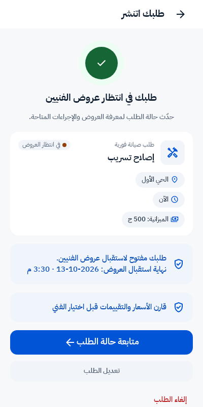

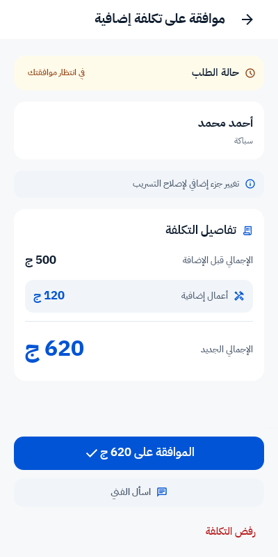

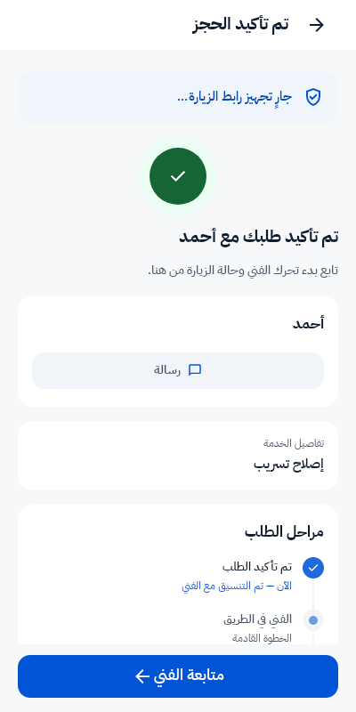

التحقق النهائي: 43 اختبار خادم، بـ483 تحققًا، و12 اختبار Android، و55 اختبار Swift Core؛ كلها نجحت. بُني [APK Debug للتجربة](../../androidapp/app/build/outputs/apk/debug/app-debug.apk)، واجتازت ملفات SwiftUI فحص الصياغة والتنسيق. فحوص موارد التصميم وتطابق التطبيقين نجحت. لم يُجرَ بناء Xcode أو اختبار مشاركة على جهاز Android أو iOS أو نشر إلى الإنتاج أو المتاجر. ملفات PDF وHTML السابقة تظل توثيق المقارنة الأصلية؛ هذا التحديث في Markdown يوثّق التنفيذ اللاحق.

نتائج التحقق: [الخادم](validation/workflow-backend-tests.json) · [Android](validation/workflow-android-tests.log) · [Swift Core](validation/workflow-swift-tests.log) · [مراجع اللقطات وبصماتها](validation/workflow-evidence.json).

## تنفيذ بيانات الفني والرسائل والحساب — 13 أكتوبر 2026

اعتمد المستخدم إجابات الشات 10 و11 و12: صور وتحقق فعليان في ملف الفني، وعدّاد غير المقروء مع وصف «متاح الآن»، والمكتملة والنشطة معًا في الحساب. تقابل هذه الإجابات س34 وس32 وس35 في هذا الملف.

ملف الفني يعرض التقييم والخدمات وسنوات الخبرة دون متوسط رد ثابت، وإثبات الهوية فقط دون ادعاء تحقق جنائي أو مهني مستقل. الصورة الشخصية ومعرض الأعمال مرتبطان بروابط الخادم المحمية؛ الطلبات تتحقق من ملكية العميل للطلب وصلة الفني به، ولا يمكن طلب صورة من معرض فني آخر عبر السياق نفسه. تحميل الصور في التطبيقين مصادق عليه ومقيّد بمضيف الخادم، وعند غياب الصورة أو فشلها يبقى البديل البصري.

عداد الرسائل يحسب الوارد غير المقروء من جميع رسائل كل محادثة، لا من عدد الرسائل في الصفحة فقط. قراءة أحدث صفحة لا تعلّم الأقدم غير المعروض مقروءًا، ولا تعلّم رسائل صاحب الحساب الصادرة. فلتر غير المقروء ومجموعه يخصان المحادثات المحمّلة بالقائمة؛ الرجوع من المحادثة يحدّث البيانات. التوفر من الخادم يظهر كنقطة ووصف «متاح الآن»، دون ادعاء اتصال لحظي. علامة الرسالة الصادرة الحالية لا تُقدّم كإثبات قراءة الطرف الآخر.

الحساب يعرض إجمالي المكتملة والنشطة والعناوين من `/me` مباشرة دون طلب الصفحة الأولى للطلبات وعدّها محليًا. الاختبار يشمل 24 طلبًا مكتملًا وأربع حالات نشطة، مع استبعاد الملغي والمنتهي وطلبات مستخدم آخر. التقييم الثابت أُزيل، ولا يُعاد تقييم العميل له في بيانات محادثته.

لقطات Android من واجهات التطبيق ببيانات اختبار. صور الفني والمعرض في اللقطات تستخدم الصورة التوضيحية الموجودة أصلًا في `design/images/home-hero.jpg`، وليست صور مستخدمين أو أعمال فعلية. اختبارات الخادم جلبت ملفات صور خاصة مصطنعة للتحقق من الحماية:

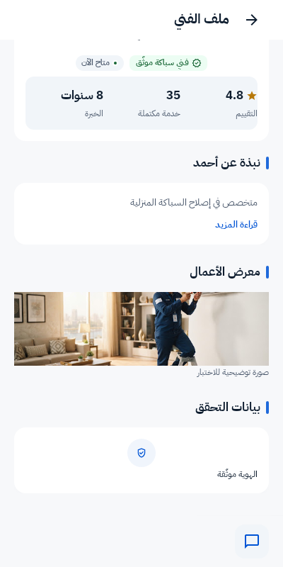

نجح 32 اختبار خادم، بـ367 تحققًا، و15 اختبار Android، و59 اختبار Swift Core. يشمل التحقق الإجماليات، وصلاحيات الصور، ورفض تنزيلها من مضيف مختلف، وحساب غير المقروء للطرفين، وقراءة الصفحة المعروضة فقط، وفلتر غير المقروء، وإخفاء الادعاءات الثابتة. أُصلح توقع قديم في اختبار رابط المشاركة ليتوافق مع مهلة الـ24 ساعة المعتمدة سابقًا. بُني APK Debug، ونجحت فحوص موارد التصميم والتنسيق وصياغة SwiftUI. لم يُجرَ بناء Xcode أو اختبار أجهزة أو نشر إنتاجي؛ ملفات PDF وHTML القديمة تحفظ المقارنة الأصلية.

نتائج التحقق: [الخادم](validation/trust-backend-tests.json) · [Android](validation/trust-android-tests.log) · [Swift Core](validation/trust-swift-tests.log) · [مراجع اللقطات](validation/trust-evidence.json).

## تنفيذ مهلة الدفع وقرار السعر وتقييم العميل — 13 أكتوبر 2026

اعتمد المستخدم إجابات الشات 13–15: الإغلاق التلقائي للكاش من استلام الدفع، وعرض مهلة قرار السعر الحقيقية، وإضافة وسوم وتعليق لتقييم الفني للعميل. هذه الإجابات تقابل س24 وس18 وس31.

مهمة الإغلاق تبحث عن طلبات انتظار تأكيد العميل التي مرّت عليها مهلة الإعداد من أحدث دفعة ناجحة `paid_at`، ثم يعيد إجراء الإغلاق التحقق داخل قفل الطلب. في إعداد 24 ساعة، إنهاء الإصلاح منذ ثلاثة أيام مع استلام الدفع منذ ساعة يترك 23 ساعة كاملة للتأكيد؛ أُصلح اختيار أحدث دفعة ناجحة بحيث تُستبعد المحاولات الفاشلة قبل اختيار التاريخ؛ دفعة فاشلة أحدث لا تخفي الموعد ولا تغيّره. عند بلوغ الموعد المعروض يُغلق الطلب مرة واحدة. تأكيد العميل قبل الموعد يظل متاحًا؛ غياب إثبات وقت استلام الدفع يمنع الإغلاق التلقائي.

C30 وC31 تعرضان الموعد والعدّاد ورسالة نتيجة انتهاء المهلة. الخادم يرسل `server_time` و`expiry_message` بجانب `expires_at`؛ التطبيقان يحسبان المتبقي من فرق وقت الخادم، ثم يخصمان الوقت المنقضي. الاختبار استخدم تاريخ خادم مختلفًا عن الجهاز بسنوات وأثبت بقاء 30 دقيقة صحيحة. أزرار القرار تتوقف عند الصفر، والخادم يرفض القرار المتأخر. انتهاء مقترح الخامات أو الأعمال الإضافية لا يلغي الطلب ولا يضيف تكلفة. نص نتيجة عرض التنفيذ يطابق وجود رسوم معاينة فعلية.

P17 تحفظ النجوم مع الوسوم والتعليق الاختياريين. الخيارات بكود وعنوان من الخادم، دون قائمة أعمال ثابتة في التطبيقين. يُرفض الوسم المجهول أو المكرر والتعليق الأطول من 500 حرف دون حفظ جزئي؛ يُمنع تقييم طلب فني آخر أو خارج نافذة التقييم أو تكراره. تستمر طلبات النجوم وحدها في العمل. قسم تقييم الفني في تفاصيل الطلب بلوحة الإدارة يعرض النجوم والوسوم والتعليق؛ بيانات التقييم لا تظهر للعميل نفسه.

اللقطات التالية من واجهات Android عبر Paparazzi ببيانات اختبار، وليست من أجهزة فعلية أو طلبات تشغيل:

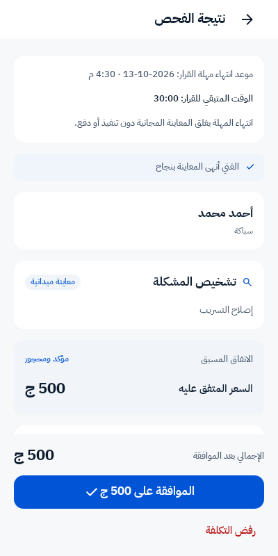

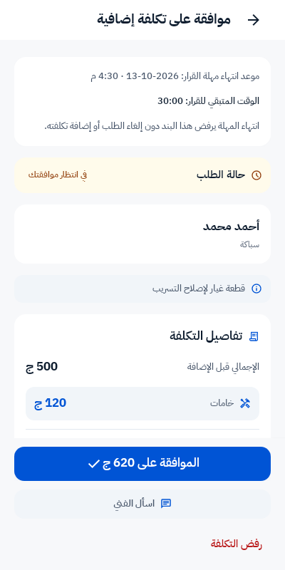

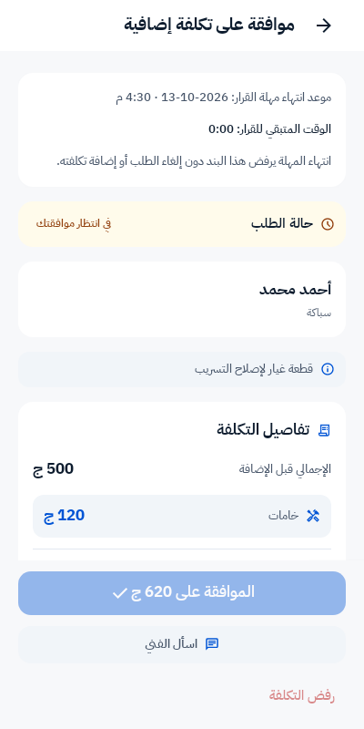

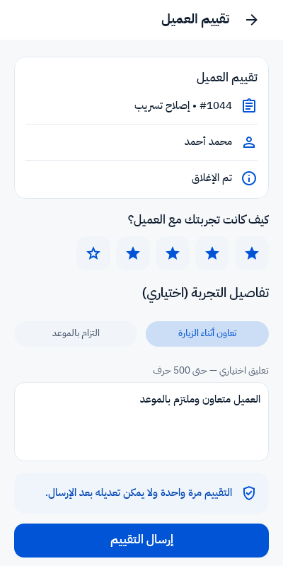

نجح 47 اختبار خادم بـ313 تحققًا، و17 اختبار Android، و64 اختبار Swift Core. بُني [APK Debug للتجربة](../../androidapp/app/build/outputs/apk/debug/app-debug.apk)، ونجحت فحوص الصياغة والتنسيق وتطابق موارد التطبيقين (939 مفتاح نص مشترك). تغيّر قاعدة بيانات التقييم طُبّق محليًا. لم يُجرَ بناء Xcode أو اختبار أجهزة أو نشر إنتاجي. ملفات PDF وHTML السابقة توثّق المقارنة الأصلية ولا تشمل هذا التنفيذ.

نتائج التحقق: [الخادم](validation/deadlines-backend-tests.json) · [Android](validation/deadlines-android-tests.log) · [Swift Core](validation/deadlines-swift-tests.log) · [مصادر اللقطات وبصماتها](validation/deadlines-evidence.json).

## تنفيذ كشف الحساب وتجهيز Push وتصحيح الوعود — 14 أكتوبر 2026

اعتمد المستخدم إجابات الشات 16–18: تنفيذ تصدير كشف حساب الفني والفلترة، وتجهيز Push الحقيقي، وحذف الوعدين غير المدعومين برد رسوم التأخير والفاتورة الضريبية. وبخصوص Push أكد لاحقًا: **«جهّز التكامل وسأوفر الإعدادات والأجهزة لاحقًا»**.

تتيح P18 اختيار نوع الحركة من الخادم: كل الحركات، الطلبات المكتملة، تحويلات المنصة، والتوريدات النقدية. يمكن تحديد تاريخ بداية ونهاية أو مسحهما، بتوقيت UTC المبيّن في الواجهة. الفلتر يخص السجل؛ ملخص الرصيد العام والمتاح والمعلّق لا يتغيّر بتغيير الفترة. تحميل المزيد يحافظ على الفلتر، والتصفية الجديدة تبدأ بالصفحة الأولى. عند فشل الطلب تبقى الحركات السابقة وتظهر إعادة المحاولة؛ تعديل الفلتر يوقف التصدير وتحميل المزيد حتى تطبيقه. العودة للشاشة تستعيد الفلتر المطبق وتتجاهل التعديلات غير المطبقة.

التصدير ملف CSV بترميز UTF-8 مع BOM، يشمل **جميع الحركات المطابقة** ولو كانت أكثر من صفحة. الأعمدة: معرّف الحركة، وقتها، نوعها، الوصف، التفاصيل، المبلغ بالجنيه، وقابلية التسوية. يتطلب الطلب مصادقة الفني ولا يقبل معرّف فني آخر. اختُبر تصدير 25 حركة مع أن الصفحة تعرض 20، واستبعاد الحركات خارج الفترة أو التابعة لفني آخر. Android يجهّز ملفًا خاصًا ويعرض مشاركة النظام لحفظه أو مشاركته؛ iOS يستخدم حوار تصدير الملفات. لم يُختبر هذان الحواران على أجهزة.

اللقطات من واجهات Android عبر Paparazzi ببيانات اختبار:

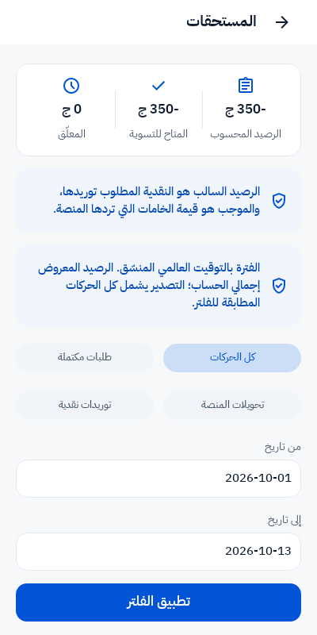

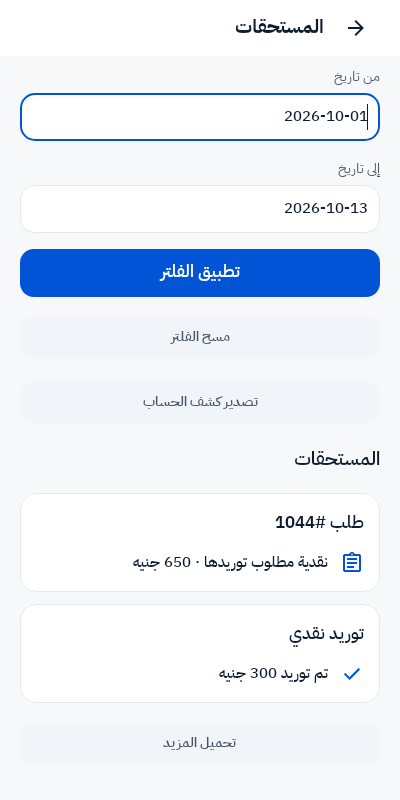

### ما جُهّز لإشعارات الأجهزة

- التكامل الحالي يستخدم FCM HTTP v1، وتسجيل وتجديد الرموز وحذفها عند الخروج، وروابط فتح الطلب وتبديل وضع العميل والفني. إعداد APNs وملف Firebase مطلوبان لـiOS وفق [دليل Firebase الرسمي](https://firebase.google.com/docs/cloud-messaging/ios/get-started).
- الأمر `php artisan notifications:push-check --json` يفحص إعداد المشغّل والمشروع وحساب الخدمة وتطابق إعدادات Android وiOS دون طباعة مفاتيح أو إرسال إشعار. حتى اجتياز الفحص لا يعني إثبات وصول الإشعار؛ النتيجة تفصل بين جاهزية الإعدادات والتحقق على الأجهزة.
- الأمر `notifications:push-test` يدعم `--order` لاختبار فتح الطلب الصحيح، ويرفض طلبًا غير مرتبط بالمستخدم والوضع المحددين. الاختبار هنا استخدم طابورًا معزولًا دون إرسال فعلي.
- أُصلح تصنيف 404 العام في FCM: خطأ مشروع عام لا يُعد رمز جهاز غير صالح؛ الحذف يتبع رمز `UNREGISTERED` أو خطأ الرمز المحدد وفق [أكواد Firebase](https://firebase.google.com/docs/cloud-messaging/error-codes).
- الوضع المحلي ما زال `log`. مشروع الخادم وحساب الخدمة غير مضبوطين، وملف `GoogleService-Info.plist` غائب. ملف Android موجود، لكن تطابقه مع مشروع الخادم لم يثبت لغياب إعداد الخادم. لا يوجد جهاز متصل أثناء التحقق. لا تُسجّل هذه الدفعة تفعيلًا إنتاجيًا أو وصول Push حقيقيًا.

قبل اختبار الأجهزة: تُضبط `PUSH_DRIVER=fcm` و`FCM_PROJECT_ID` و`FCM_CREDENTIALS_PATH` بمسار آمن خارج المستودع، وتوضع ملفات إعداد تطبيقَي Firebase المطابقة لـ`com.bremo.app`، ويربط مفتاح APNs في Firebase. يُشغّل عامل الطابور الذي يتابع طابور `default` حيث تُرسل مهام Push الحالية. يُستخدم أمر الاختبار لمستخدم اختبار وطلبه، في المقدمة والخلفية وبعد إغلاق التطبيق، على Android وiOS. الإعدادات والأجهزة سيوفرها المستخدم لاحقًا؛ لم تُضبط قيم تجريبية بدلًا منها.

### النصوص المعتمدة للإصدار

أُسقط وعد رد رسوم التأخير ووعد إصدار فاتورة ضريبية من نطاق الإصدار. لم توجد عبارتهما ضمن النصوص التشغيلية الحالية التي روجعت؛ ظهرت الوعود في الـPRD الأصلي الذي يبقى سجل المقارنة. أُعيدت تسمية عنوان ملخص الدفع إلى «تفاصيل المبلغ» و`Payment details`. الضمان 14 يومًا والزيارة والمصنعية المجانيتان مستمران وفق القرار السابق، ومسودة السياسة لا تزال غير منشورة. الإيصال وكشف الحركات لا يُقدَّمان كفاتورة ضريبية.

نجح 22 اختبار خادم بـ273 تحققًا، و7 اختبارات Android، و68 اختبار Swift Core. تشمل اختبارات Android وSwift منسّق الشاشة: الفلترة والصفحات والتصدير وفشل الفلتر والعودة إلى الفلتر المطبق. بُني [APK Debug للتجربة](../../androidapp/app/build/outputs/apk/debug/app-debug.apk)، ونجحت فحوص الصياغة والتنسيق وتطابق الموارد (949 مفتاح نص مشترك). لم يُجرَ بناء Xcode أو اختبار أجهزة أو إرسال فعلي أو نشر إنتاجي. ملفات PDF وHTML الأصلية تخص مراجعة 12 أكتوبر ولا تشمل استكمال هذه الدفعة.

نتائج التحقق: [الخادم](validation/earnings-push-backend-tests.json) · [Android](validation/earnings-push-android-tests.log) · [Swift Core](validation/earnings-push-swift-tests.log) · [جاهزية Push المحلية](validation/push-readiness.json) · [مصادر اللقطات وبصماتها](validation/earnings-push-evidence.json).

## تثبيت قرارات التسعير والتسوية ونطاق التقرير — 14 أكتوبر 2026

اعتمد المستخدم إجابات الشات 19–21، وهي تقابل س17 وس26 ونطاق التوثيق في س01 وس43:

| البند | القرار المعتمد |
| --- | --- |
| تعريف عرض التنفيذ مع معاينة قابلة للخصم | العرض شامل رسوم المعاينة؛ مثال 380 + 120 = **500 جنيه**. لا يُعاد خصم رسوم المعاينة 75 جنيهًا. |
| مستحقات الفني | تسوية أسبوعية، وتسجيل يدوي للتحويل من المدير العام في حدود الرصيد المتاح. |
| النقدية التي يحصّلها الموظف | توريد يومي. |
| وعد التحويل الفوري | مستبعد من نصوص الإصدار ونطاقه المعتمد؛ لا يُقدَّم تسجيل وسيلة الاستلام كتحويل آلي. |
| مخرج التوثيق | الاكتفاء بتقرير الاختلافات حاليًا؛ لا إنشاء PRD جديد ولا تعديل الملف الأصلي. |

الحساب القائم في [OrderAmounts](../../app/Modules/Pricing/Services/OrderAmounts.php) يطبّق التعريف المعتمد بالفعل: عرض التنفيذ هو المصنعية عند قابلية رسوم المعاينة للخصم، ثم تُضاف الخامات المعتمدة. الإعدادات السابقة تحدد الدورة الأسبوعية للمستحقات واليومية للتوريد، وإجراء تسجيل التحويل يتحقق من صلاحية المدير العام والرصيد المتاح. لم تتطلب هذه الإجابات تعديل منطق الحساب أو إعدادات التشغيل.

رُوجعت نصوص التطبيقين ولوحة الإدارة وموارد الترجمة؛ لم يظهر فيها وعد بتحويل مستحقات آلي وفوري. الوعد الوارد في صور الـPRD يظل محفوظًا ضمن المقارنة الأصلية في D11، مع تسجيل استبعاده من الإصدار. لا توجد لقطات واجهة جديدة لهذه الدفعة لأنها تثبّت تعريفًا ماليًا ومسارًا قائمًا ونطاق التوثيق، دون تغيير الشاشات.

نجحت اختبارات التسوية والمعاينة المجانية القائمة: **12 اختبارًا، بـ69 تحققًا**. تشمل صلاحية تسجيل التحويل وحدود الرصيد والتوريد وحساب مستحقات الموظف وإغلاق المعاينة المجانية؛ تعريف عرض التنفيذ الشامل جرى التحقق منه في مصدر الحساب المشار إليه أعلاه. [نتيجة الاختبارات](validation/finance-decisions-tests.json). يظل التحقق السابق لتصدير الحساب وتجهيز Push محفوظًا في الدفعة السابقة؛ اختبار وصول Push على الأجهزة ينتظر إعدادات وأجهزة المستخدم وفق الاتفاق.

## تنفيذ حد الفيديو واعتماد مدد الروابط — 14 أكتوبر 2026

اعتمد المستخدم إجابتَي الشات 22 و23: **60 دقيقة لكل من رابطَي تفعيل البريد واستعادة كلمة المرور**، و**خفض حد فيديو وصف المشكلة إلى 30 ثانية**. هذه الإجابات تقابل س39 وس40.

أصبح الحد الذي ينفّذه الخادم ويعلنه في إعدادات الـAPI هو 30 ثانية من مصدر واحد. التحقق يعتمد على الملف الفعلي باستخدام `ffprobe`، وليس على مدة يرسلها العميل. اختُبرت ملفات فيديو حقيقية صغيرة: 30 ثانية تُقبل، و30.1 ثانية و60 ثانية تُرفضان دون حفظ ملف أو سجل مرفق. إرسال العميل `duration_sec=1` لا يتجاوز هذا الفحص. الفيديو المرفوع مؤقتًا يُفحص مجددًا عند نشر الطلب أو ربط مرفق جديد أثناء تعديله، لمنع تمرير ملف قديم أطول من الحد.

في Android تُقرأ مدة الفيديو من بيانات الملف قبل تجهيز الرفع. وفي iOS تُقرأ مدة الملف عبر AVFoundation قبل استدعاء الرفع. المنطق في التطبيقين يرفض مدة تتجاوز 30 ثانية، وكذلك المدة غير القابلة للتحقق. تبقى المرفقات اختيارية؛ الفيديو المرفوض لا يُضاف للقائمة، ويمكن للعميل اختيار ملف أقصر أو المتابعة دون إرفاقه. تظهر رسالة الرفض داخل C17. تفاصيل قراءة المدة راجعت [مرجع Android](https://developer.android.com/reference/android/media/MediaMetadataRetriever) و[مرجع Apple](https://developer.apple.com/documentation/avfoundation/avasset-async-properties).

لقطات Android من واجهة التطبيق عبر Paparazzi ببيانات اختبار:

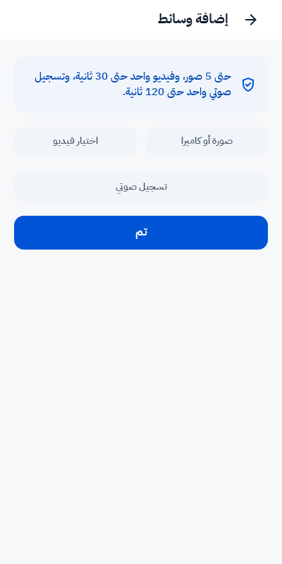

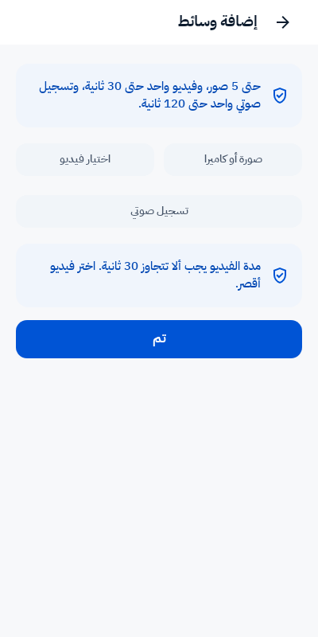

صلاحية رابطَي البريد 60 دقيقة بقيت كما هي، ورسائل البريد تقرأ المدة الفعلية. بقية حدود الوسائط مستمرة: حتى خمس صور، وفيديو واحد بحجم أقصى 50 ميجابايت، وتسجيل صوتي واحد حتى 120 ثانية. لم تُنشأ نسخة PRD جديدة؛ أصل المقارنة ولقطاته القديمة محفوظان.

نجح **28 اختبار خادم، بـ139 تحققًا، و14 اختبار Android، و71 اختبار Swift Core**. يشمل ذلك حدود مدة الفيديو الفعلية، وتجاهل مدة العميل المضللة، وإعادة التحقق عند النشر والتعديل، واستمرار اختبارات الصوت والبريد وعقود الـAPI. بُني [APK Debug للتجربة](../../androidapp/app/build/outputs/apk/debug/app-debug.apk)، ونجحت فحوص التنسيق وتطابق 951 مفتاح ترجمة وموارد التصميم. ملفات SwiftUI اجتازت فحص الصياغة.

لم يُجرَ اختبار منتقي الفيديو على أجهزة أو بناء Xcode أو نشر إنتاجي. قراءة المدة عبر AVFoundation لم تُختبر على جهاز؛ اختبارات BzrCore تغطي قرار قبول المدة ورسالة الرفض واستمرار الخطوة الاختيارية.

نتائج التحقق: [الخادم](validation/media-limit-backend-tests.json) · [Android](validation/media-limit-android-tests.log) · [Swift Core](validation/media-limit-swift-tests.log) · [مصادر اللقطات وبصماتها](validation/media-limit-evidence.json).

## تنفيذ الأجزاء الثابتة S01–S07 — 14 أكتوبر 2026

طلب المالك تحويل الأجزاء الثابتة المتبقية إلى بيانات لوحة التحكم أو الخادم. واعتمد في الشات: إخفاء وقت الوصول قبل تحرك الفني، واستخدام Google Maps عند تفعيل الـAPI، وتقدير انتهاء الإصلاح يدخله الفني ويحدّثه، وأوزان «الأنسب» 50% تقييم و30% سعر و20% وصول قابلة للتعديل من الإدارة؛ المجدول يستبعد الوصول.

نُفّذت البنود السبعة: نطاق العميل مستقل لكل نوع مشكلة في لوحة الكتالوج مع إخفاء الشرائح عند غيابه، وحذف وعد الوصول 30–45 دقيقة، وتقدير اختياري مسجّل من الفني، ومراحل التنفيذ وأوقاتها من أحداث الطلب، وترتيب الأنسب المركّب، ووسوم تقييم العميل للفني من لوحة التحكم محفوظة بأكواد مستقلة عن التعليق، ونقطة توفر العرض من `available_now`. قوائم الفرز والوسوم وتسمياتها من الخادم على التطبيقين. لا يُفترض الفحص والموافقة في زيارة الضمان أو التنفيذ المباشر. فشل إرسال التقييم يحافظ على مدخلاته ويتيح إعادة المحاولة.

الخريطة والتتبع أثناء الطريق وتكامل Google Routes موجودة بالفعل؛ لم يُختبر اتصال Google حقيقي ولم تُضبط مفاتيح جديدة. التقدير البديل من المسافة يُعرض كتقريبي. تقدير نهاية الإصلاح يظهر عند إدخاله، ولا يغيّر الحالة أو السعر ولا يتجدد آليًا. إعداد أسعار تشغيل حقيقية متروك للإدارة؛ لم تُزرع أمثلة الأسعار في قاعدة التشغيل.

نجح 69 اختبار خادم بـ339 تحققًا، و26 اختبار Android، و77 اختبار Swift Core، وبناء APK Debug وفحوص التطابق والتصميم والتنسيق وصياغة SwiftUI. طُبّقت أربع migrations محليًا. لا يوجد بناء Xcode أو اختبار أجهزة GPS/Google بهذه الدفعة، ولم يُنشر إصدار. أُعيد رسم لقطات Android ببيانات اختبار مع حفظ الصور المرجعية السابقة.

[التقرير المحدّث مع لقطات التنفيذ وأماكن الضبط](CURRENT-STATUS.md) · [نسخة HTML للقراءة والطباعة](Bremo_Current_Status_AR.html) · [أدلة الاختبارات وبصمات اللقطات](validation/static-sources-evidence.json) · [APK Debug](../../androidapp/app/build/outputs/apk/debug/app-debug.apk).

## تنفيذ صور رحلة الموظفين والسياسات واستكمال الفجوات — 15 أكتوبر 2026

اعتمد المالك صورة اختيارية للعطل الحالي في مقترح التكلفة، وصور المحادثة، ونشر السياسة، واستكمال الفجوات غير المغطاة. نقل كود الوصول إلى الإصدار الحالي واعتمد استثناء الإدارة الموثّق عند تعذّره. Firebase/APNs مؤجّل لما قبل الإطلاق، والسوق ما زال مؤجّلًا بالكامل تشغيليًا.

اكتملت الصور الخاصة للمقترح والمحادثة وصور قبل/بعد بعد إتمام العمل وصور التقييم، مع الفتح والتكبير والفشل وإعادة المحاولة في التطبيقين. رُبطت منطقة المقيّم وإحصاءات الوسوم ببيانات الخادم. نُشر محليًا: الشروط العربية v4 (قبول الشروط 2)، والخصوصية v2، والإلغاء v2؛ C34 تعرض السياسات الثلاث. كود الموظف مرتبط بالرحلة، محدود الصلاحية والمحاولات، مع بلاغ واستثناء إداري وبدء انتظار الغياب من الوصول المؤكد.

نجح 96 اختبار خادم مختلفًا في مجموعة واحدة، ثم أُعيد تحقق السياسات عند استكمال عرض الصفحات المرتبطة. نجح 18 اختبار Android و83 اختبار Swift Core وبناء APK Debug وفحوص الموارد والتصميم والتنسيق وصياغة SwiftUI. لا يوجد بناء Xcode أو اختبار أجهزة فعلي أو نشر إنتاجي بهذه الدفعة.

الصفحات المنشورة استجابت بنجاح على خادم PHP 8.4 المحلي المؤقت؛ Nginx لموقع `bzr.noox.test` ما زال مربوطًا بـPHP 8.3 ويحتاج تعديلًا بصلاحية إدارية غير متاحة. [التعديل المحدّد](validation/staff-nginx-php84.patch) محفوظ للمراجعة. إعداد بيانات مستلم إنستاباي ما زال ينتظر إدخال المالك من اللوحة؛ لا تُحفظ بيانات استقبال تجريبية.

[التقرير المحدّث ولقطات التنفيذ](CURRENT-STATUS.md) · [الأدلة والاختبارات](validation/staff-gaps-evidence.json) · [APK Debug للتجربة](../../androidapp/app/build/outputs/apk/debug/app-debug.apk).
