# تقرير الحالة الحالية: الأجزاء الثابتة والفجوات في التطبيق والـPRD

**آخر تحديث تنفيذ: 15 أكتوبر 2026.** أصل هذه المراجعة بتاريخ 14 أكتوبر 2026. يشمل هذا التقرير الكود المحلي بعد تنفيذ إجابات الشات 1–23 ودفعتي معالجة الأجزاء الثابتة S01–S07 وصور رحلة الموظفين والسياسات وكود الوصول، وملف [Bremo_PRD.pdf الأصلي](/home/tro/Downloads/Bremo_PRD.pdf) ذي 29 صفحة. لا يغيّر التقرير نطاق الإصدار أو القرارات المعتمدة.

[نسخة HTML للقراءة والطباعة](Bremo_Current_Status_AR.html) · [المقارنة الأصلية المصوّرة](REPORT.md) · [القرارات والتنفيذ والاختبارات السابقة](ASSESSMENT.md) · [أدلة مراجعة 14 أكتوبر](validation/current-status-evidence.json) · [أدلة تنفيذ 15 أكتوبر](validation/staff-gaps-evidence.json)

**نطاق التشغيل المؤكّد من المالك — 14 أكتوبر 2026:** الإطلاق الفعلي بفنيين موظفين لدى الشركة فقط، والتعيين من الإدارة، والمعاينة مجانية. السوق والعروض مؤجّلان بالكامل تشغيليًا. استكمال وظائف السوق برمجيًا لا يعني إتاحتها، ونواقصه الخاصة لا تدخل ضمن متطلبات إطلاق وضع الموظفين. فُحصت القاعدة المحلية بعد هذا التأكيد: `operating.offers_enabled=false` و`operating.inspection_fee_enabled=false`؛ لم تُغيّر المفاتيح بهذه المتابعة.

**النتيجة المحدّثة:** عولجت الأجزاء الثابتة السبعة S01–S07 على الخادم وAndroid وiOS: مصدرها الآن لوحة التحكم أو بيانات الطلب والفني الفعلية، وتُخفى القيم غير المتوفرة. يضيف الفني تقدير انتهاء الإصلاح ويحدّثه. اكتملت لاحقًا صور المحادثة والمقترح وإثبات الخدمة والتقييم وكود الوصول، مع نشر السياسات محليًا. تبقى صور بعض الحسابات والتتبع P05، والإعدادات وتجارب الأجهزة والتأجيلات المحددة أدناه.

**قرارات هذه الدفعة:** إخفاء وقت الوصول حتى يبدأ الفني التحرك؛ استخدام تكامل Google Routes الموجود عند ضبطه، مع التتبع على الخريطة الموجود أثناء الطريق. تقدير انتهاء الإصلاح من الفني. «الأنسب» بأوزان التقييم 50% والسعر 30% والوصول 20%، قابلة للتعديل من الإدارة؛ المجدول يستبعد الوصول ويحافظ على النسبة بين العاملين الآخرين. [أدلة التنفيذ والاختبارات واللقطات](validation/static-sources-evidence.json).

## نطاق التقرير ومعنى التصنيفات

- **القسم 1:** ما كان ثابتًا أو ظاهرًا دون ربط كامل؛ مع حالته الحالية، حتى لو عولج أو أُزيل.
- **القسم 2:** وظائف أو عناصر يذكرها الـPRD أو تظهر في شاشاته، وما زال تنفيذها أو تشغيلها غير مكتمل.
- **القسم 3:** نواقص لا يحدد الـPRD متطلباتها، ثم فجوات توثيق لمسارات أصبح كودها موجودًا بالفعل.

القيم الثابتة المقصودة هنا هي بيانات تشغيلية تبدو كأنها ناتجة عن الطلب أو الفني أو المنطقة. حدود الإصدار المعتمدة، مثل فيديو 30 ثانية وصوت 120 ثانية، لها قاعدة تنفيذ فعلية؛ لا تُحسب بيانات وهمية لمجرد أن لها قيمة محددة.

المصدران التاريخيان مختلفان: [مراجعة القيم الثابتة](../static-values-review/REPORT.md) راجعت Figma «Primo App» بتاريخ 10 أكتوبر، بينما المقارنة الثانية راجعت Bremo PRD بتاريخ 12 أكتوبر. بعض عناصر Figma القديمة ليست ظاهرة أو مطلوبة في نسخة الـPRD الحالية؛ لم تُنقل تلقائيًا إلى قائمة متطلبات الـPRD.

## 1 — الأجزاء الثابتة أو غير المربوطة: قبل التعديلات وحالتها الآن

### 1.1 الأجزاء الثابتة السبعة: ما كان موجودًا وما تغيّر

| الرمز | الجزء السابق | السلوك الحالي ومصدر البيانات | الضبط أو حدود التنفيذ | النطاق |
| --- | --- | --- | --- | --- |
| S01 / B-14 | شرائح 250 / 300 / 400 وشارة «متوسط المنطقة» | `/catalog` يعيد نطاق سعر العميل لكل نوع مشكلة؛ الشرائح من الحد الأدنى والمتوسط الحسابي والأعلى دون تكرار. الوصف أصبح «السعر المعتاد». | الإدارة تضبط حدّي السعر مستقلين عن دليل الموظفين. إذا غاب نطاق صالح تُخفى الشرائح والشارة؛ لم تُزرع أسعار تشغيل تجريبية. | C38 في السوق. |
| S02 / B-15 | وعد الوصول خلال 30–45 دقيقة قبل التحرك | أُزيل من C04. التتبع على الخريطة ووقت القيادة أثناء `ON_THE_WAY` من آخر موقع فعلي عبر الخادم. | تكامل Google Routes موجود ويستخدم المرور عند ضبط مفتاح الخادم؛ بديل المسافة يُعلن كتقدير تقريبي. لم يُجرَ اتصال Google حقيقي أو اختبار موقع على جهاز بهذه الدفعة. | الإنشاء والتتبع في التطبيقين. |
| S03 / B-07 | وقت إنهاء الإصلاح ثابت 30 دقيقة | الفني المعيّن يدخل الدقائق المتبقية ويحدّثها أثناء التنفيذ؛ الخادم يحفظ موعدًا وسجل تحديث وإصدار الطلب. العميل يرى الوقت المدخل، أو لا يرى تقديرًا عند غيابه. | إدخال اختياري 1–1440 دقيقة. تجاوز الوقت يظهر كتقدير متجاوز ولا ينهي الطلب أو يمدده آليًا. تحديث التفاصيل يجلب آخر تقدير. | P15 وC09. |
| S04 | افتراض الفحص والموافقة منتهيين والإصلاح المرحلة الرابعة | `execution_steps` يعيد مراحل وأوقات من الطلب وأحداث عرض التنفيذ وموافقته في التعيين الحالي. التطبيقان يعرضان هذه البيانات. | لا تُختلق معاينة أو موافقة في الضمان أو التنفيذ المباشر؛ وقت تقديم عرض التنفيذ هو شاهد انتهاء الفحص، وليس وقت بدء فحص مستقلًا. | C09، العادي والضمان. |
| S05 / B-18 | «الأنسب» يرسل ترتيب التقييم فقط | `sort=best` يجمع التقييم والسعر ومدة الوصول الفعلية في العرض. قوائم الفرز وأكوادها وتسمياتها من الخادم. | أوزان 50/30/20 قابلة للتعديل ومجموعها 100. المجدول يستبعد عامل الوصول؛ المدة الغائبة لا تمنح مساهمة سرعة. وصول العرض تقدير يدخله الفني، وليس تتبعًا قبل التعيين. | C06 في السوق. |
| S06 / B-04 | وسوم محلية ملحقة ببداية التعليق | وسوم فعالة مرتبة من لوحة التحكم بأكواد ثابتة، تُحفظ في `reviews.tags` منفصلة عن التعليق والنجوم والصور. تظهر تفاصيلها للإدارة. | يمكن تعديل الاسم والترجمة والترتيب والتفعيل؛ الكود لا يتغير. لا تُحلّل التعليقات التاريخية. إحصاءات الوسوم أصبحت من كل التقييمات الظاهرة، ويستبعد منها التقييم المخفي. | C24، تقييم العميل للفني. |
| S07 / B-17 | نقطة خضراء على كل عرض | `OfferResource.provider.available_now` يحدد ظهور النقطة لكل فني؛ غياب الحقل أو عدم التوفر يخفيها. | معناها توفر للخدمة؛ لا تدّعي وجوده داخل التطبيق. | كروت C06. |

**أماكن الضبط:** نطاق العميل من الكتالوج ← فئة الخدمة ← أنواع المشكلات؛ أوزان الأنسب من الإعدادات التشغيلية ← العروض؛ الوسوم من «وسوم تقييم الخدمة» للمدير العام. نطاق العميل والميزانية والأنسب تخص السوق المؤجّل، فلا يلزم ضبطها لإطلاق الموظفين. عند إتاحة السوق تُراجع أسعار العميل قبل استخدامها، ويظل إدخال الميزانية اليدوي متاحًا عند غيابها. دليل مصنعية الموظفين مستقل ويُراجع قبل الإطلاق. الخيارات الأولية للوسوم موجودة في قاعدة البيانات ويمكن تعديلها أو تعطيلها دون تغيير التطبيق.

**تقدير الفني:** حقل اختياري بالدقائق وزر حفظ في الطلب الجاري. لا يغير السعر أو الحالة، ويمنع الخادم التعديل من غير الفني المعيّن أو خارج التنفيذ أو مع إصدار قديم. الـAPI يدعم مسح التقدير بقيمة `null`؛ الواجهة الحالية تتيح إدخاله وتحديثه. فشل إرسال التقييم يحافظ على النجوم والوسوم والتعليق ويتيح إعادة المحاولة.

**أدلة الكود:** [نطاق العميل](../../app/Modules/Catalog/Models/ProblemType.php)، [إدارة أنواع المشكلات](../../app/Filament/Resources/Catalog/RelationManagers/ProblemTypesRelationManager.php)، [الأنسب](../../app/Modules/Offers/Services/OfferRanking.php)، [إعداد الأوزان](../../app/Filament/Pages/OperatingSettings.php)، [إدارة الوسوم](../../app/Filament/Resources/ReviewTags/ReviewTagResource.php)، [حفظ التقييم](../../app/Modules/Reviews/Actions/CreateProviderReviewAction.php)، [المراحل والتقدير](../../app/Modules/Orders/Services/OrderExecutionPresentation.php)، [تحديث تقدير الفني](../../app/Modules/Orders/Actions/UpdateCompletionEstimateAction.php)، [توفر العرض](../../app/Http/Api/V1/Resources/OfferResource.php)، [تكامل Google Routes](../../app/Modules/Orders/Services/GoogleRoutesEtaProvider.php)، [عقد الـAPI المحدّث](../../docs/31-API-CONTRACT.md).

لا يغيّر التنفيذ وضع التشغيل: السوق يبقى معطّلًا محليًا وفق القرار السابق. رُبطت عناصره بالبيانات دون إتاحته للعملاء تلقائيًا.

### 1.2 أجزاء ثابتة عولجت أو أُزيلت

| الجزء السابق | الحالة الحالية | ما أُنجز |
| --- | --- | --- |
| عدد الفنيين 5، وشريط تقدم 60%، وصور رمزية ووعد سرعة أول عرض / B-13 | عولج بالإزالة وعرض الحالة الحقيقية | رسالة انتظار ومهلة من الخادم حسب الموظفين أو السوق أو الضمان، مع تحديث الحالة. لم يُنفّذ عداد جديد للفنيين؛ اختير عدم عرض رقم غير مثبت. |
| متوسط الرد «10 دقائق» / B-19 | أُزيل من ملف الفني | لا يظهر رقم بديل مختلق. حساب متوسط رد حقيقي ما زال غير موجود؛ العمود المخزّن وحده لا يثبت وجود حساب دوري. |
| تحقق جنائي ومهني بجانب تحقق الهوية / B-12 | عولج بتصحيح المعروض | يظهر التحقق المدعوم وفق `is_verified`، دون ادعاء تحقق جنائي أو مهني مستقل. |
| متوسط تقييم العميل «4.9» وعدد مكتمل من أول صفحة / B-09 | عولج | الخادم يحسب المكتملة والنشطة والعناوين؛ تقييم العميل لا يظهر له. |
| نقطة اتصال ثابتة في الرسائل / B-03 | عولج في الرسائل | `available_now` مع وصف «متاح الآن». لا تُقدَّم كدليل حضور داخل التطبيق. كروت العروض رُبطت أيضًا في S07 بهذه الدفعة. |
| أعداد الرسائل غير المقروءة الغائبة / B-02 | اكتمل ربطها | عدد حقيقي للوارد غير المقروء، وتعليم قراءة الصفحات المعروضة، وفلتر غير المقروء. مجموع الفلتر يخص المحادثات المحمّلة. |
| زر مشاركة الزيارة بلا استكمال ضغط | اكتمل الربط في الكود | إنشاء رابط مؤقت من الخادم ومشاركة النظام، مع حالات تجهيز وفشل. تجربة مشاركة النظام على الأجهزة لم تُجرَ. |

**أدلة:** [إحصاءات الحساب](../../app/Http/Api/V1/Controllers/AccountController.php)، [غير المقروء والتوفر](../../app/Http/Api/V1/Controllers/ConversationController.php)، [حالة انتظار الطلب ومراحله](../../app/Modules/Orders/Services/OrderPresentation.php)، [تفاصيل تحقق دفعة الثقة والبيانات](ASSESSMENT.md#تنفيذ-بيانات-الفني-والرسائل-والحساب--13-أكتوبر-2026)، [سجل تحقق المشاركة والانتظار](validation/workflow-evidence.json).

### 1.3 أجزاء كانت ناقصة الربط وحالتها جزئية الآن

| الجزء | المنفّذ | المتبقي |
| --- | --- | --- |
| الصور / B-16 | تحميل صورة الفني ومعرض أعماله من روابط مصادق عليها في C07. | صور مقترحات التكلفة والمحادثة رُبطت في 15 أكتوبر. كروت العروض وبعض صور الأشخاص خارج C07 ما زالت حروفًا أو بدائل؛ المتبقي P05. |
| صور قبل وبعد / B-05 | رفع الفني إلزامي في المرحلتين، ومنع الإنهاء دونها، وحفظها وربطها بالطلب وإتاحتها للإدارة. | اكتمل عرض صور المرحلتين في الدفع وتأكيد الإنهاء وتفاصيل الطلب المنتهي. صور إثبات الإصلاح لا تصل للعميل قبل إتمام العمل، ولا تظهر كصور تشخيص قبل الموافقة. تحقق الأجهزة الفعلي ما زال مطلوبًا. |
| صور العميل مع التقييم / B-04 | الاختيار والرفع الاختياري والحفظ مع التقييم والإتاحة للإدارة. | اكتمل عرض الصور المحفوظة ضمن آراء العملاء من روابط خاصة في سياق الطلب؛ إخفاء التقييم يوقف قراءة صوره. تشغيل رحلة اختيار الفني في السوق يبقى مؤجّلًا. |
| تقييم الفني للعميل / D13 | النجوم والوسوم والتعليق محفوظة بالفعل، وتظهر للإدارة. | S06 يخص الاتجاه الآخر، وقد اكتمل حفظه ووسومه منفصلين في دفعة 14 أكتوبر. |
| Push / D22 | كود FCM وتسجيل الرموز والروابط وأدوات فحص الإعداد واختبار الإرسال جاهزة. | إعداد Firebase/APNs واختبار الوصول على Android وiOS ينتظران المستخدم وفق الاتفاق. التفاصيل P02. |

### 1.4 لقطات توضح الفرق

الصور التالية شواهد تاريخية للمقارنة. لقطات تنفيذ 14 أكتوبر الجديدة في القسم التالي. جميع لقطات «بعد التنفيذ» رُسمت من واجهات Android ببيانات اختبار عبر Paparazzi؛ ليست تشغيلًا على جهاز أو طلبات حقيقية.

**قبل المعالجة:** شرائح الميزانية وشارة المنطقة، ووقت إنهاء الإصلاح. اللقطتان من مراجعة 10 أكتوبر؛ عولجتا في 14 أكتوبر:

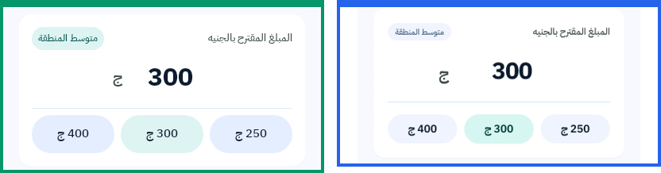

**عولج: انتظار الموظفين، وإحصاءات الحساب، وغير المقروء والتوفر.** لقطات تنفيذ 13 أكتوبر:

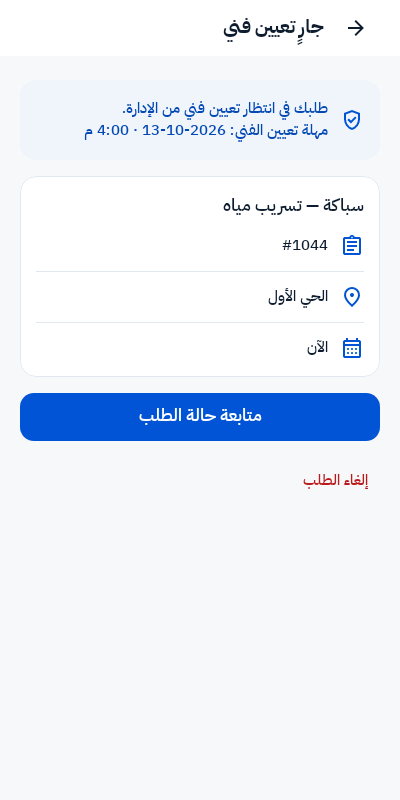

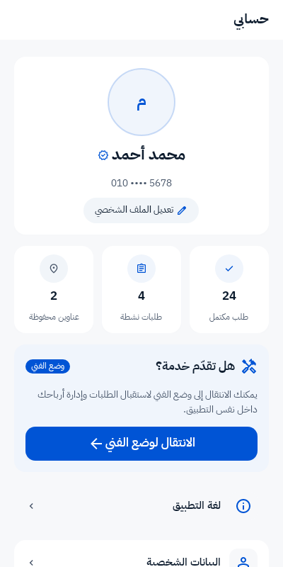

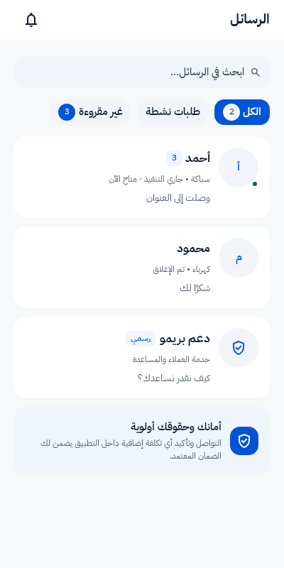

### 1.5 لقطات تنفيذ الأجزاء الثابتة — 14 أكتوبر 2026

قيم الأسعار والأسماء والوقت والوسم في اللقطات بيانات اختبار توضيحية، لا بيانات تشغيل ضُبطت في لوحة التحكم. اختبارات الـAPI ولوحة الإدارة المرافقة تتحقق من مصدرها وحفظها وصلاحياتها؛ الصورة وحدها لا تثبت اتصالًا حقيقيًا بالخادم.

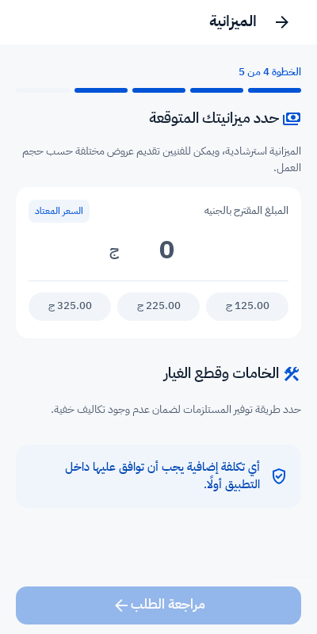

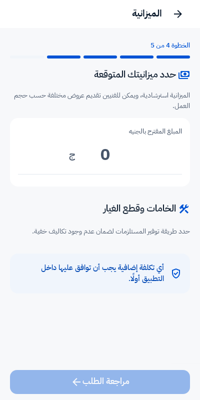

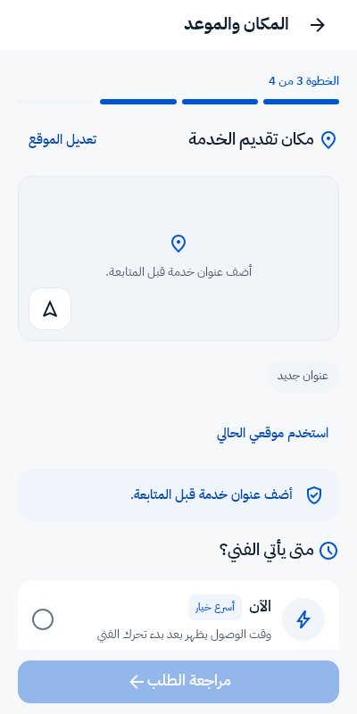

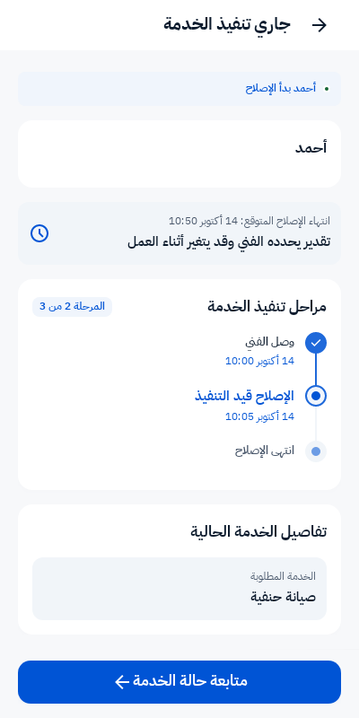

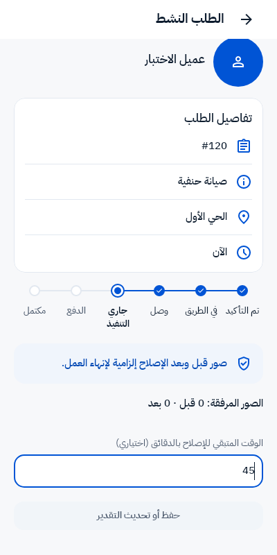

## 2 — فجوات باقية وموجودة في الـPRD

هذه قائمة المتابعة بعد التنفيذ. أُغلقت برمجيًا P03 وP04 وP06، ونُشر محتوى P09 محليًا مع بقاء إعداد خادم الموقع؛ بقيت الصفوف لتتبّع مراجعها. بقية البنود محددة بحالتها. البنود التي غُيّر نطاقها بقرارك موضّحة منفصلة بعدها.

| الرمز | مطلب الـPRD ومكانه | الحالة الحالية | المتبقي | النوع والأولوية |
| --- | --- | --- | --- | --- |
| P01 | الدفع بفوري: بطاقة/محفظة/كود، ص4 وص15، C22 | الموجود محاكي `StagingPaymentGateway`؛ المزوّد الحقيقي غير مربوط، وقناة فوري معطّلة محليًا. | ربط مزوّد فعلي والتحصيل والتحقق من الإشعارات والتسوية والفشل وانتهاء الكود. | **تكامل مؤجّل**؛ ليس شرطًا لمسار الكاش وإنستاباي المعتمد. |
| P02 | إشعارات الأحداث، ص19، C32 | صندوق التطبيق وكود Push موجودان، دون تحقق وصول على جهاز. | إعداد Firebase/APNs واختبار الوصول وفتح الطلب الصحيح على الأجهزة. | **مؤجّل لما قبل الإطلاق بإجابة المالك في هذه الدفعة**؛ لا يُدّعى اكتمال الإعداد أو اختبار الأجهزة. |
| P03 | صورة العطل الحالي في مقترح التكلفة، ص13–14، C30/C31 | اكتمل تحميل الصورة الاختيارية من رابط مصادق عليه، مع الفتح والتكبير وإعادة المحاولة. | اختبار أجهزة فعلي؛ عند غياب الصورة لا يُعرض بديل. | **أُغلق برمجيًا في 15 أكتوبر**. قرار المالك: صورة العطل الحالي فقط؛ لا صور إصلاح منتهٍ أو أعمال سابقة قبل بدء العمل. |
| P04 | صور المحادثة، ص13، C19 | اكتمل عرض صور الرسالة وفتحها وتكبيرها وإعادة تحميلها على التطبيقين وللطرفين. رابط الصورة يتحقق من المحادثة والرسالة والمرفق والمشارك. | اختبار أجهزة فعلي؛ القراءة في المحادثة المؤرشفة ممكنة للمشارك الأصلي، والفني البديل لا يقرأ صور محادثة لم يشارك فيها. | **أُغلق برمجيًا في 15 أكتوبر**. |
| P05 | صور الفني/الحساب في كروت العروض والتتبع والحساب، ص11 وص13 وص19 | صورة C07 ومعرضه مربوطان؛ مكوّنات أخرى، منها كارت العرض وC02 وC24، تستخدم الحرف الأول فقط. | إكمال التحميل في الشاشات التي تعرض صورة فعلية بالـPRD، مع البديل عند غيابها أو فشلها. | **تنفيذ جزئي — أولوية متوسطة**؛ الحرف بديل صحيح عند غياب الصورة، لكنه لا يبرر غياب الربط كله. |
| P06 | اختيار «الأنسب» في C06، ص11 | اكتمل ترتيب مركّب بأوزان الإدارة من بيانات العروض، كما في S05. | تجربة مسار السوق على الأجهزة قبل إتاحته؛ لا يوجد منطق ثابت مفتوح بهذا البند. | **أُغلق برمجيًا — 14 أكتوبر 2026**. |
| P07 | عداد اختيار العرض في C06، ص11 | تصل المهلة الحقيقية وتُعرض ضمن رسالة الانتظار؛ مكوّن C06 لا يرسم عدادًا متجددًا كالـPRD. | عداد من مهلة الخادم، وتحديث العرض عند انتهائها. عدادات C30/C31 أُنجزت بالفعل. | **مؤجّل مع تشغيل السوق؛ ليس شرطًا لإطلاق الموظفين**. |
| P08 | «عرض كل التقييمات» في ملف الفني، ص11، C07 | الخادم يحمّل آخر 10 تقييمات فقط؛ الواجهة تعرض قائمة وعددًا دون رحلة لقراءة البقية. | صفحة/تحميل المزيد وعقد مرقّم ومصادق عليه للتقييمات، أو إزالة وعد عرض الكل من التصميم. | **وظيفة غير مكتملة في رحلة اختيار فني السوق؛ خارج أولوية إطلاق الموظفين**. |
| P09 | صفحات السياسات والشروط، ص20، C34؛ واتساق الضمان | نُشرت محليًا الشروط العربية v4، والخصوصية v2، والإلغاء v2. C34 تعرض نصوص الصفحات الثلاث من الخادم. | عالج المالك إعداد PHP-FPM إلى 8.4، وتحققت استجابات HTTP 200 للسياسات من اسم الموقع. اختبار أجهزة ونشر بيئة الإطلاق منفصلان. | **اكتمل المحتوى والربط والنشر المحلي، وعولج إعداد PHP-FPM للموقع وتحقق HTTP 200**. |

**مصادر مباشرة:** [محاكي الدفع](../../app/Modules/Payments/Services/StagingPaymentGateway.php)، [اختيار بوابة الدفع](../../app/Providers/AppServiceProvider.php)، [فحص Push الحالي](validation/current-status-push-readiness.json)، [عقد المقترح](../../app/Http/Api/V1/Resources/ProposalResource.php)، [واجهة المقترح Android](../../androidapp/app/src/main/kotlin/noox/bzr/customer/ProposalDecisionView.kt)، [واجهة المقترح iOS](../../iosapp/BzrApp/Customer/ProposalDecisionViews.swift)، [فقاعة المحادثة Android](../../androidapp/core/design/src/main/kotlin/noox/bzr/design/views/ChatBubbleView.kt)، [مكوّنات iOS](../../iosapp/Packages/DesignSystem/Sources/DesignSystem/BzrComponents.swift)، [ترتيب العروض](../../app/Http/Api/V1/Controllers/OrderController.php)، [حد تقييمات ملف الفني](../../app/Http/Api/V1/Controllers/ProviderController.php)، [قراءة السياسات المنشورة](../../app/Http/Api/V1/Controllers/PageController.php).

### متطلبات في الملف الأصلي غُيّر نطاقها بقرارك

| ما في الملف الأصلي | قرار الإصدار الحالي | هل يُسجّل فجوة تنفيذ مفتوحة؟ |
| --- | --- | --- |
| السوق والعروض كرحلة أساسية | الإطلاق بالموظفين والتعيين الإداري؛ مسار السوق موجود ومعطّل. | **لا**؛ إبقاء السوق معطّلًا قرار تشغيل. عيوب مكوّناته، مثل P07 والصور، تُراجع قبل إتاحته. |
| 3 خطوات لإنشاء الطلب | 4 للموظفين و5 للسوق. | **لا**؛ التغيير معتمد ومنفّذ، والـPRD الأصلي أصبح مختلفًا. |
| أزرار اتصال مباشر بين العميل والفني | رسائل التطبيق فقط بين الطرفين؛ الإدارة تتولى الاتصال التشغيلي بالعميل. | **لا**؛ حجب الأرقام وإجراءات الاتصال بين الطرفين قرار معتمد ومنفّذ. |
| متوسط رد 10 دقائق وتفاصيل تحقق غير مثبتة | إخفاء المتوسط وإظهار التحقق المدعوم فقط. | **لا** بالنسبة للنطاق الحالي. حساب متوسط رد حقيقي أو تحقق إضافي يحتاج نطاقًا مستقلًا. |
| ضمان 14/30 يومًا بصياغات مختلفة | 14 يومًا، بفني آخر، والزيارة والمصنعية فقط. | **لا** لمنطق الضمان المنفّذ؛ السياسة نُشرت محليًا في 15 أكتوبر؛ إعداد خادم الموقع ما زال P09. |
| رد رسوم التأخير وفاتورة ضريبية | حذف الوعدين غير المنفّذين. | **لا**؛ لا يُعاد بناؤهما دون اعتماد جديد. |
| وعد التحويل الفوري لمستحقات الفني | تسوية أسبوعية وتسجيل تحويل يدوي؛ توريد نقدية الموظفين يومي. | **لا**؛ هذا هو المسار المعتمد. |
| تفعيل البريد 24 ساعة والاستعادة 15 دقيقة | 60 دقيقة لكل منهما. | **لا**؛ معتمد والإعداد القائم يطبّقه. |
| فيديو 30 ثانية | طُبّق الحد بالفعل في الخادم والتطبيقين. | **لا**؛ اختلاف 60 ثانية السابق أُغلق. |

### فجوات قديمة أُغلقت، فلا تدخل في القائمة المفتوحة

اكتملت موافقة العميل ورفضه على التكلفة الإضافية، ومنع الإنهاء مع مقترح معلّق، وإنستاباي بالإيصال ومراجعة الإدارة، وضمان الإصلاح، ورفع صور الفني الإلزامية، وصور تقييم العميل الاختيارية، ومشاركة الزيارة، والانتظار الحقيقي، وإحصاءات الحساب وغير المقروء، ومهلة قرارات السعر، والإغلاق بعد استلام الكاش، ووسوم وتعليق تقييم الفني للعميل، وفلترة كشف الحساب وتصديره. حدود التنفيذ الجزئي، خصوصًا عرض الصور وتجربة الأجهزة، مبينة أعلاه؛ نجاح التخزين لا يثبت اكتمال كل واجهات العرض.

## 3 — فجوات غير مغطاة، ومتطلباتها ما زالت غائبة أو غير محددة في الـPRD

### 3.1 استكمالات في التطبيق لا يحدد الـPRD عقدها أو قواعدها

| الرمز | النقص الحالي | الموجود في الـPRD | المطلوب لتغطيته | الحالة |
| --- | --- | --- | --- | --- |
| G01 | السعر الاسترشادي للعميل / S01 | لا يحدد حقوله أو إدارته أو فصله عن دليل الموظفين. | أصبح المصدر والنطاق والغياب موثّقين في عقد الـAPI؛ الملف الأصلي لم يُعدّل. | **نُفّذ في الخادم ولوحة التحكم والتطبيقين؛ فجوة الملف الأصلي توثيقية.** |
| G02 | تقدير انتهاء الإصلاح / S03 | لا يحدد من يضعه وكيف يتغير أو يغيب. | الفني يدخل ويحدث الدقائق؛ الخادم يسجل الموعد، والتطبيق يعرضه عند وجوده. | **نُفّذ؛ العقد موثّق محليًا، والـPRD الأصلي لم يُعدّل.** |
| G03 | مراحل التنفيذ وأوقاتها / S04 | لا يحدد أحداث المراحل الفرعية أو تجاوزها. | المراحل من أحداث التعيين الحالي، ومسارا الضمان والتنفيذ المباشر دون مراحل مفترضة. | **نُفّذ؛ تفاصيل العقد غائبة عن الملف الأصلي.** |
| G04 | وسوم تقييم العميل للفني / S06 | لا يحدد أكوادًا مستقلة أو إدارة الخيارات وإحصاءاتها. | اكتملت إدارة الخيارات والحفظ المستقل والتحقق والعرض للإدارة وإحصاءاتها في ملف الفني من كل التقييمات الظاهرة. تعطيل وسم لا يمحو إحصاءه التاريخي؛ إخفاء تقييم يستبعده. | **مغطّى برمجيًا؛ تفاصيله غائبة عن الـPRD الأصلي**. |
| G05 | كود تأكيد وصول الفني | لا يحدد رحلة الإصدار والتحقق والصلاحية والمحاولات وغياب العميل. | نُفّذ للموظفين: كود خاص بالرحلة، إدخال الفني، صلاحية وقفل محاولات، وبلاغ تعذّر تتولى الإدارة حسمه باستثناء وصول موثّق. | **معتمد ومنفّذ في 15 أكتوبر؛ إجابة المالك الجديدة تحل محل التأجيل السابق**. |
| G06 | صور قبل/بعد للعميل، وصور التقييم في آراء العملاء | لا يحدد عقد الاستعراض وصلاحياته. | اكتمل عرض صور المرحلتين بعد إتمام العمل في الدفع والتأكيد والتاريخ، وصور التقييم في سياق ملف الفني. روابط مصادق عليها مع التحميل والفشل وإعادة المحاولة والتكبير. | **مغطّى برمجيًا على الخادم والتطبيقين؛ تحقق الأجهزة الفعلي باقٍ**. |
| G07 | منطقة المقيّم في آراء العملاء / B-20 | إضافة من مراجعة Figma؛ الـPRD يستخدم تاريخ التقييم ولا يفرض المنطقة. | الخادم يرجع اسم منطقة طلب التقييم، والتطبيقان يعرضانه مع التاريخ، دون عنوان تفصيلي أو قيمة افتراضية. | **مغطّى برمجيًا؛ إتاحة السوق مؤجّلة تشغيليًا**. |
| G08 | ضبط بيانات مستلم إنستاباي في بيئة التشغيل | لا يصف الملف إعداد عنوان المستلم واسمه من الإدارة ولا حجب القناة عند غيابهما. | إدخال بيانات الاستقبال من لوحة التحكم وفق قرار المستخدم، ثم تجربة ظهور القناة ورحلة الإرسال والمراجعة. | **الكود منفّذ؛ إعدادا العنوان والاسم فارغان محليًا، لذلك تظل القناة غير متاحة فعليًا رغم تفعيل مفتاحها.** |

**أدلة إضافية:** [نموذج نوع المشكلة](../../app/Modules/Catalog/Models/ProblemType.php)، [المراحل التي يعيدها الخادم](../../app/Modules/Orders/Services/OrderPresentation.php)، [حفظ تقييم العميل للفني](../../app/Modules/Reviews/Actions/CreateProviderReviewAction.php)، [التحقق من حقول اتجاهَي التقييم](../../app/Http/Api/V1/Controllers/RatingController.php)، [حقول صور العمل في الطلب](../../app/Http/Api/V1/Resources/OrderResource.php)، [مكوّن الإنهاء Android](../../androidapp/app/src/main/kotlin/noox/bzr/customer/FinishServiceBlocks.kt)، [مكوّن الإنهاء iOS](../../iosapp/BzrApp/Customer/FinishServiceBlocks.swift)، [حقول آراء العملاء](../../app/Http/Api/V1/Resources/ProviderResource.php)، [استكمال كود الوصول المعتمد](../../docs/36-FUTURE-ROADMAP.md).

G01–G07 أصبحت مغطاة برمجيًا وفق القرارات الحالية؛ ما يغيب عنها في الـPRD الأصلي يبقى فجوة توثيق. G08 إعداد تشغيل ينتظر بيانات المستلم التي سيدخلها المالك من اللوحة، ولا تُختلق بيانات لاستكماله.

المفضلة، وحفظ البطاقات، و«تقييماتي»، وواتساب بين العميل والفني ليست وظائف جديدة معتمدة بهذا التقرير. أُخفيت أو استُبعدت سابقًا، فلا تُضاف تلقائيًا إلى قائمة الاستكمال.

### 3.2 فجوات توثيق في الـPRD؛ التنفيذ موجود بالفعل

هذه البنود **لا تعني غياب الكود**. هي تفاصيل ما زال القارئ لا يجد لها رحلة مكتملة وقواعد كافية في الملف الأصلي، مع أن التنفيذ والقرارات اللاحقة يغطيانها.

| المسار | ما ينقص الملف الأصلي | الحالة التنفيذية ومصدرها |
| --- | --- | --- |
| الموظفون والتعيين الإداري | 4 خطوات، الأهلية، توفر «الآن» من الخادم، انتهاء مهلة التعيين، الاعتذار وإعادة التعيين، وفصل وضع السوق المثبّت على الطلب. | منفّذ؛ [وضعا التشغيل](../../docs/39-OPERATING-MODES.md) وس04/س08/س09 في ASSESSMENT. |
| بلاغ غياب العميل | الفني يبلغ بعد مهلة الانتظار، الإدارة تتصل وتسجّل النتيجة وتغيّر الحالة؛ البلاغ وحده لا يلغي الطلب. | منفّذ؛ س12. التواصل بين الطرفين بالرسائل فقط وحجب أرقامهما طوال الرحلة. |
| المعاينة والتسعير | مجانية المعاينة في الموظفين، رفض/انتهاء عرض التنفيذ المجاني يغلق بصفر، ومع المعاينة المدفوعة تبقى رسومها؛ عرض التنفيذ الشامل لا تُخصم منه المعاينة مرتين. | منفّذ وقواعد الحساب مثبتة؛ س13/س16/س17. المثال المعتمد 380 +120 =500. |
| الإضافات أثناء التنفيذ | القرار من صاحب الطلب قبل المهلة؛ رفض الإضافة أو انتهاؤها لا يلغي الطلب؛ الإنهاء محجوب مع مقترح معلّق. | منفّذ؛ س19 ومتابعة إجابات 7–9. |
| إنستاباي ومراجعة التحويل | بيانات المستلم من الإدارة، إيصال ومرجع إلزاميان، انتظار التأكيد أو الرفض وسببه وإعادة المحاولة، وصلاحية المرفق وملكيته. | منفّذ؛ س20/س21. إدخال بيانات المستلم ما زال G08، ولم يُثبت تحويل مالي حقيقي. |
| زيارة الضمان | 14 يومًا من الإصلاح الأصلي دون تمديد، فني مختلف، زيارة ومصنعية صفر، خامات بموافقة العميل فقط، طلب مرتبط وإعادة تعيين وتتبع ودفع الخامات. | منفّذ؛ س37 واستكمال تغطية الضمان. السياسة نُشرت محليًا في 15 أكتوبر؛ إعداد خادم الموقع ما زال P09. |
| الدفع والإغلاق والنزاع | فروع الكاش والإلكتروني والمعاينة بلا تنفيذ؛ إغلاق الكاش من `paid_at`؛ النزاع بعد الإغلاق ووقف التسوية. | منفّذ؛ س23–س25. النوافذ إعدادات فعلية وليست أرقام تصميم. |
| التحصيل والتسوية | توريد يومي للموظف، تسوية أسبوعية، تسجيل التحويل يدويًا وصلاحية المدير والرصيد؛ كشف الحساب لا يعني تحويلًا آليًا. | منفّذ؛ س26/س27 ودفعة تصدير الحساب. |
| مشاركة الزيارة والخصوصية | عمر الرابط 24 ساعة كحد أقصى، توقفه بانتهاء الزيارة أو سحبه، والبيانات المسموح عرضها وحجب الهواتف والعنوان التفصيلي. | منفّذ في الكود؛ س30. اختبار مشاركة النظام على أجهزة غير منفّذ. |
| إثبات العمل والتقييم والبيانات | صور الفني إلزامية وصور العميل اختيارية، فرق اتجاهَي التقييم، إخفاء تقييم العميل عنه، تعريف المكتملة والنشطة وغير المقروء والتوفر. | التخزين والقواعد المذكورة منفّذة؛ س28 وس31–س35. صور المحادثة والمقترح وإثبات الخدمة والتقييم اكتملت؛ صور الأشخاص المتبقية مبينة في P05. |
| حدود الوسائط والتشغيل | فحص الفيديو الحقيقي 30 ثانية قبل الرفع وعند ربطه، والصوت 120 ثانية والأحجام والصيغ، ساعات المدينة والجدولة وحد الطلبات. | التنفيذ موجود؛ س40/س42. الملف يذكر بعض الحدود دون عقد تشغيل كامل. |
| إجراءات الإدارة | المسؤول وصلاحياته ومهلته ونتيجة تدخله في التعيين ومراجعة الفني والتحويل والنزاع والاسترداد والسياسات. | توجد وظائف الإدارة في الكود؛ الـPRD يركّز على التطبيقين ولا يقدم رحلة إدارة كاملة. لم تُجرَ جولة تشغيل للوحة ضمن هذه المراجعة. |

لا تُنشأ نسخة PRD جديدة بهذه المراجعة، وفق اختيارك السابق بالاكتفاء بتقرير الاختلافات. الجدول يحدد ما يحتاج التوثيق مستقبلًا ويحتفظ بالملف الأصلي دليلًا للمقارنة.

## لقطة الإعدادات التاريخية — 14 أكتوبر 2026

هذه لقطة فحص إعدادات المراجعة قبل دفعة S01–S07. أضافت الدفعة إعدادات الأوزان الافتراضية والوسوم ومخطط البيانات محليًا، دون بيانات أسعار أو مستلم تجريبية. لم تُرسل Push أو تُنفّذ دفعة مالية:

| البند | نتيجة الفحص الحالي |
| --- | --- |
| وضع التشغيل | عروض السوق معطّلة؛ رسوم المعاينة معطّلة. |
| قنوات الدفع | الكاش متاح؛ مفتاح إنستاباي مفعّل، لكن غياب عنوان الاستقبال يحجب القناة الفعلية. فوري معطّل. |
| بيانات مستلم إنستاباي | العنوان والاسم فارغان في القاعدة المحلية (`JSON null`)، وينتظران الإدخال من لوحة التحكم. وجود سجل الإعداد لا يعني وجود قيمة. |
| Push | غير جاهز إعدادًا ولم يثبت وصوله لجهاز؛ [نتيجة الفحص الحالية](validation/current-status-push-readiness.json). |
| شروط الضمان | النسخة العربية v3 مسودة غير منشورة؛ النسخ الموجودة في الفحص المحلي كلها مسودات. لا يُستنتج من ذلك وضع أي قاعدة إنتاج أخرى. |
| iOS | اختبارات Swift Core السابقة ناجحة؛ لا يوجد بناء Xcode أو تحقق أجهزة موثّق في الدفعات الأخيرة. |
| Android | APK Debug واختبارات الواجهات والمنطق السابقة ناجحة؛ Paparazzi لا يثبت منتقي الوسائط أو مشاركة النظام أو وصول Push على جهاز. |

هذه مراجعة للكود وعقوده والملف الأصلي مع تحقق دفعة S01–S07؛ لا تثبت تجربة شاملة على أجهزة أو بيئة إنتاج. نتائج الدفعات السابقة باقية في ASSESSMENT، ولا تُجمع أعدادها كأنها اختبارات مستقلة جديدة.

## تحقق دفعة معالجة الأجزاء الثابتة

نجح **69 اختبار خادم، بـ339 تحققًا، و26 اختبار Android، و77 اختبار Swift Core**. شمل التحقق ضبط نطاق سعر العميل منفصلًا عن دليل الموظفين، تعديل الوسوم وتعطيلها وحفظ أكوادها، تغيير أوزان الأنسب واستبعاد الوصول للمجدول ومعالجة السعر الصفري، توفر كل عرض، صلاحيات تقدير الفني والتحقق من الإصدار، ومراحل الضمان والتنفيذ المباشر، والحفاظ على مدخلات التقييم عند فشل الإرسال. أعيدت اختبارات الصور بعد تحسين بيانات اللقطة والتمرير لإظهار زر الحفظ؛ لم تُستبدل اللقطات المرجعية المعتمدة.

بُني [APK Debug للتجربة](../../androidapp/app/build/outputs/apk/debug/app-debug.apk). نجحت فحوص تطابق موارد التطبيقين والتصميم وPint وتنسيق Swift وصياغة SwiftUI. طُبّقت أربع migrations محليًا. لم يُجرَ بناء Xcode أو اختبار جهاز iOS أو تتبع GPS على جهاز أو اتصال Google Routes حقيقي أو نشر إنتاجي.

[الخادم](validation/static-sources-backend-tests.json) · [Android](validation/static-sources-android-tests.log) · [ملخص اختبارات Android](validation/static-sources-android-summary.json) · [Swift Core](validation/static-sources-swift-tests.log) · [الأدلة وبصمات الصور والملفات](validation/static-sources-evidence.json).

لتفعيل وقت القيادة مع المرور يستخدم الخادم تكامل **Google Routes API** الموجود و`GOOGLE_MAPS_SERVER_KEY` في إعدادات البيئة؛ مفاتيح خرائط عرض الأجهزة منفصلة. يظهر تقدير القيادة أثناء تحرك الفني وتوفر موقع حديث. [توثيق Google الرسمي لحساب المسار](https://developers.google.com/maps/documentation/routes/compute_route_directions). لم تُضبط مفاتيح جديدة في هذه الدفعة.

## تنفيذ صور الموظفين والسياسات وكود الوصول — 15 أكتوبر 2026

**اعتماد المالك:** الصورة قبل الموافقة اختيارية للعطل الحالي فقط؛ صور قبل وبعد تظهر بعد انتهاء العمل. صور المحادثة معتمدة. إعداد Firebase/APNs مؤجّل لما قبل الإطلاق. نشر السياسة معتمد. كود الوصول يُنفّذ الآن، والإدارة تؤكد الوصول باستثناء موثّق عند غياب العميل أو تعذّر الكود.

كود الوصول ستة أرقام عشوائية يظهر لصاحب الطلب أثناء تحرك الفني فقط. يُحفظ مشفّرًا ويرتبط بالفني ورحلة التحرك، ويُستهلك عند الوصول. تحديثه يبطل السابق. إعداداته الحالية من اللوحة: صلاحية 10 دقائق، خمس محاولات، وقفل خمس دقائق. لا يتغير الطلب عند الكود الخاطئ، وتظل محاولة الخطأ مسجّلة. لا يُعاد إصدار كود أثناء القفل، ولا يعمل كود رحلة سابقة. الفني يرسل بلاغ التعذّر بموقعه والسبب؛ الإدارة تسجل نتيجة الاتصال والتحقق وسبب الاستثناء قبل تأكيد الوصول. تبدأ مهلة انتظار غياب العميل من الوصول المؤكد، وتستمر صلاحيات الإدارة القائمة.

أُزيل أيضًا وعد تنبيه العميل عندما يصبح الفني على بعد خمس دقائق، لعدم وجود حدث فعلي يدعمه؛ يعرض النص متابعة حالة الطلب والخريطة، وإعداد Push مؤجّل كما طلب المالك.

صور التكلفة تعني العطل الحالي فقط، ولا تمثل إنجازًا أو عملًا سابقًا. صور المحادثة تعرض كل مرفقات الرسالة. صور إثبات الإصلاح تُحجب عن العميل حتى وجود وقت إتمام العمل؛ بعدها تظهر في الدفع والتأكيد وتفاصيل الطلب السابق. صور التقييم لها سياق وصلاحيات وتُحجب عند إخفاء التقييم. التطبيقان يعرضان فشل الصورة وإعادة المحاولة وفتحها وتكبيرها، دون إرسال رمز الحساب إلى مضيف آخر.

نُشرت النسخ العربية في القاعدة المحلية: **الشروط v4 (نسخة قبول الشروط 2)، والخصوصية v2، والإلغاء v2**. صُححت وعود إظهار الهواتف وبلاغ الغياب وبيانات مشاركة الزيارة؛ الضمان 14 يومًا للزيارة والمصنعية فقط وبفني مختلف والخامات بموافقة العميل. C34 تعرض السياسات الثلاث من الخادم. المستخدم الموافق على نسخة شروط أقدم يُطلب منه قبول النسخة الجديدة عند طلبه التالي.

**فحص التشغيل الفعلي:** عالج المالك إعداد Nginx إلى PHP 8.4-FPM في 15 أكتوبر، وأُعيد التحقق من اسم الموقع: الشروط v4 والخصوصية v2 والإلغاء v2 أعادت HTTP 200؛ عقد الشروط الحالي يعيد أيضًا السياسات المرتبطة. [التعديل الذي عولج](validation/staff-nginx-php84.patch) محفوظ كشاهد تاريخي. لم يُنشر إصدار إنتاجي أو نسخة متجر ضمن دفعة المراجعة.

لقطات Android التالية من واجهة التطبيق ببيانات اختبار. الصور المكتوب عليها `TEST IMAGE` ملفات اختبار للعرض، وليست إصلاحات فعلية أو أعمالًا سابقة. الكود `123456` مثال داخل اختبار الواجهة فقط؛ الخادم يولّد كود كل زيارة عشوائيًا. لقطة السياسة تستخدم نص النسخة المنشورة محليًا، لا نصًا مختلقًا داخل التطبيق.

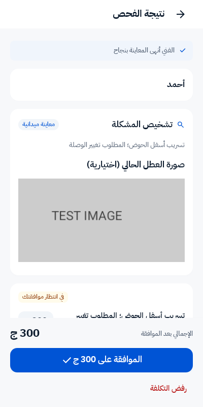

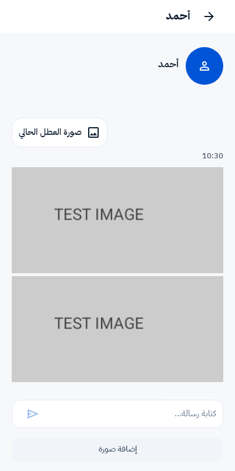

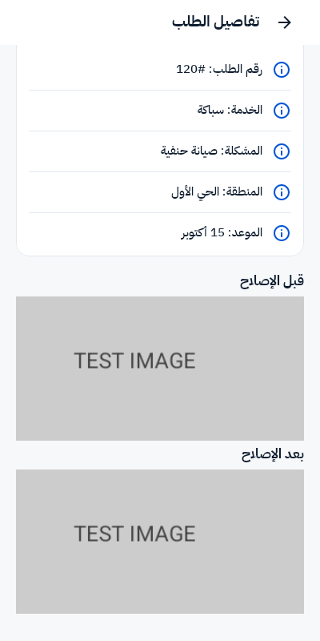

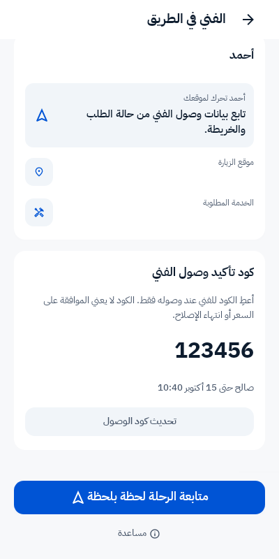

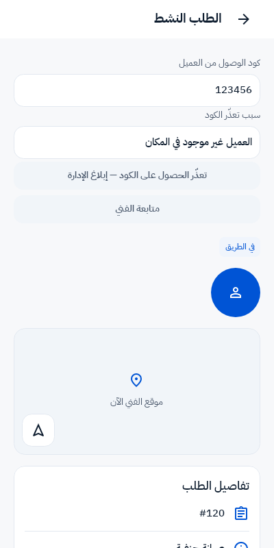

**التحقق:** 96 اختبار خادم مختلفًا نجحت في مجموعة موحّدة؛ أُعيدت اختبارات صفحات السياسة بعد إكمال عرض الصفحات المرتبطة. وأُعيدت اختبارات كود الوصول الخمسة بعد ضمان استمرار استثناء الإدارة للطلبات المحفوظة بوضع الموظفين عند تغيير وضع التشغيل لاحقًا، ونجحت. نجح 18 اختبار Android و83 اختبار Swift Core، وبناء APK Debug وفحوص الموارد والتصميم والتنسيق وصياغة SwiftUI. طُبّقت migration كود الوصول محليًا. لم يُجرَ بناء Xcode أو اختبار أجهزة أو GPS أو Push فعلي، ولم تُستبدل الصور المرجعية المعتمدة للاختبارات.

[أدلة التنفيذ](validation/staff-gaps-evidence.json) · [اختبارات الخادم](validation/staff-gaps-backend-tests.json) · [اختبارات السياسات](validation/staff-gaps-policy-tests.json) · [إعادة تحقق كود الوصول](validation/staff-gaps-arrival-recheck-tests.json) · [Android](validation/staff-gaps-android-tests.log) · [Swift Core](validation/staff-gaps-swift-tests.log) · [الشروط من HTTP المحلي](validation/staff-gaps-terms-current.json) · [APK Debug](../../androidapp/app/build/outputs/apk/debug/app-debug.apk).

## ترتيب الاستكمال المقترح لإطلاق الموظفين فقط

1. إعداد PHP-FPM عولج والتحقق من صفحات السياسة عبر اسم الموقع نجح. التالي اختبار صور المحادثة والمقترح وإثبات الخدمة وكود الوصول واستثناء الإدارة على الأجهزة.
2. مراجعة الفنيين الموظفين والتخصصات والمناطق والتوفر ودليل المصنعية وصلاحيات التعيين وإعادة التعيين؛ إدخال بيانات مستلم إنستاباي الفعلية من اللوحة.
3. استكمال صور الأشخاص في رحلة الموظفين P05، وتجربة الطلب والتعيين والمعاينة وقرار السعر والإضافات والدفع والتقييم والضمان والغياب وانتهاء المهل.
4. قبل الإطلاق: إعداد Firebase/APNs واختبار وصول Push وفتح الطلب الصحيح، وتفعيل Google Routes واختبار التتبع على الأجهزة عند توفر المفاتيح.

**يؤجّل إلى الاستعداد لتشغيل السوق:** عداد اختيار العروض وصور كروتها وقراءة جميع تقييمات الفني وضبط الميزانية والعمولة وقواعد المستقلين وتجربة السوق كاملة. الأنسب والتوفر وإحصاءات الوسوم والمنطقة جاهزة برمجيًا؛ لا يؤدي ذلك إلى تفعيل السوق. يستمر تأجيل فوري والتحقق الإضافي. كود الوصول أصبح ضمن المنفّذ بقرار المالك الجديد.

هذا الترتيب يراعي إجابات المالك ولا يغيّر بقية التأجيلات. ملف الـPRD الأصلي وHTML/PDF المقارنة الأصلية محفوظة للمقارنة؛ نسخة الحالة الحالية تشمل التنفيذ اللاحق.

## تحقق تجهيز الرفع — 15 أكتوبر 2026

كشف فحص المجموعة الكاملة خللًا في تحويل قيم إعدادات كود الوصول عند حفظ لوحة التحكم؛ نُقلت قيود الحقول إلى بناء النموذج، وأضيف تحقق للحفظ والحدود. حُدّث اختبار زيارة الضمان لاستخدام كود الوصول الفعلي، وأُعيد توليد عقد OpenAPI من المسارات والإجراءات الحالية. نجح **415 اختبار خادم، بـ5538 تحققًا، و171 اختبار Android** وبناء APK Debug؛ هذه نتيجة المجموعة الكاملة، ولا تُجمع مع أعداد الدفعات السابقة. [الخادم](validation/release-backend-tests.json) · [تحقق الإصلاحات](validation/release-fixes-tests.json) · [Android والبناء](validation/release-android-tests.log).

## ربط أخطاء التطبيقات والخادم بقناة Slack — 16 أكتوبر 2026

اعتمد المالك قناة `#bremo-errors` في Workspace «General Safwa»، بتنبيه للخطأ الجديد والعائد بعد إصلاحه وتجميع التكرارات، مع ضم Android وiOS وخادم Laravel. حُفظ رابط الاستقبال خارج Git وضُبط في البيئة الخاصة لسيرفر التجربة؛ فحص الكود المعدّل وAPK لم يجد الرابط داخلهما.

**الخادم مفعّل ومختبر على سيرفر التجربة.** يلتقط الربط أحداث السجل بمستوى error فأعلى، بما فيها الاستثناءات التي يسجلها Laravel وأخطاء المهام. الرسالة تتضمن المصدر والبيئة والإصدار ونوع الاستثناء أو رمز الحدث وموضعه وأول ثمانية إطارات من المكدس دون معاملات، ومعرّف المشكلة ووقت UTC. تظهر منصة الهاتف والطراز والنظام وإصدار التطبيق عند إرسالها من النسخة الجديدة؛ البيانات غير المرسلة تظهر «unknown». لا تُرسل نصوص الاستثناء الخام أو SQL أو أجسام الطلبات أو التوكنات أو بيانات العميل؛ الخطأ الأصلي الكامل يبقى في سجل الخادم الخاص.

تُجمع التكرارات تحت بصمة واحدة مع عدّاد محفوظ في cache الملفات؛ لا يحتاج إرسال التنبيه إلى قاعدة البيانات أو طابور المهام. بعد إصلاح مشكلة الخادم، يُسجَّل حلها بالأمر `php artisan errors:resolve ISSUE_ID`، فتُرسل رسالة REGRESSED عند تكرارها. نشر كود جديد وحده لا يسجل المشكلة محلولة. مسح cache الملفات الخاص بالمراقبة يفقد سجل التجميع. الأمر `php artisan errors:slack-test` يرسل رسالة TEST واضحة دون افتعال كراش. فشل Slack يُحتوى ولا يستبدل الخطأ الأصلي؛ مهلة الاتصال والإرسال محدودة.

**Android:** أضيف سياق الشاشة ونوع الاستخدام «عميل/فني» والإصدار والبناء إلى Crashlytics، وتسجيل الأخطاء التقنية الملتقطة بعد إزالة رسائلها وأسبابها الحساسة مع الاحتفاظ بالمكدس. تُستبعد أخطاء التحقق المعتادة والإلغاء وانقطاع الشبكة؛ لا يُعاد تسجيل كائن الخطأ نفسه عند مروره بأكثر من طبقة. أُضيفت بيانات الجهاز والإصدار إلى طلبات API. [نسخة Android للتجربة بعد تجهيز المراقبة](https://dg.dnbscy.com/downloads/bremo-errors-debug.apk).

**iOS:** جُهّز سياق الشاشة ونوع الاستخدام وبيانات الإصدار، وربط أخطاء HTTP 5xx وفشل فك الاستجابات بمراقبة Crashlytics دون نقل محتوى الاستجابة. التفعيل ينتظر ملف `GoogleService-Info.plist` لتطبيق `com.bremo.app`، وقد أجّل المالك توفيره. لم يُجرَ بناء Xcode أو اختبار iPhone.

**Firebase والأجهزة:** أكد المالك في آخر إجابة أنه ما زال يُكمل تكامل Slack وتنبيهات Crashlytics من حسابه في Firebase. نجاح Webhook واختبار Laravel لا يثبت وصول كراش Android أو iOS. رسائل Crashlytics تكون ملخصًا ورابطًا للتقرير الكامل؛ وقد يحتاج الكراش إلى إعادة تشغيل التطبيق والاتصال بالإنترنت قبل رفعه. هذا المسار مستقل عن تأجيل إعداد Push عبر APNs.

**التحقق:** نجح 43 اختبار خادم بـ2316 تحققًا، و86 اختبار Swift Core. نجحت مجموعة اختبارات Android الكاملة وبناء APK، ثم أُعيدت عشرة اختبارات متأثرة بعد آخر تعديل ونجحت. اجتازت ملفات SwiftUI فحص الصياغة، ونجح Pint وفحص فروق Git. قبل Slack اختبار الاتصال من سيرفر التجربة فعلًا؛ بقيت الصحة وتسجيل دخول الإدارة وconfig وcatalog بحالة HTTP 200، وأصبحت أداة الإعداد المؤقتة HTTP 404 بعد حذفها. نسخة APK المنشورة مطابقة للمحلية. حُفظت نسخة احتياطية لملفات الخادم والبيئة قبل التعديل؛ لم تتغير قاعدة البيانات أو مفاتيح تشغيل السوق. نسخة HTML السابقة لا تشمل هذا التحديث.
