# تقرير مقارنة Bremo PRD بالتطبيق الحالي

**التاريخ:** 12 أكتوبر 2026. **النطاق:** PDF من 29 صفحة، كود Laravel وAndroid وiOS، والإعدادات المحلية.
**النتيجة:** تطابق جزئي مع اختلافات في التشغيل وخطوات الطلب والمال وبعض الوظائف والتكاملات.

**للحالة الحالية بعد التعديلات:** [تقرير 14 أكتوبر: الثوابت والفجوات المتبقية في التطبيق والـPRD](CURRENT-STATUS.md). البنود أدناه توثّق المقارنة الأصلية؛ لا تُعتبر جميعها فجوات مفتوحة الآن.

[نسخة PDF](Bremo_PRD_Comparison_AR.pdf) · [نسخة HTML مستقلة مع تكبير الصور](Bremo_PRD_Comparison_AR.html)

## المنهج وحدود الأدلة

- أُعيد توليد 404 لقطة جديدة لـ59 رمز شاشة بواسطة Paparazzi؛ بياناتها fixtures ولا تمثل طلبات حقيقية.
- المقارنة البصرية من Android، ومنطق iOS روجع بالكود دون تشغيل Xcode.
- استُخرجت صور الشاشات الأصلية من PDF؛ قد يحتوي أصل الصورة على جزء يقصّه إطار الهاتف في صفحة المصدر.
- الصور في المقارنات: الـPRD أولًا (يمين في العرض العربي)، ثم التطبيق الحالي. قيم الأمثلة ليست مصدرًا لإثبات الحساب أو الصلاحيات.
- نجحت اختبارات Backend المختارة: 101 اختبار و486 تحققًا. توليد الصور عبر طرق الاختبار الثلاث نجح.
- تحقق اللقطات المعتمدة الأول سجّل فرق C02-verified؛ لم تُقبل اللقطات الجديدة كبديل للـgolden snapshots.
- API المحلي يرجع HTTP 500 ورسالة PHP >=8.4.1؛ لا توجد شهادة تشغيل للرحلة على جهاز أو لبيئة الهاتف الافتراضية.
- لم يُعدّل منطق التطبيق أو إعداداته. مصدر القيم الفعلية: [settings.json](validation/settings.json).

## مسار التشغيل الحالي

C03 اختيار الخدمة ← C37 وصف المشكلة ← C04 المكان والموعد ← C38 الخامات/الميزانية حسب الوضع ← C05 النشر.
انتظار تعيين الإدارة ← تأكيد ← تحرك ← وصول ← معاينة مجانية ← عرض تنفيذ وموافقة ← تنفيذ ← دفع.
الكاش: تأكيد استلام الفني ثم تأكيد العميل. الإلكتروني: التسوية تغلق الطلب مباشرة. رفض معاينة مجانية يغلق دون دفع.

## سجل الاختلافات

| الرمز | البند | الأولوية | النوع |
|---|---|---|---|
| D01 | وضع التشغيل: العروض مقابل تعيين الإدارة | P1 | فرق إعدادات وشرح رحلة |
| D02 | إنشاء الطلب: ثلاث خطوات مقابل خمس | P1 | اختلاف workflow |
| D03 | الخامات والتسعير انتقلا إلى C38 | P2 | اختلاف workflow وخيارات |
| D04 | المعاينة المجانية ونتيجة رفض السعر | P1 | قاعدة مالية وتعارض داخل الملف |
| D05 | مثال خصم المعاينة لا يطابق تعريف السعر في الخادم | P1 | اختلاف تعريف مالي |
| D06 | قرار التكلفة الإضافية لا يُتاح عبر available_actions | P1 | فجوة تنفيذ مستنتجة من الكود |
| D07 | فوري معطّل والربط الحالي محاكي | P1 | فرق إتاحة وتكامل |
| D08 | إنستاباي: الخادم موجود والرحلة على العميل غير مكتملة | P1 | فجوة تنفيذ وإعداد |
| D09 | إغلاق الكاش يختلف عن إغلاق الدفع الإلكتروني | P2 | تفصيل ناقص في مخطط الرحلة |
| D10 | الإلغاء والاعتذار والتعذر ثلاثة مسارات مختلفة | P2 | قيود workflow غير موضحة |
| D11 | استلام مستحقات الفني ليس تحويلًا تلقائيًا | P1 | فرق مالي وتشغيلي |
| D12 | P18: الحساب الأساسي موجود؛ التصدير والفلترة ناقصان | P2 | اختلاف وظائف الواجهة |
| D13 | P17: تقييم العميل بالنجوم فقط | P2 | وظيفة غير منفذة |
| D14 | صور إنهاء العمل في P15 ليست رحلة مكتملة | P2 | وظيفة غير منفذة |
| D15 | C18: شارات غير المقروء وحالة الاتصال | P2 | بيانات واجهة ناقصة أو ثابتة |
| D16 | مشاركة الزيارة: زر ظاهر ومسار الضغط ناقص | P2 | فجوة ربط في التطبيقين |
| D17 | ملف الفني: مؤشرات لا تأتي من بيانات حقيقية | P2 | حدود البيانات |
| D18 | الانتظار والمهلات: مؤشرات ثابتة وعدادات غير ظاهرة | P2 | اختلاف واجهة وحدود بيانات |
| D19 | C25: ثلاث تبويبات بدل تبويبين | P3 | اختلاف واجهة وتنقل |
| D20 | روابط البريد: مدد الصلاحية تختلف | P2 | فرق إعدادات ونصوص |
| D21 | وسائط الطلب: 30 ثانية مقابل 60 ثانية للفيديو | P3 | فرق حدود إدخال |
| D22 | الإشعارات: صندوق التطبيق موجود وPush المحلي log | P1 | فرق إعداد تكامل |
| D23 | وعود الضمان والفاتورة والرد تحتاج سياسة وتنفيذًا | P1 | تعارض داخل الملف ومتطلبات غير مثبتة |
| D24 | صفحة 29 لا تصف الهوية والتنقل الحاليين بدقة | P3 | توثيق قديم |
| D25 | حسابي: الإحصاءات الظاهرة ليست كلها محسوبة بالكامل | P2 | حدود بيانات وفجوة إحصاء |
| D26 | الإغلاق التلقائي: وقت العرض يختلف عن وقت التنفيذ | P1 | اتساق داخلي مستنتج من الكود |

## D01 — وضع التشغيل: العروض مقابل تعيين الإدارة

**الأولوية:** P1 · **التصنيف:** فرق إعدادات وشرح رحلة

**في الملف:** الرحلة الأساسية في ص 2–3 و11 و24–25 تبدأ بعروض الفنيين واختيار العميل. تظهر C36 في ص 12 كمسار بديل.

**الحالي:** الإعداد الفعلي offers_enabled=false؛ الطلبات الجديدة تنتظر تعيين الإدارة، والمعاينة مجانية. مسار العروض موجود لكنه غير مفعّل.

**الأثر:** تختلف نقطة التأكيد، مصدر السعر، إشعارات الفنيين، والشاشات المتاحة للطرفين.

**المعالجة المقترحة:** توثيق وضع الموظفين كمسار الإطلاق الحالي، وفصل مسار السوق المشروط بتفعيل العروض.

**لقطات: C06: العروض — صفحة 11 من الـPRD.**


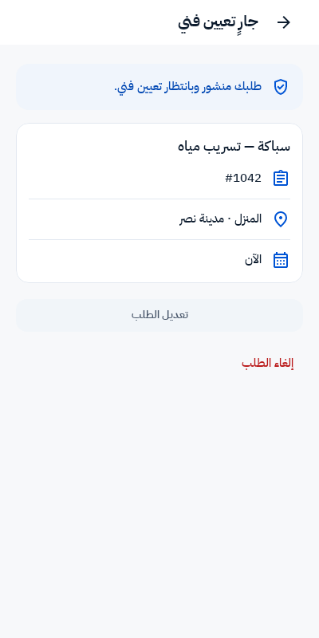

**لقطات: P08: رئيسية الفني — صفحة 24 من الـPRD.**

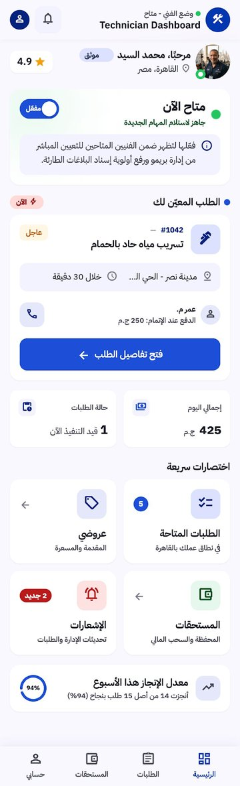

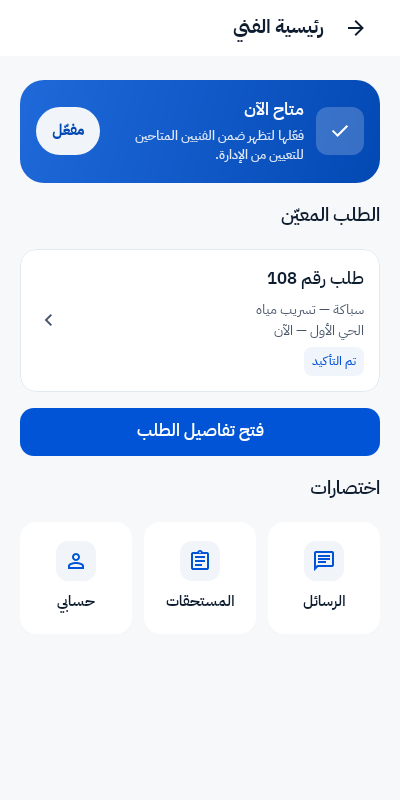

> لقطة C36 هي حالة انتظار التعيين. مثال P08 في الملف نفسه يتضمن طلبًا معيّنًا؛ المشكلة أن الرحلة العامة تخلط الوضعين.

**المصادر:**

- [app/Modules/Settings/Services/FeatureGate.php:21](/var/www/html/bzr.noox.test/app/Modules/Settings/Services/FeatureGate.php:21)
- [app/Modules/Orders/Actions/AssignProviderAction.php:38](/var/www/html/bzr.noox.test/app/Modules/Orders/Actions/AssignProviderAction.php:38)

## D02 — إنشاء الطلب: ثلاث خطوات مقابل خمس

**الأولوية:** P1 · **التصنيف:** اختلاف workflow

**في الملف:** ص 8–10: C03 المشكلة والوسائط، ثم C04 العنوان والموعد والخامات، ثم C05 المراجعة؛ وعد «3 خطوات».

**الحالي:** Android وiOS: C03 اختيار الخدمة، C37 وصف المشكلة، C04 المكان والموعد، C38 الخامات والميزانية، ثم C05.

**الأثر:** الرمز C03 يشير إلى محتوى مختلف، والملف لا يعرض C37 وC38 كخطوتين مستقلتين.

**المعالجة المقترحة:** تحديث مخطط الرحلة وترقيم الخطوات والمراجع الخاصة بالشاشات.

**لقطات: C03 في الملف — صفحة 8 من الـPRD.**

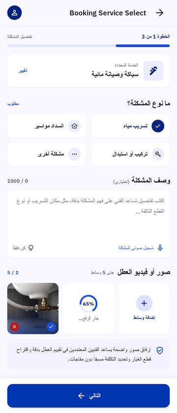

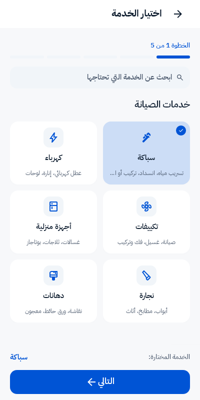

**لقطات: المحتوى انتقل إلى C37 — صفحة 8 من الـPRD.**


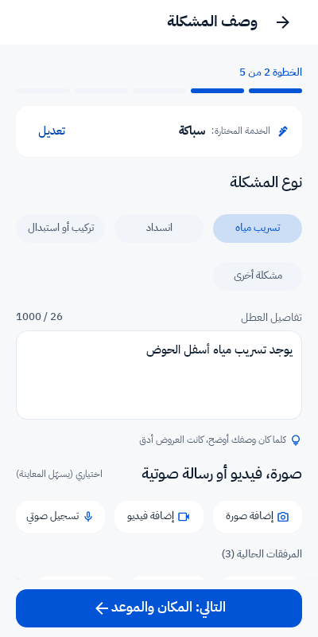

> المقارنة هنا لهيكل الرحلة؛ اختلاف أسماء الأشخاص والمبالغ في اللقطات سببه بيانات الاختبار.

**المصادر:**

- [androidapp/app/src/main/kotlin/noox/bzr/customer/CustomerScreens.kt:9](/var/www/html/bzr.noox.test/androidapp/app/src/main/kotlin/noox/bzr/customer/CustomerScreens.kt:9)
- [iosapp/Core/Sources/BzrCore/CustomerJourney.swift:245](/var/www/html/bzr.noox.test/iosapp/Core/Sources/BzrCore/CustomerJourney.swift:245)

## D03 — الخامات والتسعير انتقلا إلى C38

**الأولوية:** P2 · **التصنيف:** اختلاف workflow وخيارات

**في الملف:** C04 في ص 9 تجمع الموعد والخامات والتسعير، وتعرض خيارين للخامات.

**الحالي:** C04 للمكان والموعد. C38 للخامات، بثلاثة خيارات بينها «الفني يحدد المطلوب بعد المعاينة». التسعير والميزانية يظهران في وضع السوق فقط.

**الأثر:** تختلف شاشة إدخال البيانات، وهناك اختيار أعمال إضافي غير موضح في الملف.

**المعالجة المقترحة:** إضافة C38 والخيار الثالث، وشرح أن EXECUTION وINSPECTION كلاهما يستقبل عروضًا في وضع السوق.

**لقطات: C04: الخامات والتسعير — صفحة 9 من الـPRD.**

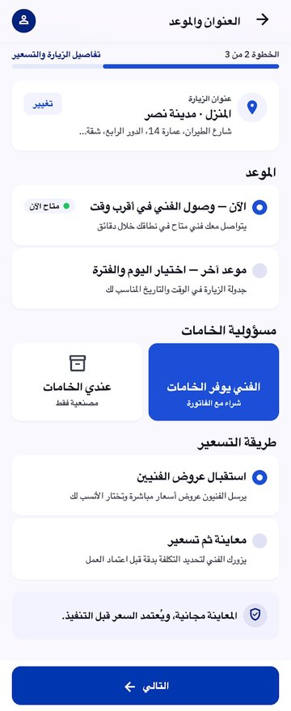

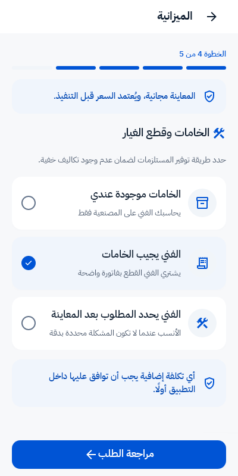

**لقطات: C04 الحالية: الموعد فقط — صفحة 9 من الـPRD.**


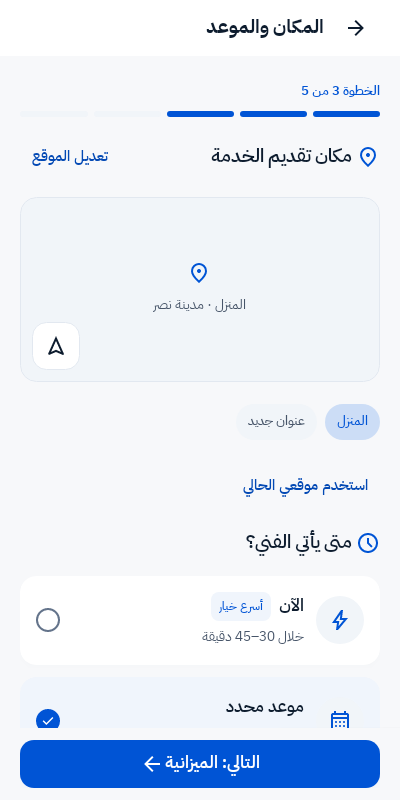

**المصادر:**

- [app/Modules/Orders/Enums/MaterialsResponsibility.php:13](/var/www/html/bzr.noox.test/app/Modules/Orders/Enums/MaterialsResponsibility.php:13)
- [androidapp/app/src/main/kotlin/noox/bzr/customer/CustomerViewModel.kt:772](/var/www/html/bzr.noox.test/androidapp/app/src/main/kotlin/noox/bzr/customer/CustomerViewModel.kt:772)

## D04 — المعاينة المجانية ونتيجة رفض السعر

**الأولوية:** P1 · **التصنيف:** قاعدة مالية وتعارض داخل الملف

**في الملف:** ص 4 تقول إن الرفض لا يكلّف شيئًا. C04 تصف المعاينة بأنها مجانية، بينما C06/C08 تعرض رسومًا مثل 75 جنيه.

**الحالي:** الإعداد الحالي: معاينة مجانية؛ رفض عرض التنفيذ يغلق الطلب بمبلغ صفر. عند وجود رسوم معاينة مدفوعة، يبقى استحقاق الرسوم وحدها.

**الأثر:** وعد الرفض المجاني لا يصلح كقاعدة عامة لكل أوضاع التشغيل.

**المعالجة المقترحة:** كتابة نتيجة الرفض بحسب مجانية المعاينة، وتوضيح النتيجة نفسها عند انتهاء مهلة القرار.

**لقطات: C08: رسوم المعاينة — صفحة 11 من الـPRD.**


> في وضع السوق يمكن أن تكون المعاينة مجانية أيضًا؛ الاستحقاق يعتمد على وجود رسوم فعلية، وليس اسم الوضع وحده.

**المصادر:**

- [app/Modules/Pricing/Actions/DecideProposalAction.php:80](/var/www/html/bzr.noox.test/app/Modules/Pricing/Actions/DecideProposalAction.php:80)
- [app/Modules/Orders/Actions/CompleteInspectionOnlyAction.php:23](/var/www/html/bzr.noox.test/app/Modules/Orders/Actions/CompleteInspectionOnlyAction.php:23)

## D05 — مثال خصم المعاينة لا يطابق تعريف السعر في الخادم

**قرار 14 أكتوبر 2026 — إجابة الشات 19:** أُقر تعريف الحساب الحالي: عرض التنفيذ يشمل رسوم المعاينة القابلة للخصم؛ 380 جنيهًا عرض تنفيذ +120 جنيهًا خامات =500 جنيه، دون خصم 75 مرة أخرى. يُثبت القرار في التقرير، ويظل ملف الـPRD الأصلي محفوظًا للمقارنة.

**الأولوية:** P1 · **التصنيف:** اختلاف تعريف مالي

**في الملف:** ص 4 و15 تعرض 380 مصنعية +120 خامات −75 معاينة =425، مع عرض الخصم كسطر مستقل.

**الحالي:** إذا كان عرض التنفيذ 380 والرسوم قابلة للخصم، OrderAmounts يعتبر عرض التنفيذ شاملًا لها؛ الناتج مع خامات 120 هو 500. إذا لم تُخصم، تُضاف الرسوم.

**الأثر:** تطبيق المثال حرفيًا قد يؤدي إلى خصم الرسوم مرتين، أو تعريف مختلف لمبلغ عرض التنفيذ.

**المعالجة المقترحة:** تحديد هل قيمة عرض التنفيذ قبل الخصم أم شاملة له، ثم توحيد مثال العميل والفني والحساب.

**لقطات: C21: المثال المالي — صفحة 15 من الـPRD.**

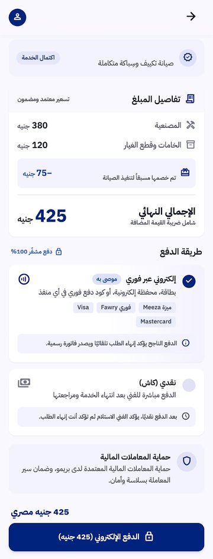

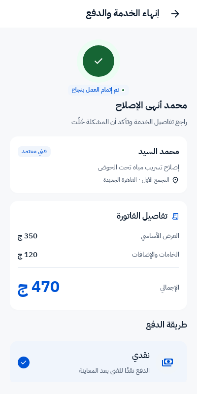

> أرقام لقطة التطبيق بيانات اختبار مختلفة؛ إثبات الفرق الحسابي من الكود، وليس مقارنة مبالغ طلبين مختلفين.

**المصادر:**

- [app/Modules/Pricing/Services/OrderAmounts.php:72](/var/www/html/bzr.noox.test/app/Modules/Pricing/Services/OrderAmounts.php:72)

```text
    private static function laborBase(Order $order, mixed $quote): string
    {
        $offer = $order->acceptedOffer;

        if ($order->pricing_mode === PricingMode::Execution) {
            return self::money($offer?->price);
        }

        $fee = self::money($offer?->price);

        if ($quote === null) {
            return $fee;
        }

        // في وضع الموظفين الرسوم صفر، فالنتيجة هي عرض التنفيذ وحده مهما كانت قيمة الخصم.
        return $offer?->inspection_fee_deductible
            ? self::money($quote)
            : bcadd(self::money($quote), $fee, 2);
    }

    /** BR-056 — طلب بمبلغ صفر يُغلق مباشرة بلا مرور بـ AWAITING_PAYMENT. */
    public function isZero(): bool
```

## D06 — قرار التكلفة الإضافية لا يُتاح عبر available_actions

**الأولوية:** P1 · **التصنيف:** فجوة تنفيذ مستنتجة من الكود

**في الملف:** C31 في ص 14 تتيح قبول أو رفض أي تكلفة إضافية قبل تنفيذها.

**الحالي:** مقترحات MATERIALS وEXTRA_WORK تُقدَّم أثناء IN_PROGRESS، لكن إجراءات قرار العميل تُضاف عبر انتقالات عرض التنفيذ الأول، المسموحة فقط في AWAITING_QUOTE_APPROVAL.

**الأثر:** الواجهتان تعتمدان على الإجراءات لإتاحة القرار؛ قد لا يستطيع العميل حسم المقترح، ولا يستطيع الفني إنهاء العمل ما دام معلّقًا.

**المعالجة المقترحة:** إتاحة قرار المقترحات الإضافية دون تغيير حالة الطلب، وإضافة اختبار API لتلك الإجراءات ثم اختبار الرحلة على الجهاز.

**لقطات: C31: قرار العميل — صفحة 14 من الـPRD.**

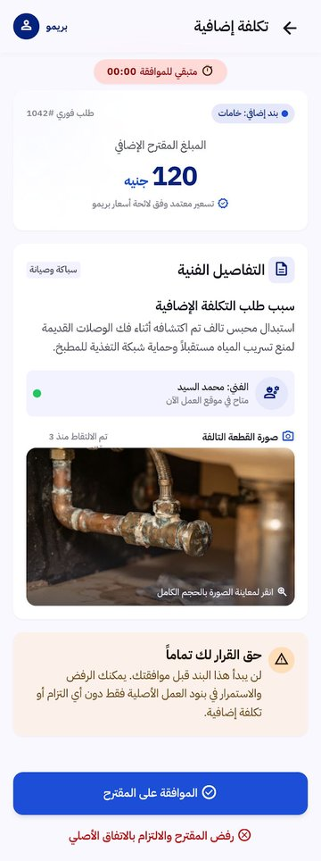

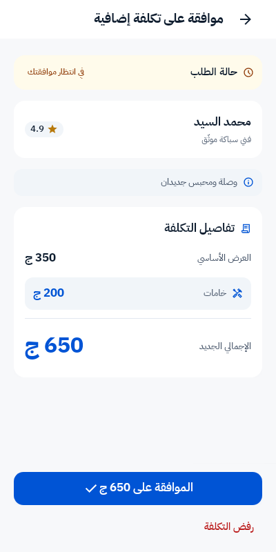

> لقطة الاختبار تعطي الواجهة إجراءات الموافقة عمدًا، ولذلك تظهر الأزرار. لا تثبت أن API الحقيقي يُرجعها. النتيجة هنا تحليل كود، وليست إعادة إنتاج على جهاز.

**المصادر:**

- [app/Modules/Orders/Services/OrderPresentation.php:189](/var/www/html/bzr.noox.test/app/Modules/Orders/Services/OrderPresentation.php:189)
- [app/Modules/Orders/StateMachine/TransitionTable.php:41](/var/www/html/bzr.noox.test/app/Modules/Orders/StateMachine/TransitionTable.php:41)
- [androidapp/app/src/main/kotlin/noox/bzr/customer/CustomerLogic.kt:833](/var/www/html/bzr.noox.test/androidapp/app/src/main/kotlin/noox/bzr/customer/CustomerLogic.kt:833)

```text
        if ($order->pendingProposalRecord !== null) {
            if ($this->stateMachine->can($order, 'approveExecutionQuote', ActorType::Customer)) {
                $actions[] = 'approve_proposal';
            }
            if ($this->stateMachine->can($order, 'rejectExecutionQuote', ActorType::Customer)) {
                $actions[] = 'reject_proposal';
            }
        }
```

```text
            new Transition('T-14', 'approveExecutionQuote', [S::AwaitingQuoteApproval], S::InProgress, [$C], E::ProposalApproved),
            new Transition('T-15', 'rejectExecutionQuote', [S::AwaitingQuoteApproval], S::AwaitingPayment, [$C, $Y], E::ProposalRejected, note: 'رسوم المعاينة > 0'),
```

## D07 — فوري معطّل والربط الحالي محاكي

**الأولوية:** P1 · **التصنيف:** فرق إتاحة وتكامل

**في الملف:** ص 15 تعرض دفعًا فعليًا ببطاقة أو محفظة أو كود فوري، وكودًا صالحًا 48 ساعة.

**الحالي:** channel_fawry_enabled=false وdriver=staging. الربط الحقيقي محجوب صراحة في AppServiceProvider. المحاكي يصدر صلاحية 24 ساعة.

**الأثر:** وجود C22 لا يعني أن الأموال يمكن تحصيلها فعليًا عبر فوري، ولا يكفي تفعيل المفتاح وحده.

**المعالجة المقترحة:** تحديد متطلبات الربط الحقيقي واختباره، وتصحيح مدة الكود إلى السياسة المعتمدة.

**لقطات: C22: طرق فوري — صفحة 15 من الـPRD.**


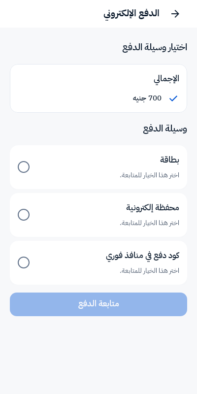

**لقطات: C22: كود الدفع — صفحة 15 من الـPRD.**

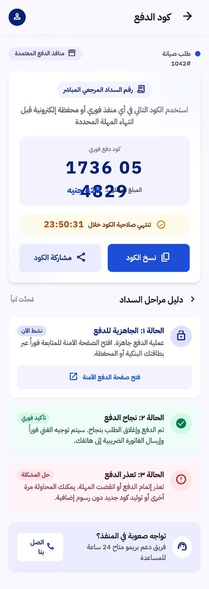

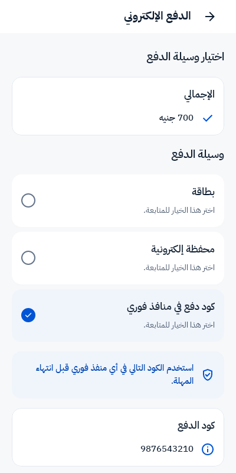

> لقطة التطبيق تُظهر قدرة الواجهة مع fixtures، لا قناة مفعّلة أو عملية تحصيل حقيقية.

**المصادر:**

- [app/Providers/AppServiceProvider.php:37](/var/www/html/bzr.noox.test/app/Providers/AppServiceProvider.php:37)
- [app/Modules/Payments/Services/StagingPaymentGateway.php:31](/var/www/html/bzr.noox.test/app/Modules/Payments/Services/StagingPaymentGateway.php:31)

## D08 — إنستاباي: الخادم موجود والرحلة على العميل غير مكتملة

**الأولوية:** P1 · **التصنيف:** فجوة تنفيذ وإعداد

**في الملف:** الرحلة الأساسية تذكر كاش وفوري. ص 29 تشير إلى شاشة انتظار تأكيد التحويل دون رسم دورة التحويل كاملة.

**الحالي:** الخادم يدعم إرسال المرجع وإيصال اختياري ثم اعتماد المدير العام. المفتاح true، لكن عنوان الاستقبال null فيمنع إتاحة القناة. لا توجد رحلة إرسال متكاملة في العميلين.

**الأثر:** المتاح فعليًا بالإعدادات المحلية هو الكاش. إضافة نص حالة انتظار وحده لا تكمل الدفع بإنستاباي.

**المعالجة المقترحة:** ضبط عنوان الاستقبال، وتنفيذ اختيار القناة والمرجع والإيصال والإرسال والانتظار والرفض وإعادة المحاولة.

**لقطات: C22 في الملف — صفحة 15 من الـPRD.**


> القول إن إنستاباي مفعّل فعليًا غير دقيق قبل ضبط العنوان. توفر إنستاباي لاستلام مستحقات الفني في P06 مسار مختلف.

**المصادر:**

- [app/Modules/Payments/Services/PaymentChannels.php:20](/var/www/html/bzr.noox.test/app/Modules/Payments/Services/PaymentChannels.php:20)
- [app/Modules/Payments/Actions/SubmitInstapayTransferAction.php:34](/var/www/html/bzr.noox.test/app/Modules/Payments/Actions/SubmitInstapayTransferAction.php:34)
- [androidapp/app/src/main/kotlin/noox/bzr/customer/CustomerFragments.kt:260](/var/www/html/bzr.noox.test/androidapp/app/src/main/kotlin/noox/bzr/customer/CustomerFragments.kt:260)

## D09 — إغلاق الكاش يختلف عن إغلاق الدفع الإلكتروني

**الأولوية:** P2 · **التصنيف:** تفصيل ناقص في مخطط الرحلة

**في الملف:** الرسم العام في ص 3 يسرد الدفع ثم تأكيد الإنهاء. نص C21 نفسه يذكر أن النجاح الإلكتروني يُنهي الطلب تلقائيًا.

**الحالي:** الكاش: تأكيد استلام الفني ثم AWAITING_CONFIRMATION ثم تأكيد العميل. الإلكتروني: التسوية تنقل الطلب مباشرة إلى CLOSED.

**الأثر:** المخطط المختصر قد يجعل C23 خطوة إجبارية رغم أن نص الملف والخادم يفرّقان بين المسارين.

**المعالجة المقترحة:** رسم فرعين للدفع، مع مسار إغلاق المعاينة المجانية دون دفع.

**لقطات: C23: تأكيد الإنهاء — صفحة 16 من الـPRD.**


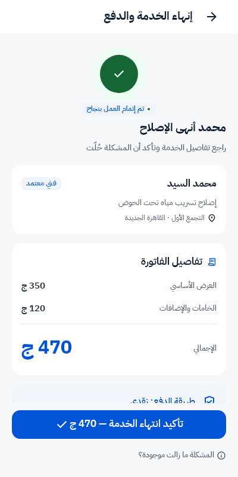

> هذا نقص في رسم الفروع، وليس تعارضًا كاملًا: الملف يذكر السلوك الصحيح في نص شاشة الدفع.

**المصادر:**

- [app/Modules/Orders/StateMachine/TransitionTable.php:46](/var/www/html/bzr.noox.test/app/Modules/Orders/StateMachine/TransitionTable.php:46)

## D10 — الإلغاء والاعتذار والتعذر ثلاثة مسارات مختلفة

**الأولوية:** P2 · **التصنيف:** قيود workflow غير موضحة

**في الملف:** C20 في ص 14 تعرض الإلغاء، وP21 في ص 27 توحي بإلغاء أو تعليق المهمة عند تعذّر التنفيذ.

**الحالي:** العميل يلغي حتى ON_THE_WAY فقط؛ بعد الوصول يفتح مشكلة. اعتذار الفني قبل الوصول يعيد الطلب إلى OPEN. التعذر عند الوصول أو التنفيذ يلغي بلا مبلغ؛ لا حالة تعليق مستقلة.

**الأثر:** اختيار الإجراء الخاطئ يغيّر مصير الطلب: إعادة توزيع، أو نزاع، أو إلغاء نهائي.

**المعالجة المقترحة:** توثيق الصلاحيات والنتيجة والمرحلة المسموحة لكل إجراء، وفصلها في مخطط الحالات.

**لقطات: C20: الإلغاء — صفحة 14 من الـPRD.**


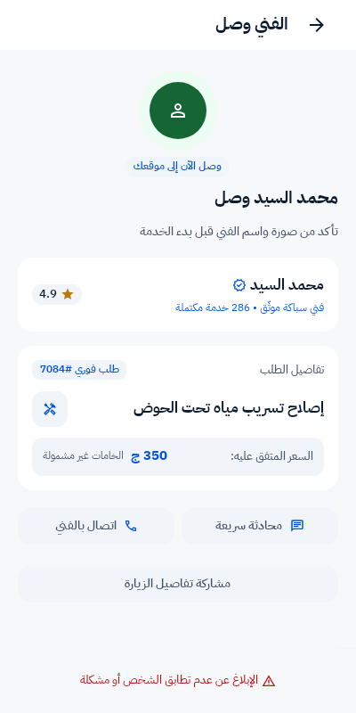

**لقطات: P21: تعذر التنفيذ — صفحة 27 من الـPRD.**

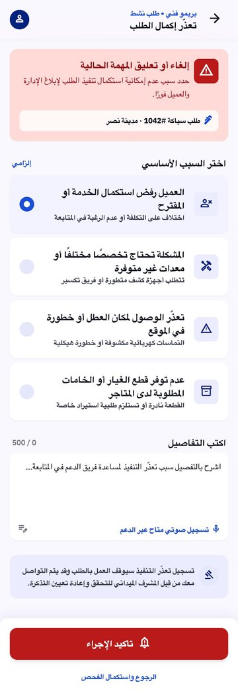

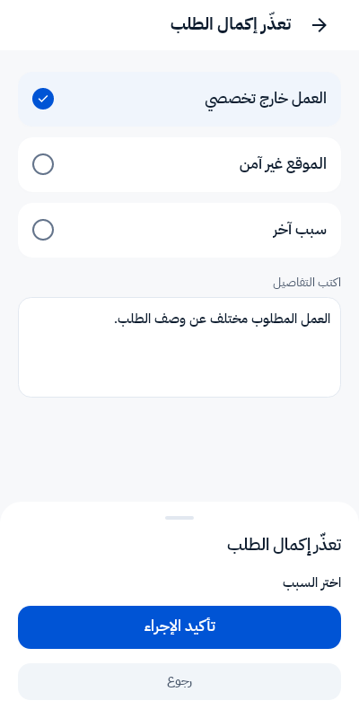

**المصادر:**

- [app/Modules/Orders/Actions/CancelOrderAction.php:57](/var/www/html/bzr.noox.test/app/Modules/Orders/Actions/CancelOrderAction.php:57)
- [app/Modules/Orders/Actions/BackOutAction.php:22](/var/www/html/bzr.noox.test/app/Modules/Orders/Actions/BackOutAction.php:22)
- [app/Modules/Orders/Actions/ReportUnableAction.php:21](/var/www/html/bzr.noox.test/app/Modules/Orders/Actions/ReportUnableAction.php:21)

## D11 — استلام مستحقات الفني ليس تحويلًا تلقائيًا

**قرار 14 أكتوبر 2026 — إجابة الشات 20:** التسوية أسبوعية مع تسجيل التحويل يدويًا من المدير العام ضمن الرصيد المتاح، وتوريد نقدية الموظفين يومي. وعد التحويل الفوري الوارد في الـPRD مستبعد من نطاق الإصدار؛ لا يُستدل على تحويل آلي من تسجيل وسيلة الاستلام.

**الأولوية:** P1 · **التصنيف:** فرق مالي وتشغيلي

**في الملف:** P06 في ص 23 تعد بتحويل تلقائي فوري إلى المحفظة بعد إتمام العملية.

**الحالي:** PayoutMethod يخزن طريقة الاستلام. التحويلات تسجل يدويًا بواسطة المدير العام، بما لا يتجاوز الرصيد المتاح؛ إعداد دورة التحويل أسبوعي والتوريد النقدي للموظف يومي.

**الأثر:** اختيار محفظة لا يشغّل تحويلًا ماليًا آليًا ولا يضمن زمن التحويل المذكور.

**المعالجة المقترحة:** تعديل الوعد إلى سياسة التسوية الحالية، أو تنفيذ تكامل تحويل مستقل إذا كان الفوري مطلبًا جديدًا.

**لقطات: P06: طريقة الاستلام — صفحة 23 من الـPRD.**


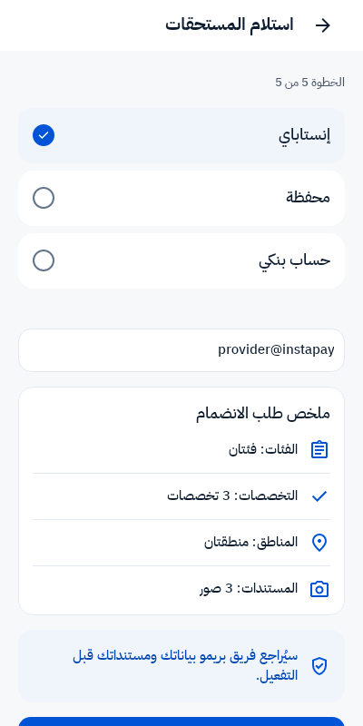

**المصادر:**

- [app/Modules/Settlements/Actions/RecordProviderPayoutAction.php:19](/var/www/html/bzr.noox.test/app/Modules/Settlements/Actions/RecordProviderPayoutAction.php:19)
- [app/Modules/Settlements/Actions/RecordGuard.php:15](/var/www/html/bzr.noox.test/app/Modules/Settlements/Actions/RecordGuard.php:15)

## D12 — P18: الحساب الأساسي موجود؛ التصدير والفلترة ناقصان

**الأولوية:** P2 · **التصنيف:** اختلاف وظائف الواجهة

**في الملف:** P18 في ص 28 تعرض الرصيد والمعلّق والمتاح وسجل الحركات، وزر كشف حساب وفلترة.

**الحالي:** الحساب والسجل موجودان؛ في وضع الموظفين السالب توريد والموجب خامات، وهو معنى مذكور في صورة الملف أيضًا. لا يوجد تنفيذ ظاهر للتصدير أو أدوات الفلترة المعروضة.

**الأثر:** لا يصح تصنيف P18 كلها كاختلاف بين السوق والموظفين. النقص المحدد هو أدوات إضافية وشرح الحساب لكل وضع.

**المعالجة المقترحة:** توثيق حساب الموظفين والسوق منفصلين، واعتماد أو حذف وظائف كشف الحساب والفلترة.

**لقطات: P18: المستحقات — صفحة 28 من الـPRD.**

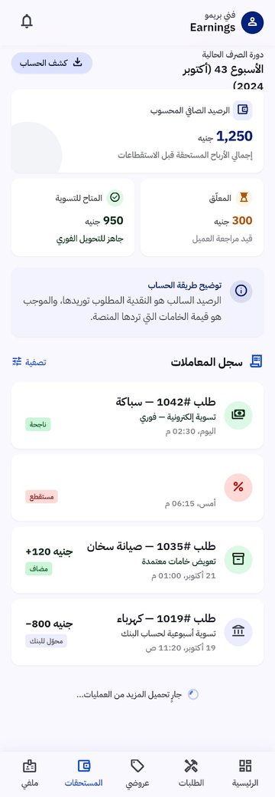

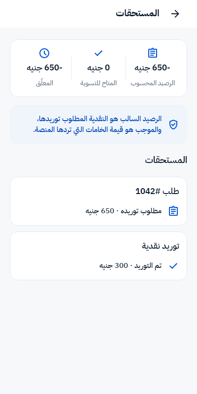

> اختلاف الرصيد الموجب والسالب في الصورتين يعكس معاملات fixtures مختلفة؛ ليس خطأً حسابيًا مثبتًا.

**المصادر:**

- [app/Modules/Settlements/Services/ProviderEarningsService.php:78](/var/www/html/bzr.noox.test/app/Modules/Settlements/Services/ProviderEarningsService.php:78)
- [androidapp/app/src/main/kotlin/noox/bzr/provider/P18EarningsView.kt:15](/var/www/html/bzr.noox.test/androidapp/app/src/main/kotlin/noox/bzr/provider/P18EarningsView.kt:15)

## D13 — P17: تقييم العميل بالنجوم فقط

**الأولوية:** P2 · **التصنيف:** وظيفة غير منفذة

**في الملف:** ص 28: نجوم، وسوم مثل تعاون ممتاز، وتعليق اختياري حتى 300 حرف.

**الحالي:** API وAndroid وiOS يدعمون stars فقط لتقييم العميل. شرط الإغلاق والنافذة ومرة واحدة موجود.

**الأثر:** الوسوم والتعليق الظاهران في التصميم لن يُحفظا أو يُرسلا حاليًا.

**المعالجة المقترحة:** إضافة الحقول إلى العقد والتخزين والواجهتين، أو إزالة العناصر من التصميم.

**لقطات: P17: تقييم العميل — صفحة 28 من الـPRD.**


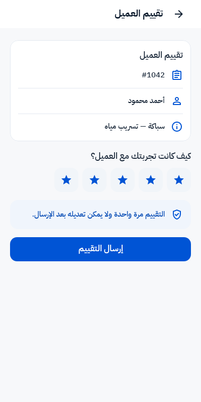

**المصادر:**

- [app/Http/Api/V1/Controllers/RatingController.php:43](/var/www/html/bzr.noox.test/app/Http/Api/V1/Controllers/RatingController.php:43)
- [app/Modules/Reviews/Actions/CreateCustomerRatingAction.php:22](/var/www/html/bzr.noox.test/app/Modules/Reviews/Actions/CreateCustomerRatingAction.php:22)

## D14 — صور إنهاء العمل في P15 ليست رحلة مكتملة

**الأولوية:** P2 · **التصنيف:** وظيفة غير منفذة

**في الملف:** ص 27 تعرض قسم صور الفحص والإصلاح وإضافة صورة أثناء تنفيذ الطلب.

**الحالي:** تقديم مقترح سعر يدعم صورة؛ إنهاء العمل لا يتضمن رحلة رفع وتثبيت صور قبل/بعد أو صور إثبات الإنجاز.

**الأثر:** إرفاق صورة للمقترح لا يحقق توثيق الإنجاز الذي توحي به الشاشة.

**المعالجة المقترحة:** تحديد وقت الرفع وملكية الملفات وظهورها للعميل، ثم إضافة المسار أو استبعاده من النسخة الحالية.

**لقطات: P15: الصور أثناء التنفيذ — صفحة 27 من الـPRD.**

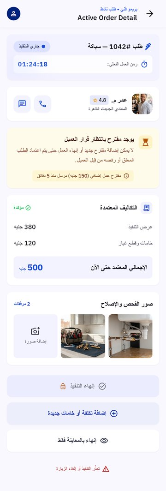

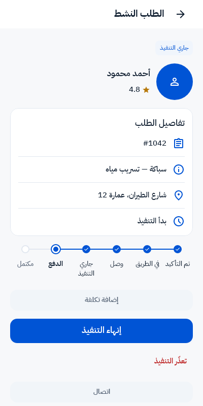

**المصادر:**

- [app/Http/Api/V1/Controllers/ProviderOrderController.php:279](/var/www/html/bzr.noox.test/app/Http/Api/V1/Controllers/ProviderOrderController.php:279)
- [androidapp/app/src/main/kotlin/noox/bzr/provider/ProviderViewModel.kt:438](/var/www/html/bzr.noox.test/androidapp/app/src/main/kotlin/noox/bzr/provider/ProviderViewModel.kt:438)

## D15 — C18: شارات غير المقروء وحالة الاتصال

**الأولوية:** P2 · **التصنيف:** بيانات واجهة ناقصة أو ثابتة

**في الملف:** ص 19 تعرض عدد رسائل غير مقروءة على المحادثة ونقطة حالة اتصال.

**الحالي:** قائمة المحادثات لا تعيد unread_count، والشارات العددية غير منفذة. بعض نقاط الحالة في الواجهة ثابتة وليست حضورًا لحظيًا.

**الأثر:** لا يمكن تفسير النقطة كفني متصل الآن أو الشارة كعدد حقيقي دون مصدر بيانات.

**المعالجة المقترحة:** توفير عداد قراءة حقيقي، وتسميـة حالة التوفر بوضوح إذا استُخدم available_now بدل الحضور.

**لقطات: C18: الرسائل — صفحة 19 من الـPRD.**


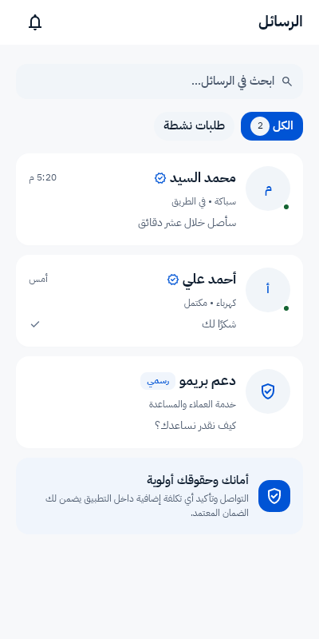

**المصادر:**

- [app/Http/Api/V1/Controllers/ConversationController.php:18](/var/www/html/bzr.noox.test/app/Http/Api/V1/Controllers/ConversationController.php:18)
- [androidapp/app/src/main/kotlin/noox/bzr/customer/C18MessagesView.kt:78](/var/www/html/bzr.noox.test/androidapp/app/src/main/kotlin/noox/bzr/customer/C18MessagesView.kt:78)

## D16 — مشاركة الزيارة: زر ظاهر ومسار الضغط ناقص

**الأولوية:** P2 · **التصنيف:** فجوة ربط في التطبيقين

**في الملف:** الملف لا يرسم دورة إنشاء رابط الزيارة ومشاركته وصلاحيته، رغم تضمين المتابعة والتواصل.

**الحالي:** الخادم يتيح share_visit، والزر ظاهر في التتبع. معالجات الضغط الحالية في Android وiOS لا تحتوي تنفيذًا له.

**الأثر:** ضغط المستخدم على الزر لا يكمل وظيفة المشاركة.

**المعالجة المقترحة:** ربط إنشاء الرابط بواجهة مشاركة النظام، وتوثيق المعلومات المسموح نشرها وصلاحية الرابط.

**لقطات: C09: متابعة الزيارة — صفحة 13 من الـPRD.**

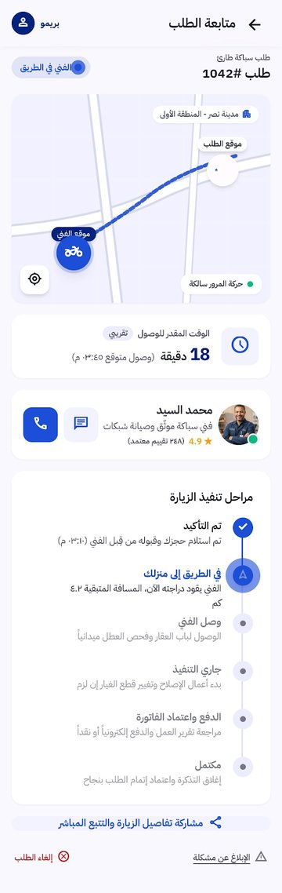

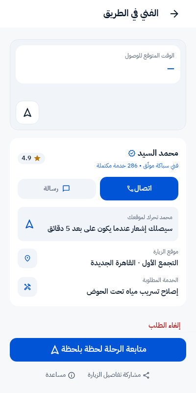

> الزر في صورة التطبيق يثبت وجود العنصر فقط؛ عدم اكتمال الضغط مُستنتج من معالج الإجراء.

**المصادر:**

- [androidapp/app/src/main/kotlin/noox/bzr/customer/CustomerFragments.kt:260](/var/www/html/bzr.noox.test/androidapp/app/src/main/kotlin/noox/bzr/customer/CustomerFragments.kt:260)
- [iosapp/BzrApp/Customer/CustomerJourneyRoot.swift:282](/var/www/html/bzr.noox.test/iosapp/BzrApp/Customer/CustomerJourneyRoot.swift:282)

```text
class C09TrackingFragment : CustomerFragment<C09TrackingView>(R.id.scr_c09) {
    private var mapController: NativeGoogleMapController? = null

    override fun create() = C09TrackingView(requireContext())
    override fun C09TrackingView.bind() {
        onAction = { action ->
            when (action) {
                "cancel" -> viewModel.openCancellation()
                "approve_proposal", "reject_proposal" -> viewModel.loadPendingProposal()
                "change_payment_method", "pay_electronic" -> viewModel.loadPaymentSummary()
                "confirm_completion" -> viewModel.loadCompletionSummary()
                "rate" -> viewModel.openRating()
                "open_dispute" -> viewModel.openDispute()
                "report_provider" -> viewModel.openProviderReport()
                "chat" -> viewModel.openCurrentOrderChat()
                "call" -> viewModel.currentProviderPhone()?.let { phone ->
                    val intent = android.content.Intent(android.content.Intent.ACTION_DIAL, android.net.Uri.parse("tel:$phone"))
                    if (intent.resolveActivity(requireContext().packageManager) != null) startActivity(intent)
                }
                "refresh" -> viewModel.openOrder()
                "help" -> viewModel.loadHelp()
            }
        }
    }

    override fun onViewCreated(view: View, savedInstanceState: Bundle?) {
        super.onViewCreated(view, savedInstanceState)
        val controller = NativeGoogleMapController(requireContext(), selectable = false)
        mapController = controller
        viewLifecycleOwner.lifecycle.addObserver(controller)
```

```text
    private var tracking: some View {
        C09TrackingView(
            state: viewModel.state,
            tracking: viewModel.trackingPayload,
            destinationLatitude: viewModel.orderDestinationLatitude,
            destinationLongitude: viewModel.orderDestinationLongitude,
            onRefreshTracking: viewModel.refreshTracking
        ) { action in
            if action == "cancel" {
                viewModel.openCancellation()
            } else if ["approve_proposal", "reject_proposal"].contains(action) {
                Task { await viewModel.loadPendingProposal() }
            } else if ["change_payment_method", "pay_electronic"].contains(action) {
                Task { await viewModel.loadPaymentSummary() }
            } else if action == "confirm_completion" {
                Task { await viewModel.loadCompletionSummary() }
            } else if action == "rate" {
                viewModel.openRating()
            } else if action == "open_dispute" {
                Task { await viewModel.openDispute() }
            } else if action == "report_provider" {
                viewModel.openProviderReport()
            } else if action == "chat" {
                Task { await viewModel.openCurrentOrderChat() }
            } else if action == "call", let phone = viewModel.currentProviderPhone, let url = URL(string: "tel:\(phone)") {
                openURL(url)
            } else if action == "refresh" {
                Task { await viewModel.openCurrentOrder() }
            } else if action == "help" {
                Task { await viewModel.loadHelp() }
            }
        }
    }

    private var electronicPayment: some View {
```

## D17 — ملف الفني: مؤشرات لا تأتي من بيانات حقيقية

**الأولوية:** P2 · **التصنيف:** حدود البيانات

**في الملف:** C07 في ص 11 تعرض متوسط رد 10 دقائق، بيانات تحقق تفصيلية وصور أعمال وأشخاص.

**الحالي:** الهوية موثقة على مستوى is_verified، لكن بعض تفاصيل التحقق ومتوسط الرد قيم عرض ثابتة. الصور في عدد من المكونات تظهر كحرف أو رمز رغم وجود روابط.

**الأثر:** قد تبدو القيم الثابتة إحصاءات فعلية أو مستويات تحقق منفصلة.

**المعالجة المقترحة:** إظهار البيانات المتاحة فقط، وحساب زمن الرد، وربط تحميل الصور؛ مراجعة نصوص التحقق غير المدعومة.

**لقطات: C07: ملف الفني — صفحة 11 من الـPRD.**


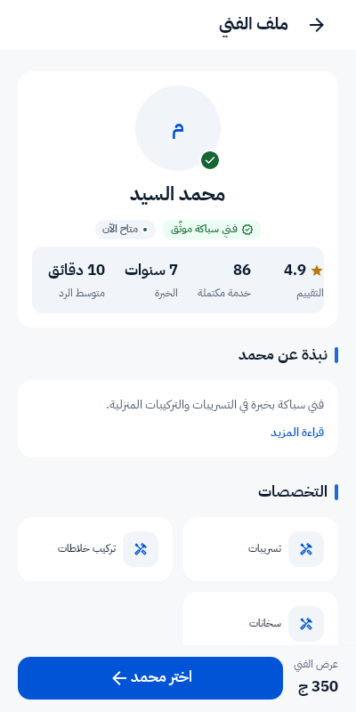

**المصادر:**

- [androidapp/app/src/main/kotlin/noox/bzr/customer/C07ProviderView.kt:65](/var/www/html/bzr.noox.test/androidapp/app/src/main/kotlin/noox/bzr/customer/C07ProviderView.kt:65)
- [reports/batch-figma-a/BACKEND-NOTES.md:29](/var/www/html/bzr.noox.test/reports/batch-figma-a/BACKEND-NOTES.md:29)

## D18 — الانتظار والمهلات: مؤشرات ثابتة وعدادات غير ظاهرة

**الأولوية:** P2 · **التصنيف:** اختلاف واجهة وحدود بيانات

**في الملف:** ص 11 تعرض عداد اختيار العرض، وص 13–14 تعرض عداد قرار السعر، وص 12 تعرض عدد الفنيين الذين وصلهم الطلب ونطاقًا جغرافيًا.

**الحالي:** المهل في الخادم موجودة، لكن العدادات غير ظاهرة في C06 وC30/C31 الحالية. C35 تستخدم عددًا ثابتًا وشريط تقدم وصور رمزية؛ ليست نتيجة توزيع محسوبة.

**الأثر:** الشريط وعدد الفنيين لا يثبتان وصول الطلب أو سرعة أول عرض. مهلة القرار تظل مؤثرة رغم غياب العداد.

**المعالجة المقترحة:** إظهار المهلة الحقيقية عند الحاجة، وحذف المؤشرات الثابتة أو ربطها ببيانات الخادم.

**لقطات: C35: لم تصل عروض — صفحة 12 من الـPRD.**


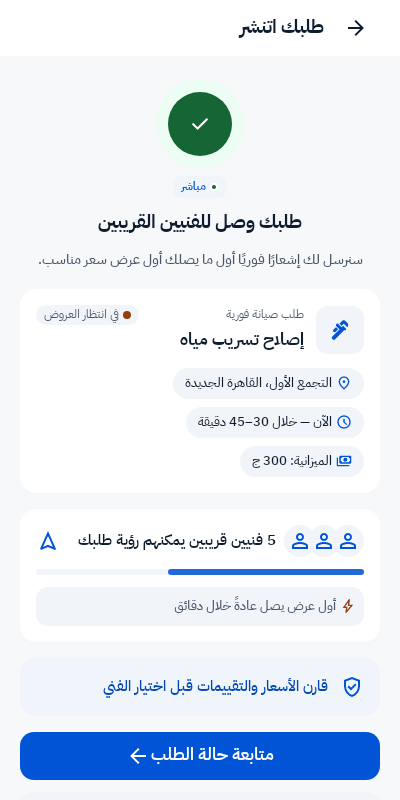

**لقطات: C06: العروض — صفحة 11 من الـPRD.**


> شاشات السوق هنا تُعرض بحالات اختبار توضيحية، رغم أن وضع السوق معطّل بالإعدادات المحلية.

**المصادر:**

- [androidapp/app/src/main/kotlin/noox/bzr/customer/C35NoOffersView.kt:33](/var/www/html/bzr.noox.test/androidapp/app/src/main/kotlin/noox/bzr/customer/C35NoOffersView.kt:33)
- [androidapp/app/src/main/kotlin/noox/bzr/customer/ProposalDecisionView.kt:31](/var/www/html/bzr.noox.test/androidapp/app/src/main/kotlin/noox/bzr/customer/ProposalDecisionView.kt:31)
- [app/Modules/Orders/Services/OrderDeadlines.php:48](/var/www/html/bzr.noox.test/app/Modules/Orders/Services/OrderDeadlines.php:48)

## D19 — C25: ثلاث تبويبات بدل تبويبين

**الأولوية:** P3 · **التصنيف:** اختلاف واجهة وتنقل

**في الملف:** ص 17 تجمع الطلبات في الحالية والسابقة، وتضع المكتملة والملغية في السابقة.

**الحالي:** الواجهة الحالية تضيف «الملغاة»؛ السابقة تستبعد CANCELLED وEXPIRED، والملغاة تجمعهما.

**الأثر:** يتغير مكان العثور على الطلب الملغي أو المنتهي، وتحتاج صور دليل الاستخدام إلى تحديث.

**المعالجة المقترحة:** تحديث C25 ومخطط التنقل وتقسيم الطلبات في الملف.

**لقطات: C25: الطلبات السابقة — صفحة 17 من الـPRD.**

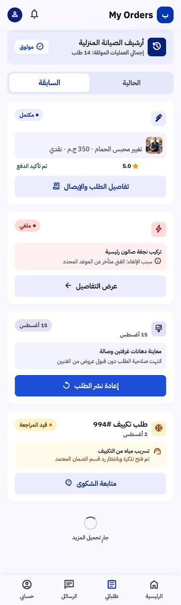


**المصادر:**

- [androidapp/app/src/main/kotlin/noox/bzr/customer/CustomerViewModel.kt:652](/var/www/html/bzr.noox.test/androidapp/app/src/main/kotlin/noox/bzr/customer/CustomerViewModel.kt:652)
- [iosapp/Core/Sources/BzrCore/CustomerJourney.swift:453](/var/www/html/bzr.noox.test/iosapp/Core/Sources/BzrCore/CustomerJourney.swift:453)

## D20 — روابط البريد: مدد الصلاحية تختلف

**قرار 14 أكتوبر 2026 — إجابة الشات 22:** أُقر الإبقاء على 60 دقيقة لكل من رابط تفعيل البريد ورابط استعادة كلمة المرور.

**الأولوية:** P2 · **التصنيف:** فرق إعدادات ونصوص

**في الملف:** ص 7: رابط تفعيل البريد صالح 24 ساعة، ورابط استعادة كلمة المرور 15 دقيقة.

**الحالي:** تفعيل البريد يستخدم افتراضيًا 60 دقيقة، واستعادة كلمة المرور مضبوطة فعليًا على 60 دقيقة.

**الأثر:** المستخدم قد يتوقع صلاحية أطول للتفعيل أو أقصر للاستعادة من الواقع.

**المعالجة المقترحة:** توحيد الإعدادات ورسائل البريد والنصوص الظاهرة في الملف.

**لقطات: C12: تفعيل البريد — صفحة 7 من الـPRD.**


**لقطات: C13: الاستعادة — صفحة 7 من الـPRD.**


**المصادر:**

- [app/Providers/AppServiceProvider.php:74](/var/www/html/bzr.noox.test/app/Providers/AppServiceProvider.php:74)
- [config/auth.php:111](/var/www/html/bzr.noox.test/config/auth.php:111)

## D21 — وسائط الطلب: 30 ثانية مقابل 60 ثانية للفيديو

**قرار 14 أكتوبر 2026 — إجابة الشات 23:** خُفض حد الفيديو إلى 30 ثانية في الخادم والتطبيقين، مع فحص مدة الملف الفعلية وإعادة التحقق عند ربط الفيديو المؤقت بالطلب. بقية حدود العدد والصور والصوت مستمرة. التفاصيل واللقطات الجديدة في [متابعة التنفيذ](ASSESSMENT.md#تنفيذ-حد-الفيديو-واعتماد-مدد-الروابط--14-أكتوبر-2026).

**الأولوية:** P3 · **التصنيف:** فرق حدود إدخال

**في الملف:** C17 في ص 8 توضح فيديو بحد 30 ثانية، حتى خمس صور، وفيديو وتسجيل صوتي واحد.

**الحالي:** الخادم يعلن فيديو حتى 60 ثانية وتسجيلًا صوتيًا حتى 120 ثانية، مع حد خمس صور وفيديو واحد وصوت واحد.

**الأثر:** التوثيق لا يعكس الحدود التي يتعامل معها العميل والخادم.

**المعالجة المقترحة:** تحديث الحدود وتحديد أحجام الملفات ونوع الصوت وسلوك الرفع والفشل وإعادة المحاولة.

**لقطات: C17: الوسائط — صفحة 8 من الـPRD.**

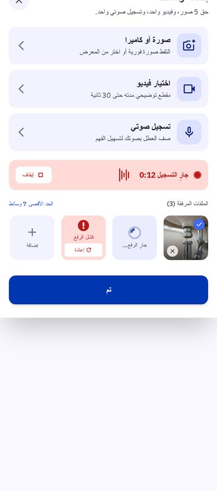

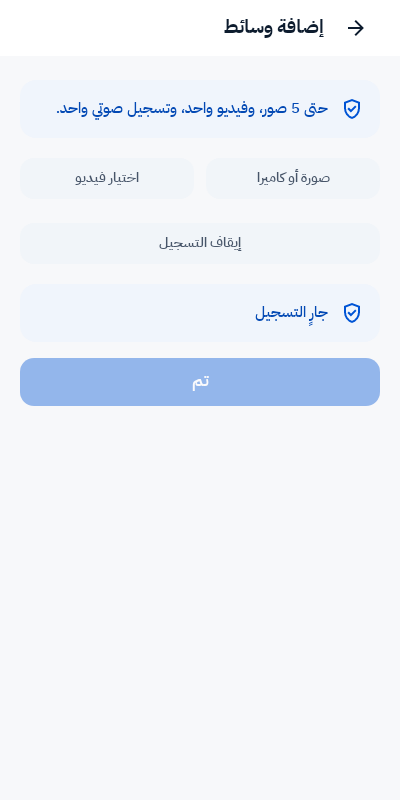

**المصادر:**

- [app/Http/Api/V1/Controllers/ConfigController.php:68](/var/www/html/bzr.noox.test/app/Http/Api/V1/Controllers/ConfigController.php:68)
- [app/Modules/Orders/Actions/PublishRequestAction.php:309](/var/www/html/bzr.noox.test/app/Modules/Orders/Actions/PublishRequestAction.php:309)

## D22 — الإشعارات: صندوق التطبيق موجود وPush المحلي log

**الأولوية:** P1 · **التصنيف:** فرق إعداد تكامل

**في الملف:** C32 في ص 19 توعد بتحديثات الطلب أولًا بأول، مع روابط تتبع ومراجعة عرض.

**الحالي:** الإشعارات داخل التطبيق لها API وتوجيه للطلب. إعداد Push المحلي log يسجل الإرسال؛ لا يمثل إرسال FCM فعليًا للأجهزة.

**الأثر:** لا تثبت لقطة صندوق الإشعارات وصول التنبيه خارج التطبيق.

**المعالجة المقترحة:** إعداد FCM واختبار استقبال الأجهزة، مع فصل نتائج الاختبار المحلي عن بيئة الإطلاق.

**لقطات: C32: الإشعارات — صفحة 19 من الـPRD.**


> الحكم يخص الإعدادات المحلية التي تمت قراءتها، وليس بيئة تشغيل أخرى أو خادم الهاتف الافتراضي.

**المصادر:**

- [app/Providers/AppServiceProvider.php:45](/var/www/html/bzr.noox.test/app/Providers/AppServiceProvider.php:45)
- [app/Modules/Notifications/Push/LogPushSender.php:13](/var/www/html/bzr.noox.test/app/Modules/Notifications/Push/LogPushSender.php:13)

## D23 — وعود الضمان والفاتورة والرد تحتاج سياسة وتنفيذًا

**الأولوية:** P1 · **التصنيف:** تعارض داخل الملف ومتطلبات غير مثبتة

**في الملف:** C08 تذكر ضمانًا 14 يومًا، وC02 تذكر 30 يومًا. C22 تعد بفاتورة ضريبية، وتظهر وعود رد أو تحويل فوري.

**الحالي:** يوجد إيصال وبيانات طلب ونزاعات، لكن لم يُعثر على رحلة ضمان مستقلة أو إصدار فاتورة ضريبية أو SLA آلي لهذه الوعود.

**الأثر:** الوعود تتجاوز الوظائف التي تثبتها الشاشات والخادم، وبعضها غير متسق داخل الملف نفسه.

**المعالجة المقترحة:** توحيد مدة الضمان ونطاقه، واعتماد نصوص الخدمة والفاتورة ومواعيد الدعم والتحويل قبل نشرها.

**لقطات: C02: ضمان 30 يومًا — صفحة 19 من الـPRD.**


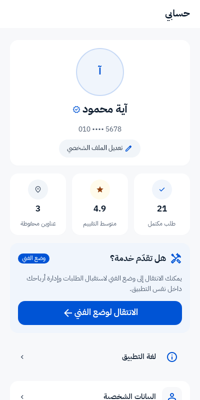

> عدم العثور على وظيفة في المستودع لا ينفي وجود إجراء تشغيلي خارجه؛ يلزم تأكيد السياسة مع المسؤولين. لا يتضمن التقرير حكمًا قانونيًا.

**المصادر:**

- [app/Modules/Support/Actions/OpenDisputeAction.php:114](/var/www/html/bzr.noox.test/app/Modules/Support/Actions/OpenDisputeAction.php:114)
- [app/Http/Api/V1/Resources/OrderResource.php:101](/var/www/html/bzr.noox.test/app/Http/Api/V1/Resources/OrderResource.php:101)

## D24 — صفحة 29 لا تصف الهوية والتنقل الحاليين بدقة

**الأولوية:** P3 · **التصنيف:** توثيق قديم

**في الملف:** ص 29 تقول إن التطبيق تيل وخط Cairo، وإن القائمة الجانبية موجودة، وإن كل الخطوات متطابقة.

**الحالي:** المصدر الحالي أزرق #0054D5 وIBM Plex Sans Arabic. C02 صفحة حساب ضمن التنقل السفلي. الخطوات خمس، وهناك اختلافات إعدادات وتكامل.

**الأثر:** صفحة المقارنة قد تدفع الفريق لاعتماد تغييرات نُفذت بالفعل، أو تجاهل فروق حقيقية.

**المعالجة المقترحة:** إعادة كتابة صفحة التطابق بحسب تاريخ نسخة التطبيق، وتصنيف التنفيذ والإعداد والواجهة كل على حدة.

**لقطات: C02 في التصميم — صفحة 19 من الـPRD.**


> لا يصح القول إن جميع ملفات Cairo حُذفت: بعضها ما زال ضمن الأصول؛ الخط الأساسي المعتمد هو IBM Plex.

**المصادر:**

- [design/tokens.json:9](/var/www/html/bzr.noox.test/design/tokens.json:9)
- [design/tokens.json:127](/var/www/html/bzr.noox.test/design/tokens.json:127)
- [iosapp/BzrApp/Customer/CustomerJourneyRoot.swift:12](/var/www/html/bzr.noox.test/iosapp/BzrApp/Customer/CustomerJourneyRoot.swift:12)

## D25 — حسابي: الإحصاءات الظاهرة ليست كلها محسوبة بالكامل

**الأولوية:** P2 · **التصنيف:** حدود بيانات وفجوة إحصاء

**في الملف:** C02 في ص 19 تعرض إجمالي الطلبات المكتملة ومتوسط تقييم العميل كإحصاءات حساب.

**الحالي:** عدد المكتمل يُعدّ من أول صفحة للطلبات السابقة فقط. قيمة متوسط التقييم في الواجهة ثابتة. لا تأتي الإحصاءات كلها كحقول محسوبة من /me.

**الأثر:** قد يقل العدد عن الإجمالي الحقيقي للحساب، وقد يظهر متوسط لا يمثل تقييم صاحبه.

**المعالجة المقترحة:** إرجاع إجماليات صحيحة من الخادم، وتنفيذ قرار إتاحة تقييم العميل للطرف المناسب.

**لقطات: C02: الإحصاءات — صفحة 19 من الـPRD.**


> أرقام fixture في الصورة ليست سجلات شخص حقيقي؛ ملاحظة الحساب تتعلق بمصدر الإحصاء في الكود.

**المصادر:**

- [androidapp/app/src/main/kotlin/noox/bzr/customer/CustomerViewModel.kt:351](/var/www/html/bzr.noox.test/androidapp/app/src/main/kotlin/noox/bzr/customer/CustomerViewModel.kt:351)
- [androidapp/app/src/main/kotlin/noox/bzr/customer/C02AccountView.kt:51](/var/www/html/bzr.noox.test/androidapp/app/src/main/kotlin/noox/bzr/customer/C02AccountView.kt:51)

## D26 — الإغلاق التلقائي: وقت العرض يختلف عن وقت التنفيذ

**الأولوية:** P1 · **التصنيف:** اتساق داخلي مستنتج من الكود

**في الملف:** الملف لا يحدد بوضوح بداية مهلة الإغلاق التلقائي بعد الدفع النقدي.

**الحالي:** auto_close_at المرسل للواجهة يُحسب من paid_at +24 ساعة، بينما مهمة الإغلاق تختار completed_at الأقدم من 24 ساعة.

**الأثر:** عند تأخر الدفع بعد إنهاء العمل، قد يحدث الإغلاق قبل الموعد المعروض للعميل.

**المعالجة المقترحة:** توحيد نقطة بداية المهلة في API والمهمة، واختبار حالة تأخر الدفع قبل اعتماد الوعد الزمني.

**لقطات: C23: انتظار التأكيد — صفحة 16 من الـPRD.**


> هذه ملاحظة اتساق داخل التطبيق مرتبطة بالـworkflow؛ لم تُعَد إنتاجها على جهاز أو بطلب حقيقي.

**المصادر:**

- [app/Modules/Orders/Services/OrderPresentation.php:81](/var/www/html/bzr.noox.test/app/Modules/Orders/Services/OrderPresentation.php:81)
- [app/Modules/Orders/Jobs/AutoCloseConfirmedOrders.php:29](/var/www/html/bzr.noox.test/app/Modules/Orders/Jobs/AutoCloseConfirmedOrders.php:29)

```text
            'auto_close_at' => $order->status === OrderStatus::AwaitingConfirmation
                ? $order->latestSuccessfulPayment?->paid_at?->addHours($this->settings->int(Cfg::AutoCloseHours))->toIso8601String()
                : null,
        ];
```

```text
            ->where('completed_at', '<=', $cutoff)
            ->orderBy('id')
            ->chunkById(100, function ($orders) use ($confirm, &$closed): void {
                foreach ($orders as $order) {
```

## دور الإدارة غير الممثّل بالكامل في الملف

اللوحة تشمل التعيين وإعادة التعيين، مراجعة الفنيين، نطاقات الأسعار، اعتماد التحويلات، النزاعات، الاسترداد والتوريد والتسويات. يلزم توثيق المنفّذ والصلاحية والمهلة والنتيجة لكل تدخل. المراجعة من الكود، لا لقطات جديدة للوحة.

## القواعد والإعدادات الفعلية

| البند | القيمة | الأثر |
|---|---|---|
| العروض | false | false = تعيين الإدارة. |
| رسوم المعاينة | false | false = معاينة مجانية. |
| فوري | false | معطّل؛ driver المحلي staging. |
| إنستاباي | true | مفتاح true، لكن العنوان null يمنع القناة. |
| عنوان استقبال إنستاباي | null | القيمة غير مضبوطة. |
| مهلة تعيين الآن | 60 | دقيقة؛ بعدها انتهاء الطلب إذا لم يُعيّن. |
| نافذة عروض الآن | 30 | دقيقة؛ خاصة بمسار السوق. |
| سماح الاختيار بعد النافذة | 15 | دقيقة. |
| مهلة مقترح السعر | 60 | دقيقة؛ انتهاء المهلة = رفض. |
| الإغلاق التلقائي | 24 | ساعة؛ انظر ملاحظة اتساق البداية D26. |
| مدة كود فوري | 24 | ساعة؛ متسقة مع المحاكي الحالي. |
| نافذة النزاع بعد الإغلاق | 72 | ساعة؛ النزاع يوقف التسوية. |
| نافذة التقييم | 7 | أيام بعد الإغلاق. |
| إخفاء رقم الهاتف بعد الإغلاق | 24 | ساعة. |
| حد الطلبات المفتوحة | 3 | حد للعميل. |
| مهلة الموعد المجدول | 90 | دقيقة كحد أدنى. |
| بداية ساعات الخدمة | "08:00" | بتوقيت المدينة. |
| نهاية ساعات الخدمة | "22:00" | بتوقيت المدينة. |
| دورة تحويل المستحقات | "weekly" | سياسة، لا تنفيذ تحويل تلقائي. |
| دورة توريد الموظفين | "daily" | المحصّل النقدي. |
| عمولة السوق الافتراضية | null | لم تُحدد؛ لا تُستنتج من أمثلة التصميم. |
| حد دين مقدم الخدمة | "5000.00" | خاص ببوابة عروض السوق. |
| تحديث الموقع | 30 | ثانية أثناء الطريق. |
| تحذير الوصول البعيد | 500 | متر؛ يحتاج تأكيدًا إضافيًا. |

من القواعد الأخرى: غياب العميل بعد 20 دقيقة، أقصى جدولة 7 أيام، حجب بيانات التواصل قبل التأكيد فقط، الصور في المحادثة بعد التأكيد، وإيقاف التسوية عند نزاع بعد الإغلاق.

## تغطية صور الرحلات كاملة

| صفحة | الرمز | الصورة | نتيجة المراجعة | ملاحظة |
|---|---|---|---|---|
| 6 | Splash | البداية | موجود | لا توجد لقطة جديدة للشاشة الافتتاحية ضمن مجموعة الـ404. |
| 6 | C10 | الدخول | مطابق أساسًا | دخول بالبريد وكلمة المرور. |
| 6 | C11 | إنشاء الحساب | مطابق أساسًا | اسم وبريد وهاتف وكلمة مرور. |
| 7 | C12 | تفعيل البريد | فرق صلاحية | مدة رابط التفعيل مختلفة؛ D20. |
| 7 | C13 | استعادة كلمة المرور | فرق صلاحية | مدة رابط الاستعادة مختلفة؛ D20. |
| 8 | C01 | الرئيسية | مطابق جزئيًا | تتغير دعوة الطلب بحسب وضع التشغيل؛ D01. |
| 8 | C01 | الرئيسية الفارغة | مطابق جزئيًا | تتغير دعوة الطلب بحسب وضع التشغيل؛ D01. |
| 8 | C03 | وصف المشكلة | workflow مختلف | حاليًا اختيار الخدمة؛ محتوى الملف انتقل إلى C37؛ D02. |
| 8 | C17 | الوسائط | فرق حدود إدخال | مدة الفيديو؛ D21. |
| 9 | C04 | العنوان والموعد | workflow مختلف | المكان والموعد فقط؛ الخامات والتسعير إلى C38؛ D03. |
| 9 | C16 | اختيار الموعد | مطابق جزئيًا | الجدولة موجودة؛ القيم من إعدادات المدينة والخادم. |
| 9 | C14 | العناوين | مطابق أساسًا | اختيار وتعديل العنوان المحفوظ. |
| 10 | C15 | إضافة عنوان | مطابق أساسًا | الخريطة والمنطقة وتفاصيل العنوان. |
| 10 | C05 | مراجعة الطلب | مطابق جزئيًا | المراجعة موجودة لكنها الخطوة 5 بدل 3؛ D02. |
| 11 | C06 | العروض | موجود وغير مفعّل | السوق معطّل، والعداد غير ظاهر؛ D01 وD18. |
| 11 | C07 | ملف الفني | مطابق جزئيًا | مؤشرات ثابتة وحدود بيانات الصور والتحقق؛ D17. |
| 11 | C08 | تفاصيل العرض | موجود وغير مفعّل | تفاصيل العرض موجودة؛ رسوم المعاينة حسب المفتاح؛ D04. |
| 12 | C35 | لم تصل عروض | مطابق جزئيًا | مؤشرات انتظار ثابتة؛ شروط إعادة النشر مهمة؛ D18. |
| 12 | C36 | انتظار التعيين | مطابق وظيفيًا | هي مسار التشغيل الحالي، وتوصف في الملف كبديل؛ D01. |
| 13 | C09 | التتبع | مطابق جزئيًا | التتبع موجود؛ المشاركة وقيود الحالات تحتاج استكمالًا؛ D10 وD16. |
| 13 | C19 | المحادثة | مطابق جزئيًا | الحجب قبل التأكيد فقط، والصور بعده؛ قواعد الرحلة. |
| 13 | C30 | عرض التنفيذ | مطابق جزئيًا | عرض واحد بمهلة 60 دقيقة؛ العداد غير ظاهر؛ D04 وD18. |
| 14 | C31 | تكلفة إضافية | فجوة إجراء | قرار إضافات IN_PROGRESS غير متاح عبر الإجراءات؛ D06. |
| 14 | C09 | حالات التتبع | مطابق جزئيًا | التتبع موجود؛ المشاركة وقيود الحالات تحتاج استكمالًا؛ D10 وD16. |
| 14 | C20 | الإلغاء | قيود ناقصة في الملف | الإلغاء قبل الوصول فقط؛ D10. |
| 15 | C21 | ملخص الدفع | فرق مالي وإتاحة | تعريف الخصم والقنوات؛ D05 وD07–D09. |
| 15 | C22 | الدفع الإلكتروني | تكامل غير مكتمل | فوري محاكي وإنستاباي غير مكتمل؛ D07–D08. |
| 15 | C22 | كود فوري | تكامل غير مكتمل | فوري محاكي وإنستاباي غير مكتمل؛ D07–D08. |
| 16 | C23 | تأكيد الإنهاء | مطابق جزئيًا | خاصة بالكاش؛ بداية مهلة الإغلاق تحتاج توحيدًا؛ D09 وD26. |
| 16 | C24 | تقييم الفني | مطابق أساسًا | 3 أبعاد وتعليق حتى 500 حرف؛ تقييم بعد الإغلاق خلال 7 أيام. |
| 17 | C25 | الطلبات الحالية | فرق تبويبات | 3 تبويبات بدل 2؛ D19. |
| 17 | C25 | الطلبات السابقة | فرق تبويبات | 3 تبويبات بدل 2؛ D19. |
| 17 | C26 | تفاصيل الطلب | مطابق أساسًا | بيانات وتاريخ الطلب والإيصال؛ لا يثبت إصدار فاتورة ضريبية. |
| 18 | C27 | فتح مشكلة | مطابق جزئيًا | قبل الإغلاق نزاع يغيّر الحالة، وبعده يوقف التسوية. |
| 18 | C28 | الإبلاغ عن فني | مطابق أساسًا | البلاغ لا يغيّر حالة الطلب؛ موعد الرد وعد تشغيلي يحتاج اعتمادًا. |
| 19 | C18 | الرسائل | مطابق جزئيًا | شارات القراءة والحضور؛ D15. |
| 19 | C32 | الإشعارات | مطابق جزئيًا | داخل التطبيق موجود؛ Push المحلي log؛ D22. |
| 19 | C02 | حسابي | اختلاف بيانات/توثيق | D23–D25؛ ضمان وإحصاءات وهوية وتنقل. |
| 20 | C33 | الحساب والأمان | مطابق أساسًا | تعديل وكلمة مرور وحذف؛ صورة الملف تشمل نافذة حذف مع خلفية مطموسة. |
| 20 | C29 | الدعم | مطابق جزئيًا | FAQ وتواصل موجودان؛ الوعود الزمنية تحتاج سياسة. |
| 20 | C34 | الشروط | مطابق جزئيًا | النص الحالي من نظام المحتوى؛ صورة الإصدار مثال وليست إثبات النص المعتمد. |
| 22 | P01 | الانضمام | مطابق أساسًا | انضمام فني ضمن الحساب نفسه. |
| 22 | P02 | البيانات | مطابق أساسًا | صورة وخبرة ونبذة. |
| 22 | P03 | الهوية | مطابق أساسًا | رفع الهوية وجهًا وظهرًا؛ لا يثبت ذلك تحققًا جنائيًا منفصلًا. |
| 22 | P04 | التخصصات | مطابق أساسًا | فئات وتخصصات من الكتالوج. |
| 23 | P05 | مناطق العمل | مطابق أساسًا | مناطق خدمة وأهلية تعيين. |
| 23 | P06 | استلام المستحقات | فرق وعد مالي | طرق الاستلام موجودة؛ التحويل ليس آليًا؛ D11. |
| 23 | P07 | حالة المراجعة | مطابق أساسًا | مراجعة وتفعيل ورفض وإعادة تقديم. |
| 24 | P08 | رئيسية الفني | مطابق جزئيًا | المتاح الآن والطلب المعيّن موجودان؛ فصل الوضعين مطلوب. |
| 24 | P09a | الطلبات المتاحة | موجود وغير مفعّل | قائمة طلبات السوق؛ ليست وجهة مستقلة في خريطة أكواد اللقطات. |
| 24 | P09 | تفاصيل الطلب | موجود وغير مفعّل | تفاصيل الطلب المتاح في وضع السوق. |
| 25 | P10 | تقديم عرض | موجود وغير مفعّل | عرض ما قبل التعيين وصافي السوق؛ لا ينطبق على رحلة الموظفين. |
| 25 | P11 | عروضي | موجود وغير مفعّل | تقديم وسحب عروض السوق. |
| 26 | P12 | التأكيد | مطابق جزئيًا | بدء التحرك واعتذار قبل الوصول؛ الاعتذار يعيد الطلب إلى OPEN. |
| 26 | P13 | في الطريق | مطابق أساسًا | ملاحة وموقع وتسجيل وصول، مع قيود الجدولة والموقع. |
| 26 | P14 | الوصول | مطابق جزئيًا | تنفيذ مباشر أو معاينة ثم عرض؛ يوجد إنهاء معاينة فقط. |
| 26 | P20 | عرض التنفيذ | مطابق جزئيًا | الدليل وسبب الخروج موجودان؛ المقترحات الإضافية لها فجوة قرار؛ D06. |
| 27 | P15 | التنفيذ | مطابق جزئيًا | الإنهاء والإضافات موجودان؛ صور الإنجاز ناقصة؛ D06 وD14. |
| 27 | P21 | التعذر | قيود ناقصة في الملف | التعذر إلغاء بلا مبلغ؛ غياب العميل بعد 20 دقيقة؛ D10. |
| 27 | P16 | انتظار الدفع | مطابق أساسًا | تأكيد كاش كامل؛ الانتظار الإلكتروني يختلف. |
| 28 | P17 | تقييم العميل | حقول غير منفذة | نجوم فقط؛ D13. |
| 28 | P18 | المستحقات | مطابق جزئيًا | الحساب موجود، التصدير والفلترة ناقصان؛ D12. |
| 28 | P19 | ملف الفني | مطابق أساسًا | النبذة والخبرة والتخصصات والمناطق ومعرض الأعمال. |

C37 وC38 حاليتان ولا تظهران كشاشتين مستقلتين في الملف. عدد 63 يشمل صورًا متعددة لنفس الشاشة، وليس 63 وجهة مستقلة.

## الملفات والتحقق

- PDF وHTML: التقرير للمشاركة والعرض.
- assets/: صور المصدر والواجهة الجديدة.
- evidence.json: مراجع الأدلة وبصمات الملفات.
- validation/backend-tests.log: نتيجة الاختبارات.
- validation/settings.json: الإعدادات المقروءة.
- source-preview.png: معاينة إحدى صفحات المقارنة من PDF النهائي.


## متابعة تنفيذ قرارات الشات — 13 أكتوبر 2026

التقرير أعلاه يوثّق المقارنة الأصلية. أُضيفت بعده صور الفني الإلزامية قبل وبعد الإصلاح، والصور الاختيارية مع تقييم العميل، ورحلة إنستاباي بإيصال إلزامي وتأكيد الإدارة. بيانات إنستاباي واسم المستلم تُضبط من لوحة التحكم بحسب إجابة المستخدم. استُكمل ضمان 14 يومًا بزيارة فني مختلف مرتبطة بالإصلاح الأصلي: الزيارة والمصنعية مجانًا، والخامات وحدها مدفوعة بعد موافقة العميل. الزيارة مرتبطة بالتتبع والرسائل والصور والتقييم والدفع عند وجود خامات معتمدة. مسودة الشروط العربية بالإصدار 3 محفوظة بهذه التغطية ولم تُنشر.

التفاصيل وحالة التنفيذ واللقطات الجديدة موجودة في [تحديث السؤال والجواب](ASSESSMENT.md#استكمال-بيانات-إنستاباي-وتغطية-الضمان--13-أكتوبر-2026). نجح 50 اختبار خادم مختلفًا و7 اختبارات Android و51 اختبار Swift Core في الاستكمال الأخير، مع بناء APK Debug. ملفات PDF وHTML السابقة تحفظ نتائج المراجعة الأصلية، ولا تشمل تنفيذ هذه الدفعة؛ بناء Xcode واختبار جهاز iOS والنشر الإنتاجي لم تُجرَ.

### استكمال إجابات الشات 7–9

نُفّذت موافقة العميل ورفضه للخامات والإضافات أثناء التنفيذ في الطلبات العادية، مع حجب الإنهاء حتى حسم المقترح وعرض الإجمالي الحالي وبعد الإضافة من الخادم. نُفّذ زر مشاركة الزيارة على Android وiOS برابط صالح 24 ساعة كحد أقصى، يحجب أرقام الطرفين والبيانات الخاصة. أُزيلت مؤشرات توزيع الطلب والعدد والتقدم والوقت الثابتة من الانتظار؛ الرسالة والمهلة تأتيان من الحالة الفعلية في الخادم.

[اللقطات ونتائج التنفيذ](ASSESSMENT.md#تنفيذ-موافقة-التكلفة-والمشاركة-والانتظار--13-أكتوبر-2026): 43 اختبار خادم و12 Android و55 Swift Core، وبناء APK Debug. صفحة المشاركة العامة اختُبرت عبر طلبات HTTP؛ لقطات Android تستخدم بيانات اختبار. المشاركة على جهاز وبناء Xcode والنشر الإنتاجي لم تُجرَ.

### استكمال إجابات الشات 10–12

نُفّذ تحميل صورة الفني ومعرضه بروابط محمية بصلاحيات الطلب، وأُزيل متوسط الرد الثابت وتفاصيل التحقق غير المدعومة. قائمة الرسائل تعرض غير المقروء وفلتره والتوفر الفعلي للخدمة، وتُسجَّل قراءة الوارد المعروض فقط. الحساب يعرض إجمالي المكتملة والنشطة والعناوين من الخادم، مع إزالة تقييم العميل الثابت.

[التفاصيل واللقطات](ASSESSMENT.md#تنفيذ-بيانات-الفني-والرسائل-والحساب--13-أكتوبر-2026): 32 اختبار خادم و15 Android و59 Swift Core نجحت، مع بناء APK Debug. اللقطات ببيانات وصور توضيحية للاختبار؛ بناء Xcode واختبار الأجهزة والنشر الإنتاجي لم تُجرَ.


### استكمال إجابات الشات 13–15

أُصلح الإغلاق التلقائي للكاش ليبدأ من أحدث دفعة ناجحة `paid_at` بمدة الإعداد الحالية (24 ساعة)، مع إعادة الفحص داخل قفل الطلب وتصحيح اختيار الدفعة عند وجود محاولة فاشلة أحدث. تعرض C30 وC31 موعد قرار السعر والعدّاد من توقيت الخادم، ونتيجة الانتهاء بحسب نوع المقترح ورسوم المعاينة. أُضيفت وسوم وتعليق اختياريان إلى تقييم الفني للعميل على التطبيقين، مع حفظهما وعرضهما للإدارة وحجبهما عن العميل نفسه.

[التفاصيل واللقطات](ASSESSMENT.md#تنفيذ-مهلة-الدفع-وقرار-السعر-وتقييم-العميل--13-أكتوبر-2026): 47 اختبار خادم بـ313 تحققًا، و17 Android، و64 Swift Core، مع بناء APK Debug. تشمل الاختبارات تأخر الدفع، وتعدد محاولاته، ومنع قرار السعر المتأخر، واختلاف ساعة الجهاز عن الخادم، وملكية التقييم وحدوده وعرضه للإدارة. اللقطات من واجهات Android ببيانات اختبار؛ بناء Xcode واختبار الأجهزة والنشر الإنتاجي لم تُجرَ. ملفات PDF وHTML الأصلية لم تُحدَّث بهذا الاستكمال.


### استكمال إجابات الشات 16–18 — 14 أكتوبر 2026

أُضيفت فلترة حساب الفني بالفترة ونوع الحركة من خيارات الخادم، وتحميل بقية الصفحات، وتصدير CSV لجميع الحركات المطابقة. ملخص الرصيد يخص الحساب الكامل. استُكمل فحص جاهزية Push واختبار روابط الطلب للمستلم الصحيح، وتصنيف خطأ مشروع FCM دون حذف رموز الأجهزة. وفق إجابة المستخدم، **الإعدادات والأجهزة ستُوفّر لاحقًا**؛ لم يُفعّل إرسال حقيقي أو يُختبر وصوله على أجهزة. أُسقط وعد رد رسوم التأخير والفاتورة الضريبية من الإصدار، وأصبح عنوان ملخص الدفع «تفاصيل المبلغ».

[التفاصيل واللقطات ونتائج التحقق](ASSESSMENT.md#تنفيذ-كشف-الحساب-وتجهيز-push-وتصحيح-الوعود--14-أكتوبر-2026): 22 اختبار خادم بـ273 تحققًا، و7 Android، و68 Swift Core، مع بناء APK Debug. اللقطات ببيانات اختبار. فحص إعدادات Push المحلي يوضح النواقص ولا يثبت وصول تنبيه؛ بناء Xcode واختبار الأجهزة وحوارات تصدير النظام والنشر الإنتاجي لم تُجرَ. ملفات PDF وHTML الأصلية تبقى سجل مقارنة 12 أكتوبر.


### استكمال إجابات الشات 19–21 — 14 أكتوبر 2026

اعتمد المستخدم تعريف عرض التنفيذ الشامل لرسوم المعاينة القابلة للخصم: 380 +120 =500 جنيه، وتوثيق التسوية الأسبوعية بتسجيل يدوي للتحويل والتوريد النقدي اليومي للموظفين، مع استبعاد وعد التحويل الفوري. الحساب والمسار الحاليان يطابقان ذلك؛ لم تتغير معادلة مالية أو إعداد تشغيل بهذه الدفعة.

اختار المستخدم **الاكتفاء بتقرير الاختلافات حاليًا**. لم تُنشأ نسخة PRD جديدة، ويظل الملف الأصلي ولقطاته دليل المقارنة. [التفاصيل وحالة التحقق](ASSESSMENT.md#تثبيت-قرارات-التسعير-والتسوية-ونطاق-التقرير--14-أكتوبر-2026).

التحقق لهذه الدفعة: 12 اختبارًا قائمًا للتسوية والمعاينة المجانية، بـ69 تحققًا، نجحت. [النتيجة](validation/finance-decisions-tests.json). لا تعديلات على واجهات التطبيق أو إعدادات التشغيل أو ملف الـPRD الأصلي بهذه الإجابات.


### استكمال إجابتَي الشات 22–23 — 14 أكتوبر 2026

اعتمد المستخدم مدة 60 دقيقة لكل من رابطَي التفعيل والاستعادة، وخفض حد الفيديو إلى 30 ثانية. أُضيف التحقق قبل الرفع على التطبيقين، وفحص المدة الفعلية في الخادم وإعدادات الـAPI، وإعادة التحقق عند ربط فيديو مؤقت بنشر الطلب أو تعديله. تعرض C17 الحد الجديد ورسالة الرفض؛ بقية حدود الصور والصوت مستمرة.

[التفاصيل واللقطات ونتائج التحقق](ASSESSMENT.md#تنفيذ-حد-الفيديو-واعتماد-مدد-الروابط--14-أكتوبر-2026). لم يُجرَ اختبار منتقي الفيديو على أجهزة أو بناء Xcode أو نشر إنتاجي؛ ملفات PDF وHTML الأصلية تبقى توثيق المقارنة السابقة، دون إنشاء PRD جديد.

التحقق لهذه الدفعة: **28 اختبار خادم بـ139 تحققًا، و14 اختبار Android، و71 اختبار Swift Core** نجحت، مع بناء APK Debug وفحوص التنسيق والتصميم وتطابق موارد التطبيقين.

## استكمال 14 أكتوبر 2026 — معالجة الأجزاء الثابتة

عولجت S01–S07 في الخادم والتطبيقين: أسعار العميل والوسوم وأوزان الأنسب من لوحة التحكم، ومراحل التنفيذ والتوفر من بيانات فعلية، وتقدير الانتهاء من الفني، وحذف وعد الوصول الثابت. [تقرير الحالة المحدّث ولقطات التنفيذ](CURRENT-STATUS.md) يحدد أماكن الضبط والاختبارات والفجوات الباقية. هذا التقرير وPDF/HTML المقارنة الأصلية يحفظان مراجعة 12 أكتوبر، ولا يثبتان حالة التنفيذ اللاحق وحدهما.

## استكمال 15 أكتوبر 2026 — صور الموظفين والسياسات وكود الوصول

اكتملت صور العطل الحالي الاختيارية والمحادثة وإثبات الإصلاح بعد إتمامه وصور التقييم، وإحصاءات الوسوم ومنطقة التقييم. نُفّذ كود الوصول مع استثناء إداري موثّق بقرار المالك الجديد، ونُشرت السياسات العربية محليًا. [تقرير الحالة الحالية](CURRENT-STATUS.md) يوثق اللقطات والاختبارات وإعداد Nginx المتبقي. Firebase/APNs مؤجّل لما قبل الإطلاق والسوق مؤجّل تشغيليًا. المقارنة الأصلية والـPRD لم يُعاد تحريرهما.
