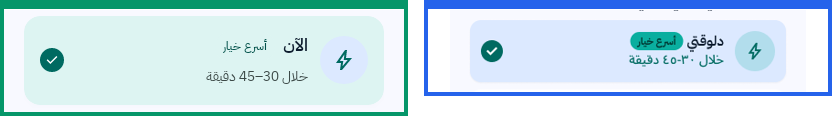
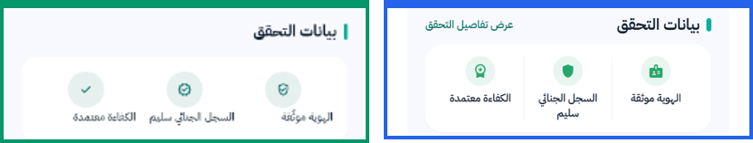
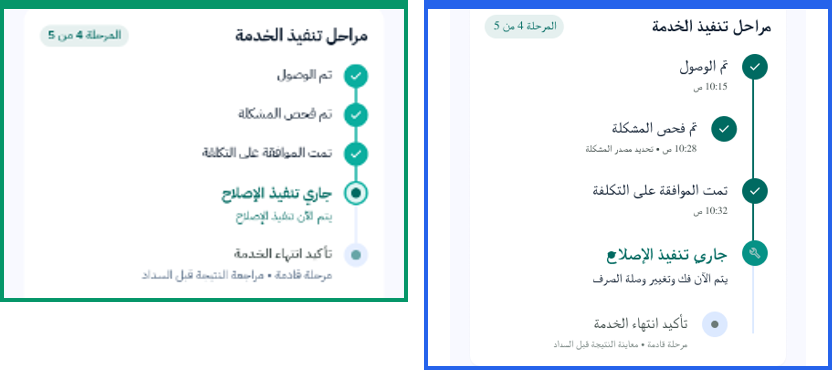
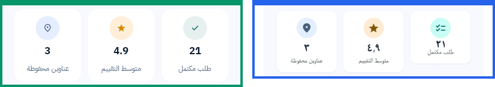
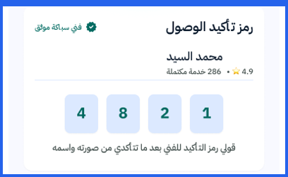
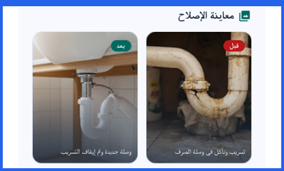
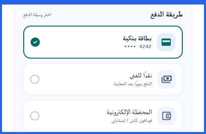
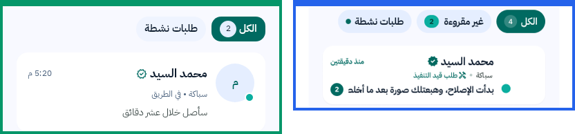
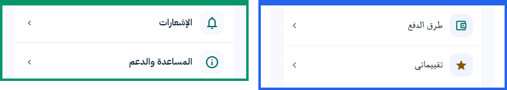
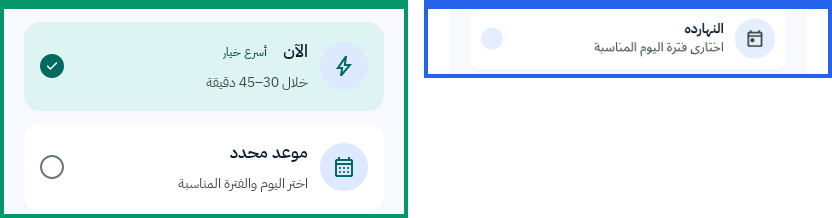

# مراجعة القيم الثابتة والعناصر المحذوفة عن قصد — مطابقة Figma «Primo App»

**التاريخ:** 2026-10-10 · **الحالة:** ✅ التقسيم معتمد من المالك (DEC-077) · **يغطي:** الدفعات figma-a لحد figma-d (كل شاشات العميل) · **الخادم:** ما اتعدّلش لحد دلوقتي
**المرجع التفصيلي:** `reports/batch-figma-a/BACKEND-NOTES.md` (B-01 لحد B-23)

**إزاي تقرا الصور:** كل صورة فيها جزء الشاشة المقصود بس.
- 🟦 **الإطار الأزرق (يمين):** Figma.
- 🟩 **الإطار الأخضر (شمال):** التطبيق دلوقتي (Android، ونفس الترتيب في iOS).
- لو فيه إطار أزرق بس، يبقى العنصر مش موجود في التطبيق.

---

## 1. الخلاصة والتوصية في جدول واحد

**المفتاح:**
- **🛠 خادم:** نعدّل الـ API، فيظهر زي التصميم ببيانات حقيقية.
- **✂️ تصميم:** نشيله أو نغيّره في Figma.
- **📱 تطبيق:** شغل في التطبيقين بس، من غير خادم.

**الجهد:** صغير = أقل من يوم · متوسط = 1–3 أيام · كبير = محتاج تعديل في تطبيق الفني أو قرار عمل.

| # | العنصر | الوضع دلوقتي | التوصية | الجهد |
|---|---|---|---|---|
| B-14 | مبالغ سريعة و«متوسط المنطقة» (الميزانية) | ثابت | 🛠 **(DEC-077)** سعر استرشادي للعميل لكل نوع مشكلة، الإدارة بتحدده من لوحة الإدارة، و✂️ «متوسط المنطقة» تبقى «السعر المعتاد» | صغير–متوسط |
| B-15 | «خلال 30–45 دقيقة» (الموعد، وطلبك اتنشر، وتم التأكيد) | ثابت | 🛠 قيمة في `/config` الإدارة تحددها لكل مدينة | صغير |
| B-13 | «5 فنيين قريبين» والشريط (طلبك اتنشر) | ثابت | 🛠 العدد الحقيقي، و✂️ شيل الشريط وصور الفنيين و«أول عرض خلال دقائق» | صغير |
| B-17 / B-03 | نقطة «متصل» (العروض والرسائل) | ثابت على الكل | 🛠 `available_now` موجود، يتبعت مع العرض والمحادثة، والنقطة تبقى «متاح الآن» | صغير جدًا |
| B-18 | شريحة «الأنسب» | بتطلب ترتيب التقييم | 🛠 ترتيب `best` (تقييم + سعر + وصول) | صغير |
| B-19 | «متوسط الرد 10 دقائق» | ثابت | 🛠 العمود موجود ومش بيتحسب: مهمة تحسبه، وبعدين يتبعت | صغير–متوسط |
| B-12 | بيانات التحقق التلاتة | ثابتة لو موثّق | 🛠 «الهوية موثّقة» حقيقية (المستندات موجودة)، و✂️ «السجل الجنائي» و«الكفاءة» تتشال | صغير |
| B-07 | «الوقت المتوقع للانتهاء 30 دقيقة» | ثابت | ✂️ تتشال. لو اتطلبت بعدين: الفني يدخلها عند بدء الشغل | كبير لو اتعملت |
| — | مراحل «جاري التنفيذ» وأوقاتها | استنتاج من الحالة | 🛠 المراحل وأوقاتها من `order_events` والمقترحات | متوسط |
| B-04 | الوسوم السريعة في التقييم | بتتبعت جوه التعليق | 🛠 حقل `tags` في التقييم | صغير |
| B-09 | «متوسط التقييم 4.9» و«طلب مكتمل» (حسابي) | ثابت، والعدد جزئي | 🛠 `/me`: عدد المكتمل والعناوين. ✂️ **(DEC-077)** خانة التقييم تتشال، لأن تقييم العميل للموظفين والإدارة بس | صغير |
| B-02 | «غير مقروءة» والأعداد (الرسائل) | مش ظاهرة | 🛠 `read_at` موجود: `unread_count` في قايمة المحادثات | صغير |
| B-22 | كود الوصول و«تأكيد الوصول» | مش ظاهر | ⏭ **(DEC-077)** متأجل للمرحلة التالية، ومتسجّل في `docs/36-FUTURE-ROADMAP.md` | كبير |
| B-05 | صور «قبل / بعد» | مش ظاهرة | 🛠 مرحلة تانية: الفني يرفع صور عند الإنهاء (مفيدة جدًا في النزاعات) | كبير |
| B-06 | بطاقة بنكية ومحفظة | مش ظاهرين | ✂️ التصميم يبقى «نقدي / إلكتروني» زي الخادم (ASM-05 وOD-10) | — |
| B-04 | «إضافة صورة» مع التقييم | مش ظاهر | ✂️ يتشال (قيمته قليلة) | — |
| B-10 | «تقييماتي» | مش ظاهر | ✂️ يتشال دلوقتي، ويرجع مع شاشة لو اتطلب | — |
| ASM-05 | «طرق الدفع» في حسابي | مش ظاهر | ✂️ يتشال (مفيش حفظ بطاقات) | — |
| B-20 | منطقة المقيّم | التاريخ مكانها | 🛠 منطقة الطلب (`area`) مع كل تقييم | صغير جدًا |
| B-21 | محادثة الفني قبل قبول العرض | مش ظاهرة | ✂️ تتشال: قرار عمل (منع التواصل خارج المنصة) | — |
| B-23 | «عرض الفاتورة» جوه الإشعار | الكارت كله بيفتح الرابط | ✂️ يتشال الرابط التاني | — |
| — | كارت «النهارده» في الموعد | مش ظاهر | 📱 بيفتح الفترات على تاريخ النهارده (مفيش خادم) | صغير |
| B-01 | «حفظ الفني» (مفضلة) | مش ظاهر | ✂️ يتشال (ميزة جديدة كاملة) | — |
| B-16 | صور الفنيين والعميل والأعمال | الحرف الأول | 📱 تحميل الصور في التطبيقين (الروابط موجودة) | متوسط |
| — | «مشاركة تفاصيل الزيارة» | الزرار ظاهر ومش شغال | 📱 تنفيذ المشاركة في التطبيقين | صغير |

**الحصيلة:**
- **دفعة خادم واحدة:** 13 بند. كلهم صغيرين، إلا المراحل (متوسط) وصور «قبل / بعد» (مرحلة تانية).
- **تعديلات تصميم:** 9 بنود تتشال، و3 بنود تتعدّل جزئيًا (B-14 وB-13 وB-12).
- **دفعة تطبيق:** 3 بنود.

---

## 2. القيم الثابتة (ظاهرة في التطبيق بقيمة مش حقيقية)

كل قيمة من دول عليها تعليق `STATIC (DEC-074, BACKEND-NOTES B-xx)` في الكود، في المنصتين.

### B-14 — المبالغ السريعة و«متوسط المنطقة» (C38 الميزانية، Figma 3002:1270)

- **في التطبيق:** شرائح 250 / 300 / 400، وشارة «متوسط المنطقة» بنص ثابت.
- **الموجود في الخادم:** دليل أسعار لكل نوع مشكلة (`employee_price_min/max` في `problem_types`، بيترفع من الإدارة)، لكنه لوضع الموظفين ومش بيتبعت للعميل.
- **التوصية:**
  - 🛠 `/catalog` يرجّع `price_hint {min, max}` لكل نوع مشكلة، والشرائح تبقى (الأقل، والمتوسط، والأعلى).
  - ✂️ الشارة تبقى «السعر المعتاد»، لأن مفيش بيانات بالمنطقة.
  - ✅ **قرار المالك (DEC-077):** الإدارة بتتعامل مع دليل الأسعار. السعر الاسترشادي اللي بيظهر للعميل بيتحدد من لوحة الإدارة لكل نوع مشكلة، منفصل عن دليل الموظفين، والـ API بيرجّعه.

### B-15 — «خلال 30–45 دقيقة» (C04 الموعد، C35 طلبك اتنشر، C09 تم التأكيد، C08)

- **في التطبيق:** نص ثابت جنب «الآن»، لحد ما الرحلة تبدأ ويظهر ETA الحقيقي.
- **الموجود في الخادم:** ETA بس بعد ما الفني يتحرك.
- **التوصية:** 🛠 قيمة `now_arrival_window {min, max}` في `/config`، الإدارة تحددها لكل مدينة، وتظهر كتقدير. لو مش عايزين، ✂️ نشيل السطر من التصميم.

### B-13 — «5 فنيين قريبين» والشريط (C35، Figma 3002:1519)

- **في التطبيق:** العدد 5، وشريط بنسبة 60%، و3 دواير بأيقونة شخص، و«أول عرض يصل عادةً خلال دقائق».
- **الموجود في الخادم:** فئات الفنيين ومناطقهم وحالة «متاح الآن». العدد ممكن يتحسب.
- **التوصية:**
  - 🛠 `matching_providers_count` في الطلب المفتوح.
  - ✂️ يتشال الشريط (ملوش معنى)، وصور الفنيين (ما ينفعش نعرض الفنيين قبل ما يقدّموا)، وجملة «أول عرض خلال دقائق» لحد ما يبقى فيه مقياس حقيقي.

### B-17 و B-03 — نقطة «متصل» (C06 العروض، C18 الرسائل)

- **في التطبيق:** النقطة على كل الكروت.
- **الموجود في الخادم:** `available_now` (الفني بيفعّله بنفسه)، وبيتبعت في ملف الفني بس.
- **التوصية:** 🛠 سطر واحد يضيفه للعرض (`OfferResource.provider`) وللمحادثة. النقطة تبقى «متاح الآن» بدل «متصل»، لأن مفيش تتبع للاتصال اللحظي ومش مستاهل.

### B-18 — شريحة «الأنسب» (C06)

- **في التطبيق:** «الأنسب» هي الافتراضية، وبتطلب ترتيب التقييم.
- **التوصية:** 🛠 ترتيب `best` في `GET offers`: درجة بتجمع التقييم والسعر ووقت الوصول. بديل: ✂️ نشيل «الأنسب» ونخلي «الأعلى تقييمًا» الافتراضي.

### B-19 — «متوسط الرد 10 دقائق» (C07 ملف الفني)

- **الموجود في الخادم:** عمود `avg_response_minutes` (BR-132) موجود، لكن مفيش حاجة بتحسبه، ومش بيتبعت للعميل.
- **التوصية:** 🛠 مهمة دورية تحسب متوسط وقت أول رد أو أول عرض، و`ProviderResource` يرجّعه. لو فاضي، الخانة متظهرش.

### B-12 — بيانات التحقق التلاتة (C07)

- **في التطبيق:** «الهوية موثّقة» و«السجل الجنائي سليم» و«الكفاءة معتمدة» بيظهروا لكل فني موثّق.
- **الموجود في الخادم:** صور البطاقة وسيلفي (`provider_documents`)، فالهوية حقيقية. السجل الجنائي والكفاءة **مش بيتجمعوا أصلاً**.
- **التوصية:**
  - 🛠 `identity_verified` من المستندات.
  - ✂️ يتشال البندين التانيين. عرضهم من غير ما نجمعهم ادعاء غلط قدام العميل.
  - لو اتقرر نجمعهم، يبقى تغيير في طلب الانضمام وتطبيق الفني.

### B-07 — «الوقت المتوقع للانتهاء» (C09 جاري التنفيذ، Figma 3002:2540)

- **في التطبيق:** 30 دقيقة، ومعاها «الوقت تقديري».
- **التوصية:** ✂️ يتشال من التصميم. الرقم الحقيقي محتاج الفني يدخل تقدير عند بدء الشغل، يعني تعديل في تطبيق الفني والـ API، وقيمته قليلة قصاد الجهد.

### مراحل «جاري التنفيذ» وأوقاتها (C09)

- **في التطبيق:** «تم الوصول»، و«تم فحص المشكلة»، و«تمت الموافقة على التكلفة» بتظهر خلصانة لأي طلب `IN_PROGRESS`، ومن غير أوقات.
- **الموجود في الخادم:** `order_events` بيسجّل كل تغيير حالة بوقته، والمقترحات المعتمدة موجودة.
- **التوصية:** 🛠 `stepper` يرجّع المراحل الفرعية الحقيقية (الوصول، والفحص، والموافقة لو فيه مقترح)، ووقت كل مرحلة.

### B-04 — الوسوم السريعة في التقييم (C24، Figma 3002:4475)

- **في التطبيق:** الوسوم ظاهرة، والمختار منها بيتبعت في أول نص التعليق.
- **التوصية:** 🛠 حقل `tags[]` في `POST review` بقايمة ثابتة من الخادم، وتظهر في ملف الفني كإحصائية («شغل متقن ×42»).

### B-09 — إحصائيات حسابي (C02، Figma 3002:4654)

- **في التطبيق:**
  - «متوسط التقييم» 4.9 ثابت.
  - «طلب مكتمل» بيتعد من أول صفحة بس.
  - «عناوين محفوظة» حقيقي.
- **الموجود في الخادم:** جدول `customer_ratings` (الفني بيقيّم العميل) موجود، وعدد الطلبات ممكن يتحسب.
- **التوصية:** 🛠 `/me` يرجّع `completed_orders_count` و`addresses_count`.
- ✅ **قرار المالك (DEC-077):** تقييم العميل ما بيظهرش للعميل. بيظهر للموظفين في تطبيق الفني وللإدارة بس. ✂️ خانة «متوسط التقييم» تتشال من حسابي، والمقترح للمصمم: «طلبات نشطة» مكانها.

---

## 3. اللي اتشال عن قصد (موجود في Figma ومش ظاهر في التطبيق)

القاعدة: قيمة ثابتة هنا كانت هتبقى إما معلومة مختلقة عن شخص أو طلب حقيقي، أو زرار مش شغال.

### B-22 — كود الوصول و«تأكيد وصول الفني» (C09 وصل، Figma 3002:2055)

- **السبب:** كود ثابت هيبقى معلومة أمان مختلقة. الوصول دلوقتي بيسجّله الفني.
- ✅ **قرار المالك (DEC-077):** متأجل للمرحلة التالية، ومتسجّل في `docs/36-FUTURE-ROADMAP.md`: الخادم يولّد الكود، والعميل يشوفه، والفني يدخله. لحد وقتها مش ظاهر في التطبيق.

### B-05 — صور «قبل / بعد» (C21 / C23، Figma 3002:4134)

- **السبب:** صورة ثابتة هتبقى صورة غلط عن شغل العميل نفسه.
- **التوصية:** 🛠 مرحلة تانية: الفني يرفع صورتين عند الإنهاء، والطلب يرجّعهم. ده مفيد جدًا في النزاعات وفي ثقة العميل. لحد وقتها القسم مش ظاهر.

### B-06 — بطاقة بنكية ومحفظة إلكترونية (C21)

- **السبب:** الخادم فيه `CASH` و`ELECTRONIC` بس، وحفظ البطاقات ممنوع (ASM-05).
- **التوصية:** ✂️ التصميم يبقى خيارين: «نقدًا للفني» و«دفع إلكتروني». المحفظة بتتحدد مع مزوّد الدفع (OD-10).

### B-02 — «غير مقروءة» وأعداد الرسائل (C18، Figma 3002:2924)

- **السبب:** عدد ثابت هيبقى كلام غلط عن محادثات حقيقية، وشريحة ثابتة مش هتفلتر حاجة.
- **التوصية:** 🛠 `messages.read_at` موجود، فـ`unread_count` لكل محادثة وتعليم القراءة عند الفتح شغل صغير، وبعده الشريحة والأعداد يظهروا زي التصميم.

### B-04 — «إضافة صورة بعد الإصلاح» في التقييم (C24)

- **التوصية:** ✂️ يتشال. قيمته قليلة، والصور الأهم هي صور «قبل / بعد» من الفني.

### B-10 و ASM-05 — «تقييماتي» و«طرق الدفع» في حسابي (C02)

- **التوصية:**
  - ✂️ «طرق الدفع» تتشال نهائيًا (ASM-05).
  - ✂️ «تقييماتي» تتشال دلوقتي. لو اتطلبت بعدين: endpoint صغير وشاشة جديدة.

### B-20 — منطقة المقيّم في آراء العملاء (C07)

- **في التطبيق:** تاريخ التقييم الحقيقي مكان المنطقة.
- **التوصية:** 🛠 `ProviderResource.reviews[].area` من منطقة الطلب. سطر واحد، ومفيش فيه بيانات حساسة.

### B-21 — زرار «محادثة الفني» قبل قبول العرض (C06، C07)

- **السبب:** المحادثة بتتفتح مع القبول بس، وده جزء من منع التواصل خارج المنصة.
- **التوصية:** ✂️ يتشال الزرار من كروت العروض وملف الفني. فتح محادثة قبل القبول قرار عمل مش تعديل تقني.

### B-23 — «عرض الفاتورة» جوه إشعار الدفع (C32، Figma 3002:3608)

- **التوصية:** ✂️ يتشال الرابط التاني. الكارت كله بيفتح الطلب، وفيه الفاتورة.

### كارت «النهارده» في الموعد (C04، Figma 3002:1125)

- **السبب:** الخادم فيه `NOW` و`SCHEDULED` بس.
- **التوصية:** 📱 من غير خادم: الكارت التالت يفتح شاشة الفترات (C16) على تاريخ النهارده، ويتبعت `SCHEDULED`. كده يبقى زي التصميم بالظبط.

### B-01 — «حفظ الفني» (C07، Figma 3002:636)
- مش ظاهر في الصورة المعتمدة (3002:873). النسخة القديمة 3002:636 بس فيها زرار في الشريط العلوي.
- **التوصية:** ✂️ يتشال. المفضلة ميزة كاملة جديدة (جدول، وendpoint، وشاشة).

### B-16 — الصور (كل الشاشات)

- **السبب:** نقص في التطبيق مش في الخادم. الروابط موجودة (`avatar_path` و`image_path`)، والتطبيقين لسه ما بيحمّلوش صور من النت.
- **التوصية:** 📱 دفعة تطبيق: تحميل الصور وتخزينها في المنصتين، والحرف الأول يفضل بديل لو مفيش صورة.

### أخرى
- **«مشاركة تفاصيل الزيارة» (C09):** الزرار بيظهر مع `share_visit`، لكن المشاركة نفسها مش متنفّذة في التطبيقين. 📱 شغل صغير.
- **B-08 واتساب:** التصميم النهائي (3002:2055) فيه «اتصال» و«محادثة» بس، فالبند اتقفل.
- **B-11 إعدادات التنبيهات:** موجودة في النسخة القديمة 3002:3278 بس، والمعتمدة 3002:3608 مفيهاش. البند اتقفل.

---

## 4. الخطة المقترحة

### دفعة خادم واحدة (حوالي 4–6 أيام، من غير صور «قبل / بعد»)

**إضافة حقول موجودة في الداتابيز للـ API (أصغر شغل):**
- `available_now` في العرض والمحادثة.
- `area` في التقييمات.
- `identity_verified`.
- `/me`: عدد المكتمل والعناوين (من غير تقييم العميل، DEC-077).

**حسابات جديدة على بيانات موجودة:**
- `unread_count`، وتعليم الرسائل كمقروءة.
- `matching_providers_count`.
- `avg_response_minutes`: مهمة دورية تحسبه.
- مراحل `stepper` وأوقاتها من `order_events`.
- ترتيب `best`.

**إضافات صغيرة:**
- `tags[]` في التقييم.
- `price_hint` في الكتالوج، بيدخله المسؤول من لوحة الإدارة (DEC-077).
- `now_arrival_window` في `/config`.

**المرحلة التالية:** كود الوصول (DEC-077، متسجّل في 36)، وصور «قبل / بعد» من تطبيق الفني (مستنية قرار).

### تعديلات تصميم (للمصمم)
1. نشيل:
   - الوقت المتوقع للانتهاء.
   - كود الوصول.
   - «السجل الجنائي» و«الكفاءة».
   - شريط الفنيين القريبين وصورهم.
   - «إضافة صورة» في التقييم.
   - «تقييماتي».
   - «طرق الدفع».
   - المحادثة قبل القبول.
   - «عرض الفاتورة».
   - «حفظ الفني».
   - خانة «متوسط التقييم» في حسابي، ومكانها «طلبات نشطة» (DEC-077).
2. طرق الدفع: «نقدي / إلكتروني» بس.
3. «متوسط المنطقة» تبقى «السعر المعتاد»، و«متصل» تبقى «متاح الآن».

### دفعة تطبيق
1. تحميل الصور (B-16).
2. كارت «النهارده».
3. مشاركة تفاصيل الزيارة.
4. ربط كل حقل خادم جديد مكان القيمة الثابتة اللي بتقابله، وشيل تعليق `STATIC` بتاعها.

## 5. قرارات المالك (2026-10-10، DEC-077)
1. ✅ **التقسيم** (خادم / تصميم / تطبيق) معتمد كما هو في §1.
2. ✅ **دليل الأسعار (B-14):** الإدارة بتتعامل معاه. السعر الاسترشادي للعميل بيتحدد من لوحة الإدارة لكل نوع مشكلة، والـ API بيرجّعه.
3. ✅ **تقييم العميل (B-09):** ما بيظهرش للعميل. بيظهر للموظفين والإدارة بس، وخانته في حسابي بتتشال.
4. ✅ **كود الوصول (B-22):** متأجل للمرحلة التالية، ومتسجّل في `docs/36-FUTURE-ROADMAP.md`.
5. ⏳ **صور «قبل / بعد» (B-05):** لسه مفيش قرار. التوصية: مرحلة تانية، والقسم مش ظاهر لحد وقتها.
